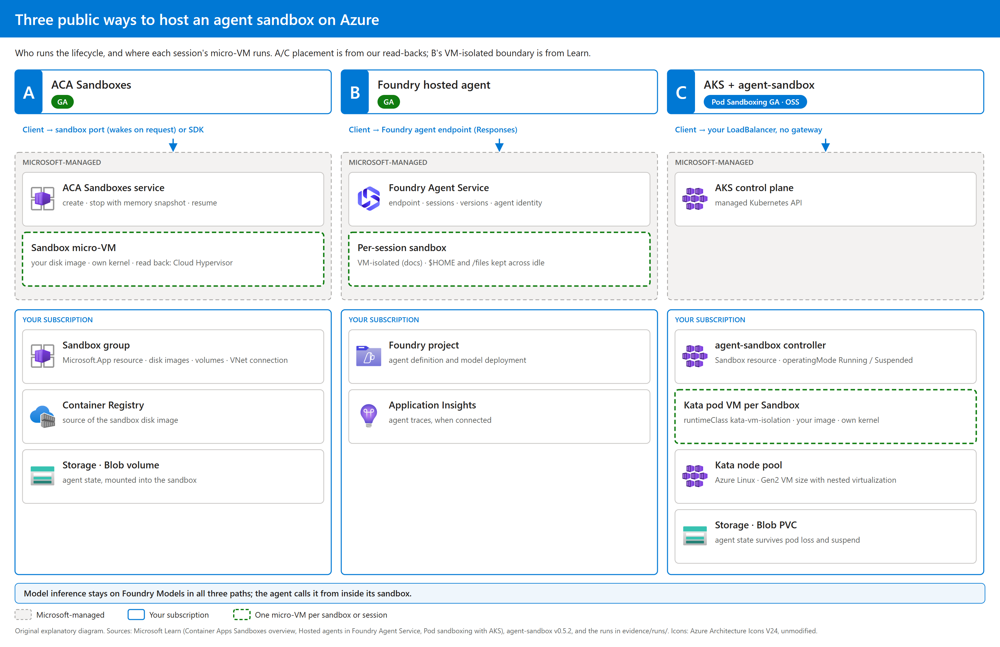

# Azure Agent Sandbox Hosting: ACA Sandboxes, Foundry Hosted Agent, AKS + agent-sandbox

[](#purpose)
[](#results)
[](https://github.com/david-xinyuwei/david-share/actions/workflows/agent-sandbox-hosting-ci.yml)

Author: Xinyu Wei · [中文](README_CN.md)

## Purpose

You need an isolated, stateful agent session on Azure and must choose who owns its lifecycle and execution nodes. This public edition compares three reproducible paths using the agenthost workshop's reflection-agent workload. Packaging, timers and client network paths differ: this is a field report, not an identical-container product benchmark.

**Publication scope.** A/B/C documentation, redacted measurements and tools are included here. D / BYO-AKS is a private preview; its onboarding, implementation details and measurements are not published here. The [complete companion repository](https://github.com/david-xinyuwei/azure-agent-sandbox-hosting) remains Private and requires access.

| Question | A · ACA Sandboxes | B · Foundry hosted agent | C · AKS + agent-sandbox |
|---|---|---|---|
| Status | GA | GA | Pod Sandboxing GA; agent-sandbox v0.5.2 is open source |
| Who runs the session lifecycle | The ACA service | Foundry | You: controller, gateway, idle sweeper |
| Where the session's micro-VM runs | Service-managed compute | Microsoft-managed compute | Your Kata node pool |
| Suspend with memory snapshot | Yes | No: idle releases compute, `$HOME` and `/files` are restored | No memory snapshot: you patch `operatingMode`; the pod goes, file state comes back from Blob |
| Largest single session (docs) | 4 vCPU / 8 GB | 2 vCPU / 4 GiB | Bounded by the node VM you select |

Start with B for a general managed enterprise agent when its limits fit. For a Qira-like long-running, per-user workload needing memory snapshots without a cluster, start with A. Choose C when you need customer-owned execution nodes and must operate the session controller, gateway and idle policy; the AKS Kubernetes API remains managed by Microsoft.



The figure is an original explanatory diagram, not a product screenshot. A/C placement comes from read-backs; B's per-session VM-isolated boundary comes from Learn. It omits identity and model-gateway flows.

| Term | Meaning |
|---|---|
| Cold | New sandbox or session until its first answer; the reported clock differs by path |
| Warm | A follow-up in the same running session |
| Resume | An already suspended session: resume request → first answer; stop and idle waiting are excluded |
| Pod lost | Delete a pod and time the replacement reaching Ready |

## Steps

**Deployment order.** A/B/C reuse the foundation from [agenthost at `905f2c2`](https://github.com/oxcp/ainotes/tree/905f2c2/agenthost). The canonical letters here are **A = ACA Sandboxes, B = Foundry hosted agent, C = AKS + agent-sandbox**. Upstream calls module-02 Solution A, module-03 Solution B and module-04 Solution C; follow its module numbers, not its solution letters.

The A example reuses C's image, VNet and Blob private endpoint, so it needs step 3. ACA itself does not require AKS: for an A-only deployment, supply your own delegated `ACA_SUBNET_ID`, a reachable Blob private endpoint and the agent image instead of the AKS VNet commands below.

**Prerequisites.** Bash (Linux, macOS or Git Bash), Azure CLI 2.80 or newer, `kubectl`, `azd` 1.34 or newer with `microsoft.foundry`, Python 3.10 or newer, model quota for `gpt-5.4-mini` GlobalStandard, and Owner or Contributor plus Role Based Access Control Administrator. Azure Cloud Shell was not tested.

**1. Clone and configure.** Sparse checkout avoids downloading unrelated projects from this large repository:

```bash
git clone --filter=blob:none --sparse --depth=1 https://github.com/david-xinyuwei/david-share.git
git -C david-share sparse-checkout set Agents/Azure-Agent-Sandbox-Hosting
cd david-share/Agents/Azure-Agent-Sandbox-Hosting
git clone https://github.com/oxcp/ainotes.git "$HOME/ainotes" && git -C "$HOME/ainotes" checkout 905f2c2
cp config/.env.example .env
python -m pip install -r requirements.txt
az login && azd ext install microsoft.foundry
set -a && . ./.env && set +a && az account set --subscription "$SUBSCRIPTION_ID"
```

Fill `SUBSCRIPTION_ID` and `LOCATION` first; fill `SN` after step 2. `az account show --query id -o tsv` confirms the selected subscription. Reload `.env` after every edit and in every new shell.

**2. Deploy the foundation.** It creates the Foundry account/project and model, APIM, ACR, Storage and managed identity:

```bash
(cd "$WORKSHOP_DIR/agenthost/module-01" && chmod +x setup.sh && ./setup.sh)
az group show -g "$RESOURCE_GROUP" --query tags.deploymentSN -o tsv
```

Success: deployment outputs appear (<!--v:f.deploy.value-->3<!--/v--> minutes in our run). Paste the tag into `SN` in `.env`, then reload it. If the deployment fails, resolve its ARM error before continuing; do not assume the foundation exists.

**3. C: AKS + agent-sandbox.** The pinned workshop builds the image and installs the Kata pool and controller. Run the private-link step only when Storage public access is disabled:

```bash
cd "$WORKSHOP_DIR/agenthost/module-03"
chmod +x prepare-agent-sandbox.sh deploy-storage-private-link.sh && ./prepare-agent-sandbox.sh
./deploy-storage-private-link.sh        # only when Storage public network access is disabled
kubectl apply -f agent-sandbox.yaml
kubectl wait --for=condition=Ready pod -l app=agent-host -n "$NAMESPACE" --timeout=3m
cd - && python tools/check_isolation.py -n "$NAMESPACE" -l app=agent-host --exec-uname
```

Success: `Solution B infrastructure prepared`, `condition met`, then `CHECK isolation PASS … runtimeClass=kata-vm-isolation`. With guest-kernel access, the check reports whether it differs from the actual host node. If no pod matches, check the namespace and Sandbox events; if exec is denied, the kernel is reported as not read. Under Git Bash, set `MSYS_NO_PATHCONV=1` if ARM resource IDs are converted to Windows paths.

```bash
kubectl patch sandbox agent-host -n "$NAMESPACE" --type merge -p '{"spec":{"operatingMode":"Suspended"}}'
kubectl patch sandbox agent-host -n "$NAMESPACE" --type merge -p '{"spec":{"operatingMode":"Running"}}'
kubectl wait sandbox agent-host -n "$NAMESPACE" --for=condition=Ready --timeout=180s
```

The final wait reports `condition met`; on failure, inspect the Sandbox and pod events. This restores file state from Blob, not process memory. The sample has no built-in idle sweeper or wake-on-request.

**4. A: ACA Sandboxes.** The workshop creates the group; our SDK tool registers its VNet connection, disk image and Blob volume. This example uses C's VNet:

```bash
(cd "$WORKSHOP_DIR/agenthost/module-04" && chmod +x sandbox-deploy.sh && ./sandbox-deploy.sh)
NODE_RG=$(az aks show -g "$RESOURCE_GROUP" -n "$AKS_NAME" --query nodeResourceGroup -o tsv)
VNET=$(az network vnet list -g "$NODE_RG" --query "[0].name" -o tsv)
az network vnet subnet create -g "$NODE_RG" --vnet-name "$VNET" -n aca-subnet \
  --address-prefixes "$ACA_SUBNET_PREFIX" --delegations Microsoft.App/environments --query id -o tsv
```

Paste the printed ID into `ACA_SUBNET_ID` and reload `.env`, then:

```bash
python tools/aca_sandbox.py vnet && python tools/aca_sandbox.py image && python tools/aca_sandbox.py volume
python tools/aca_sandbox.py create
python tools/aca_sandbox.py ask "Where is Bangkok? Answer in one short sentence."
```

Success: create prints `"state": "Running"` and `"vmm_type": "cloudhypervisor"`; ask prints an answer and its history length. Exit 2 names a missing setting; exit 1 reports the SDK error. If image import returns `RegistryAuthFailed`, verify `az acr login -n "$ACA_ACR_NAME" --expose-token` works. If create hangs with private Blob storage, check the VNet connection and private endpoint. If the agent is still starting, retry ask after 10 s.

```bash
python tools/aca_sandbox.py stop
python tools/aca_sandbox.py resume
python tools/aca_sandbox.py show
```

Success: stop reports Stopped and resume reports Running; a failed state or timeout is an error, not a successful resume.

**5. B: Foundry hosted agent.** Deploy from a working folder outside the clone:

```bash
mkdir -p "$HOME/workshop-b" && cd "$HOME/workshop-b" && azd auth login
azd ai agent init -m "$WORKSHOP_DIR/agenthost/module-02/azure.yaml" --project-id "$PROJECT_ID"
cd maf-agent && sed -i "s/<SN>/$SN/g" azure.yaml
azd env set AZURE_SUBSCRIPTION_ID "$SUBSCRIPTION_ID" && azd env set AZURE_LOCATION "$LOCATION"
azd env set AZURE_RESOURCE_GROUP "$RESOURCE_GROUP" && azd env set AZURE_AI_PROJECT_ID "$PROJECT_ID"
azd env set FOUNDRY_PROJECT_ENDPOINT "$PROJECT_ENDPOINT" && azd env set AI_MODEL_DEPLOYMENT_NAME gpt-5.4-mini
azd env set AZURE_TENANT_ID "$(az account show --query tenantId -o tsv)"
azd deploy && azd ai agent invoke "Hi"
```

Success: deployment finishes (<!--v:b.deploy.value-->161<!--/v--> s in the recorded gateway-route run), then invoke prints a reply. `MODEL_ROUTING` selects gateway/APIM or direct; the Results comparison uses gateway observations. Before measuring, put this agent's Responses endpoint from `azd ai agent show` into `AGENT_RESPONSES_URL` and reload this project's `.env`. If deployment times out with `last status: creating`, inspect the agent in Foundry; if it is not Running, delete that failed version and retry.

**6. Measure.** Return to this project's root and reload `.env`. Reports go to git-ignored `evidence-local/`:

```bash
python tools/measure_aca.py agent --runs 3
python tools/measure_responses.py --cold 3 --warm-turns 3
python tools/measure_responses.py --cold 3 --warm-turns 3 --scale 4,8
```

Exit 0 means every requested check passed: A retained increasing history lengths across resume; B completed the requested turns and recalled the exact code words, including concurrency follow-ups. Failures are recorded and return exit 1; missing settings or invalid arguments return exit 2. New runs need not equal these historical timings.

**Remove test resources.** Stopped ACA sandboxes incur no CPU/memory fees; AKS nodes keep billing until stopped or deleted:

```bash
python tools/aca_sandbox.py delete
az aks stop -g "$RESOURCE_GROUP" -n "$AKS_NAME"
az group delete -n "$RESOURCE_GROUP" --yes --no-wait
```

Success: sandbox deletion reports `deleted: true` when one existed, AKS stop finishes, and the test resource group disappears after asynchronous deletion. On failure, inspect Azure's error; do not assume billing stopped.

## Results

**Isolation.** A/C are local read-backs; B is a documented boundary:

| | A · ACA Sandboxes | B · Foundry hosted agent | C · AKS + agent-sandbox |
|---|---|---|---|
| Boundary | One micro-VM per sandbox | Per-session VM-isolated sandbox (Learn) | One Kata pod VM per Sandbox |
| VMM and hypervisor | API reports `vmm_type` <!--v:a.vmm.value-->cloudhypervisor<!--/v-->; hypervisor not named in docs | Not published; VM isolation is documented | Cloud Hypervisor on Microsoft Hyper-V (Learn) |
| Kernel read | Guest <!--v:a.isolation.guest_kernel-->6.12.8+<!--/v--> | Not read back | Sandbox pod <!--v:c.isolation.guest_kernel-->6.6.137.mshv1-1.azl3<!--/v-->; runc pod on the Ubuntu system pool <!--v:c.isolation.system_node_kernel-->6.8.0-1067-azure<!--/v--> |
| Who owns the node | Microsoft | Microsoft | You |

**Timing contract.** These are component sums, not a single end-to-end client stopwatch for A: SDK create/resume wall time plus the answer timed inside the sandbox. C's cold number is apply-to-Ready plus first-answer time. For resume, stop and idle waiting are excluded. Each per-run total is computed before its median; independently reported component medians must not be added. B is client timing through Foundry with the gateway/APIM model route.

<!-- BEGIN GENERATED: comparison -->
| Observed or documented | A · ACA Sandboxes | B · Foundry hosted agent | C · AKS + agent-sandbox |
|---|---|---|---|
| **New session → first answer** | 28.0 s median (27.07–50.41; n=3); SDK create + answer inside sandbox | 9.43 s (n=1, via the Foundry endpoint; model route: gateway (APIM)) | 57.65 s (n=1; apply → Ready 44.9 s + answer 12.75 s) |
| **Follow-up turn, same session** | 1.05 s median (1.04–1.54; n=3) | 4.03, 5.54 s (n=2); model route: gateway (APIM) | 1.96 s (n=1) |
| **Sandbox or pod until ready** | 24.25 s median (24.12–44.86; n=3), create → Running | not visible (managed) | 44.9 s (n=1), apply → Ready |
| **Resume request → first answer (stop excluded)** | 14.45 s median (12.44–17.22; n=3); separately reported resume-only median 2.83 s | not exercised (the platform restores $HOME) | 34.2 s (n=1; Ready 17.1 s, LoadBalancer healthy 26.1 s) |
| **Pod lost → ready again** | not exercised (service-managed) | not exercised (managed) | 23.4 s (n=1); same Sandbox state restored |
| **Idle behaviour** | suspends after the idle time you set (900 s here) with a memory snapshot | docs: compute released after 2–60 min idle (default 15), $HOME and /files restored | none built in; you patch operatingMode |
| **Capacity** | serverless; quota is concurrent cores (docs) | managed, per session | your Kata node pool |
| **Path setup in our run** | 146.6 s (sandbox group, VNet connection, disk image, volume, sandbox) | 161 s (`azd deploy`; model route: gateway (APIM)) | 812.9 s (prepare script, private link, apply) |
<!-- END GENERATED: comparison -->

A's create time rose from <!--v:a.attr.small.range-->1.6–2.7<!--/v--> s with image/VNet/port configurations to <!--v:a.attr.vnetvolume.range-->15.79–25.12<!--/v--> s with a private Blob volume. This locates the extra time; it does not instrument the service's internal cause. Late mounting is useful only when the first answer does not need saved state.

**Measured runs.** Grouped A→B→C, then oldest to newest within each path, exactly as in [VALIDATION.md](VALIDATION.md):

<!-- BEGIN GENERATED: runs -->
| Run | Path | Scenario | Result |
|---|---|---|---|
| `a-2026-09-27-setup` | A | first deployment, wake on request | setup 146.6 s; a request to a stopped sandbox answered in 23.7 s; kernel `6.12.8+` |
| `a-2026-10-09-agent` | A | full agent, 3 runs | cold 28.0 s, warm 1.05 s, resume → answer 14.45 s (medians); vmm `cloudhypervisor` in 3/3; state kept 3/3 |
| `a-2026-10-09-attribution` | A | create time by configuration | image, VNet or port alone 1.6–2.7 s; adding the private Blob volume 15.79–25.12 s |
| `a-2026-10-09-late-mount` | A | start first, mount Blob later | start 3.99–7.2 s, then mount 12.4–20.29 s (n=2) |
| `b-2026-09-27` | B | deploy, new session, follow-ups; gateway model route | deploy 161 s; new session 9.43 s; follow-ups 4.03, 5.54 s |
| `c-2026-09-27` | C | Kata Sandbox, pod loss, suspend/resume | pod kernel `6.6.137.mshv1-1.azl3` vs runc pod on the Ubuntu system pool `6.8.0-1067-azure`; pod lost → Ready 23.4 s; resume → answer 34.2 s |
<!-- END GENERATED: runs -->

**Limits.**
- One region (East US 2). Full-agent A has n=3; B and C are one historical campaign each. The workloads, timers and client paths are not a controlled product benchmark or SLA.
- B's direct-route observations are separate in VALIDATION. Historical B/C request text was not retained; the new measurement tools do not recreate missing prompts.
- A's guest uptime observation alone does not prove process-memory continuity; conversation-history lengths were separately retained across resume.
- Not measured: B's idle resume or host loss, A's host loss, other regions, third-party sandboxes, and a fresh-subscription end-to-end run of these packaged tools.
- Publication excludes D / BYO-AKS private-preview details and measurements; use the restricted companion only if you have access.

Offline verification: [VALIDATION.md](VALIDATION.md). Assets: [tools](tools/), [canonical claims](evidence/claims.json), [recomputable metrics](evidence/measurements.json), [figure/icon ledger](images/SOURCES.json), [settings](config/.env.example), [tests](tests/).
