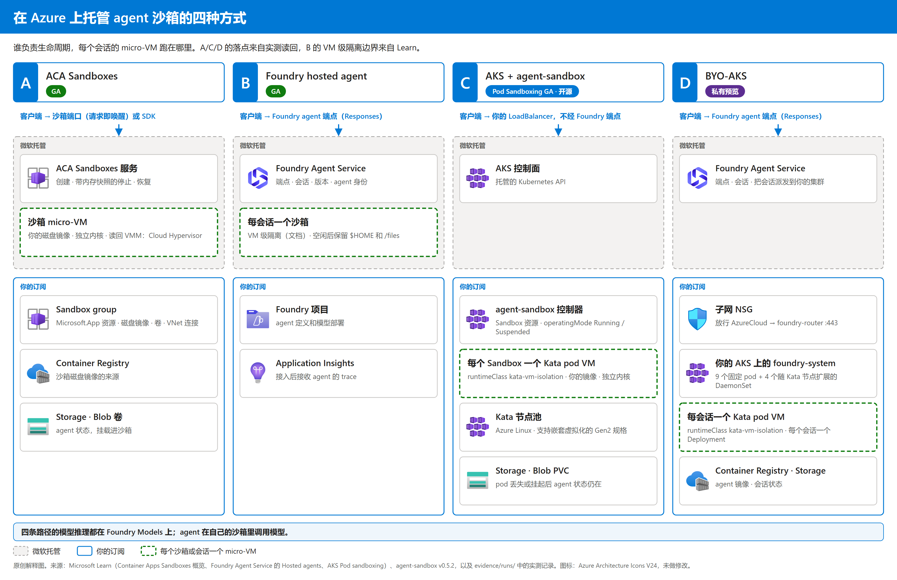

# 在 Azure 上托管 agent 沙箱的四种方式：ACA Sandboxes、Foundry Hosted Agent、AKS + agent-sandbox、BYO-AKS

[](#目的)
[](#实现效果)
[](https://github.com/david-xinyuwei/david-share/actions/workflows/agent-sandbox-hosting-ci.yml)

作者：魏新宇 · [English](README.md)

## 目的

你希望 agent 的每个会话都跑在 Azure 上独立的 micro-VM（带独立内核的轻量虚拟机）里，接下来要决定由谁来运行这个 micro-VM 和它的生命周期：交给一个托管服务、交给 Foundry，还是放在你自己的 AKS 节点上。四条路径各有取舍，光看产品页很难横向比较它们的秒数。本仓库用同一套可比的有状态交互口径测试四条路径，给出每条路径的复现步骤，并列出实测结果。A 和 C 共用 workshop 的 reflection agent；B 是另一个采用 Agent Framework 和 ResponsesHostServer 的 agent；D 使用产品组的私有预览 sample，所以这不是相同容器的基准测试：

| 问题 | A · ACA Sandboxes | B · Foundry hosted agent | C · AKS + agent-sandbox | D · BYO-AKS |
|---|---|---|---|---|
| 状态 | GA（2026-09-23） | GA（2026-06） | Pod Sandboxing GA（2025-11-18）；agent-sandbox v0.5.2 为开源项目 | **私有预览** |
| 谁负责会话生命周期 | ACA 服务 | Foundry | 你自己：控制器、网关、空闲回收 | Foundry，运行在你的集群上 |
| 会话的 micro-VM 跑在哪里 | 服务托管的算力 | 微软托管的算力 | 你的 Kata 节点池 | 你的 Kata 节点池 |
| 带内存快照的挂起 | 支持 | 不支持：空闲后释放算力，恢复时还原 `$HOME` 和 `/files` | 不保存内存快照：你修改 `operatingMode`；pod 被删除，文件状态从 Blob 恢复 | 未测；预览版是否支持挂起须向产品组确认 |
| 可选规格 / 节点 SKU（文档） | XS：0.25 vCPU / 0.5 GB<br>S：0.5 vCPU / 1 GB<br>M（默认）：1 vCPU / 2 GB<br>L：2 vCPU / 4 GB<br>XL：4 vCPU / 8 GB | 0.5 vCPU / 1 GiB<br>1 vCPU / 2 GiB<br>2 vCPU / 4 GiB<br>不选择 VM SKU | 支持 Kata 的 Gen2 VM SKU，如 Dsv3 系列；须使用 Azure Linux 并支持嵌套虚拟化 | 在预览开通条件内选择 Kata 节点 SKU；具体可选清单须向产品组确认 |
| 适合的场景 | 要每用户一个 micro-VM、要快照、不想管集群 | 希望 Foundry 托管一切，且它的限制对你没有影响 | 必须自己掌控节点、网络和控制面 | 既要 Foundry 的 agent 平台，**又**要求会话跑在你自己的节点上 |

产品能力来自 Microsoft Learn，状态来自下文链接的官方公告，实测声明来自我们的运行记录，最后一行是我们的选型建议。一般企业 agent 在 B 的限制可接受时先选 B。对于需要按用户长期运行、要内存快照又不想管集群的场景，先选 A。只有执行节点必须归你时才选 C 或 D；如果还要求 Foundry 继续运行 agent 平台，选 D。

可选项分三类：[A 的沙箱资源档位](https://learn.microsoft.com/azure/container-apps/sandboxes-overview#resource-tiers)、[B 的沙箱规格](https://learn.microsoft.com/azure/foundry/agents/concepts/hosted-agents#sandbox-sizes)、[C/D 的节点 VM SKU](https://learn.microsoft.com/azure/aks/use-pod-sandboxing)。节点 SKU 不是单会话分配规格；每个 Kata 会话还受 pod 的 requests、limits 和开销限制。节点 SKU 的可用性与配额取决于区域和订阅，D 还须满足预览开通条件。

状态来源：[A 的 GA 公告](https://techcommunity.microsoft.com/blog/appsonazureblog/azure-container-apps-sandboxes-now-generally-available/4559125)、[B 的 GA 公告](https://azure.microsoft.com/updates?id=563596)、[C 的 Pod Sandboxing GA](https://azure.microsoft.com/updates?id=526237)；agent-sandbox 本身是开源项目，不是 Azure 服务。对 C/D，[Kata 只提供计算隔离](https://learn.microsoft.com/azure/aks/concepts-pod-sandboxing)，不隔离控制面、存储与数据路径，也不限制 cluster-admin 的权限。



这张图说明的是：各组件归谁所有、micro-VM 的边界在哪里。A、C、D 的落点来自我们的读回，B 的 VM 级隔离边界来自 Learn。图里没有画网络细节、身份流转和模型网关。

看结果时要用到的几个词：

| 术语 | 含义 |
|---|---|
| 冷启动（cold） | 新会话或新沙箱从创建到返回第一个回答 |
| 后续回答（warm） | 同一个运行中会话里的下一轮对话 |
| 恢复（resume） | 会话已完成挂起：发起恢复 → 第一个回答；不含停止和空闲等待 |
| pod 丢失（pod lost） | 删除会话所在的 pod，由 Kubernetes 重新创建 |
| micro-VM | 每个沙箱、会话或 pod 一个带独立 guest 内核的轻量虚拟机（AKS 上是 Kata Containers；ACA 沙箱内读到的 VMM 是 Cloud Hypervisor） |

## 操作步骤

**先部署，再使用 agent。** 主线按[同事的固定版本 workshop](https://github.com/oxcp/ainotes/tree/905f2c2/agenthost)组织：创建共享底座 → 部署所选方案 → 打开或调用应用。压测和历史结果重算是可选项，不属于部署步骤。

**执行边界：** 原始部署产生了仓库保留的历史结果，但下面这套参数化步骤尚未在全新订阅逐条重跑。D 还依赖产品组的私有示例和开通；离线 CI 不能证明云端部署成功。

| 顺序 | 在哪里 | 做什么 | 入口 |
|---|---|---|---|
| 1 | 工作站 | 克隆、填写配置、登录 | `config/.env.example` |
| 2 | Azure 订阅 | 创建共享底座 | workshop `module-01/setup.sh` |
| 3 | C | 构建镜像、创建 AKS、部署 Sandbox 并打开应用 | workshop `module-03` |
| 4 | A | 创建 sandbox group 并部署 agent 沙箱 | workshop `module-04` + `tools/aca_sandbox.py` |
| 5 | B | 部署 hosted agent 并调用 | workshop `module-02` |
| 6 | D | 绑定现有 AKS，部署并调用私有预览 agent | 产品组示例 |

**A = ACA Sandboxes，B = Foundry hosted agent，C = AKS + agent-sandbox，D = BYO-AKS**。上游把 module-02 叫 Solution A、module-03 叫 Solution B、module-04 叫 Solution C；看它时以模块编号为准。只执行所选方案：B 的前置是第 1–2 步；这里 A 的完整示例复用第 3 步创建的镜像和网络，但 ACA 产品本身不依赖 AKS。D 使用已有集群和单独开通的示例，本页不会自动替你新建 D 的集群。

**前提。** Bash、Git、curl、带 venv 模块的 Python 3.10+（Ubuntu/Debian 需安装 `python3-venv`）、Azure CLI 2.80+、kubectl、azd 1.34+；执行 `azd ext install microsoft.foundry` 安装扩展。订阅权限需 Owner，或 Contributor 加 Role Based Access Control Administrator，所选区域需有模型配额。部署 A 时，你的身份还需要 `Container Apps SandboxGroup Data Owner` 角色（[Learn](https://learn.microsoft.com/azure/container-apps/sandboxes-overview#prerequisites)）；workshop 的 `sandbox-deploy.sh` 能识别当前登录用户时会自动分配，识别不了只打印警告。使用非生产订阅。C 需要填写实际公网出口 CIDR；这个 HTTP workshop 应用不是生产级 HTTPS/登录部署。

**1. 克隆并填写配置。** 克隆到新目录后编辑 `.env`：填写 `SUBSCRIPTION_ID`、`LOCATION`、`RESOURCE_GROUP`；部署 C 时填写 `C_ALLOW_CIDR`。`SN` 在第 2 步拿到后再填。

```bash
git clone --filter=blob:none --sparse --depth=1 https://github.com/david-xinyuwei/david-share.git
git -C david-share sparse-checkout set Agents/Azure-Agent-Sandbox-Hosting
cd david-share/Agents/Azure-Agent-Sandbox-Hosting
export HOSTING_REPO="$PWD"
git clone https://github.com/oxcp/ainotes.git "$HOME/ainotes"
git -C "$HOME/ainotes" checkout 905f2c2
cp config/.env.example .env
python3 -m venv .venv
. .venv/bin/activate
python -m pip install -r requirements.txt
```

编辑完成后登录，运行上游前置检查。工具、权限或配额未满足时先解决，不要继续创建资源。后续都在这个 shell 中操作：它保存着用来回到本仓库的 `HOSTING_REPO`，以及已激活的 `.venv`。

```bash
az login
set -a && . "$HOSTING_REPO/.env" && set +a
az account set --subscription "$SUBSCRIPTION_ID"
(cd "$WORKSHOP_DIR/agenthost" && chmod +x check-prerequisites.sh && ./check-prerequisites.sh)
```

**2. 创建共享底座。** [Module 1](https://github.com/oxcp/ainotes/blob/905f2c2/agenthost/module-01/README.md)创建 Foundry 项目和模型、APIM、ACR、Storage 与托管身份。

```bash
(cd "$WORKSHOP_DIR/agenthost/module-01" && chmod +x setup.sh && ./setup.sh)
az group show -g "$RESOURCE_GROUP" --query tags.deploymentSN -o tsv
```

成功标志：脚本输出 `Template deployed successfully.`，第二条命令返回非空后缀。把后缀填到 `.env` 的 `SN`，重新加载，让所有派生资源名一起更新；不能保留 `YOUR-DEPLOYMENT-SUFFIX` 继续执行。

```bash
set -a && . "$HOSTING_REPO/.env" && set +a
```

**3. C — 部署 AKS 上的应用。** 按 [Module 3](https://github.com/oxcp/ainotes/blob/905f2c2/agenthost/module-03/README.md)执行。准备脚本创建 AKS/Kata、控制器、镜像和 PVC，并不部署应用；后面的 `kubectl apply` 才创建 Sandbox 和 Service。

```bash
cd "$WORKSHOP_DIR/agenthost/module-03"
chmod +x prepare-agent-sandbox.sh deploy-storage-private-link.sh
./prepare-agent-sandbox.sh
if [ "$(az storage account show -g "$RESOURCE_GROUP" -n "$ACA_STORAGE_ACCOUNT" --query publicNetworkAccess -o tsv)" = "Disabled" ]; then
  ./deploy-storage-private-link.sh
fi
kubectl apply -f agent-sandbox.yaml
kubectl wait sandbox agent-host -n "$NAMESPACE" --for=condition=Ready --timeout=5m
```

成功标志：Sandbox 到达 `Ready`。接下来只允许配置的出口 CIDR，取出真正的应用地址并发起请求：

```bash
if [ -z "$C_ALLOW_CIDR" ] || [[ "$C_ALLOW_CIDR" == YOUR-* ]]; then
else
  kubectl patch service agent-host-lb -n "$NAMESPACE" --type merge \
    -p "{\"spec\":{\"loadBalancerSourceRanges\":[\"$C_ALLOW_CIDR\"]}}"
  kubectl wait service agent-host-lb -n "$NAMESPACE" --for=jsonpath='{.status.loadBalancer.ingress[0].ip}' --timeout=5m
  C_AGENT_HOST=$(kubectl get service agent-host-lb -n "$NAMESPACE" -o jsonpath='{.status.loadBalancer.ingress[0].ip}')
  C_AGENT_URL="http://${C_AGENT_HOST}"
  printf 'C application: %s\n' "$C_AGENT_URL"
  curl --fail-with-body --show-error --max-time 30 "$C_AGENT_URL/ready"
  curl --fail-with-body --show-error --max-time 180 \
    -H 'Content-Type: application/json' \
    -d '{"query":"Where is Bangkok? Answer in one short sentence."}' "$C_AGENT_URL/reflect" | \
    python -c 'import json,sys; body=json.load(sys.stdin); answer=body.get("response"); print(json.dumps(body,ensure_ascii=False)); sys.exit(0 if isinstance(answer,str) and answer.strip() else "C invocation failed: non-empty response missing")'
fi
cd "$HOSTING_REPO"
```

如果第一行打印了 `C_ALLOW_CIDR` 的提示，说明后面的命令都没有执行：填好它，重新加载 `.env`，再运行一次这段命令。
浏览器打开打印出的地址即可使用聊天页面。`/ready` 应成功，`/reflect` 应返回非空 `response`；pod Ready 不等于应用已能回答。失败时在 `NAMESPACE` 查看 `kubectl get pods`、`kubectl describe pod`、`kubectl logs`；HTTP 不通还要检查出口 CIDR、Service 地址和网络规则。

**4. A — 部署 ACA 沙箱里的 agent。** [Module 4](https://github.com/oxcp/ainotes/blob/905f2c2/agenthost/module-04/README.md)创建 sandbox group；磁盘镜像和沙箱需要继续创建。下方 SDK 命令实际执行这些操作，不是重放测量记录。这里的完整示例复用第 3 步的镜像和网络；`ACA_SUBNET_PREFIX` 必须是该 VNet 内尚未占用的地址段。按 workshop 的做法，`aca-subnet` 建在 AKS 节点资源组的 VNet 里；[AKS 文档](https://learn.microsoft.com/azure/aks/faq)说明修改该资源组内的资源不受支持，删除集群时这个资源组也会一起删除。这只是 workshop 的简便做法；正式环境请在你自己管理的 VNet 里为 sandbox group 准备委派子网。

```bash
(cd "$WORKSHOP_DIR/agenthost/module-04" && chmod +x sandbox-deploy.sh && ./sandbox-deploy.sh)
NODE_RG=$(az aks show -g "$RESOURCE_GROUP" -n "$AKS_NAME" --query nodeResourceGroup -o tsv)
VNET=$(az network vnet list -g "$NODE_RG" --query "[0].name" -o tsv)
az network vnet subnet create -g "$NODE_RG" --vnet-name "$VNET" -n aca-subnet \
  --address-prefixes "$ACA_SUBNET_PREFIX" --delegations Microsoft.App/environments --query id -o tsv
```

把打印出的子网 ID 填到 `.env` 的 `ACA_SUBNET_ID`，再回本仓库执行：

```bash
cd "$HOSTING_REPO"
set -a && . ./.env && set +a
python tools/aca_sandbox.py vnet
python tools/aca_sandbox.py image
python tools/aca_sandbox.py volume
python tools/aca_sandbox.py create
python tools/aca_sandbox.py ask "Where is Bangkok? Answer in one short sentence."
```

成功标志：`create` 返回 Running，`ask` 返回真实回答。这里通过沙箱 exec 调用应用，不代表浏览器入口已开放；需要浏览器入口时按 Module 4 配置端口和 IP。缺配置先补齐再重试；镜像访问失败检查 ACR 权限，私有 Blob 访问依赖 VNet 和私有终结点。

**5. B — 部署并调用 hosted agent。** 在源代码克隆目录之外的新工作目录执行 [Module 2](https://github.com/oxcp/ainotes/blob/905f2c2/agenthost/module-02/README.md)。绑定已有项目后直接部署，B 不执行 `azd provision`。

```bash
mkdir -p "$HOME/workshop-b" && cd "$HOME/workshop-b"
azd auth login
azd ai agent init -m "$WORKSHOP_DIR/agenthost/module-02/azure.yaml" --project-id "$PROJECT_ID"
cd maf-agent
sed -i "s/<SN>/$SN/g" azure.yaml
azd env set AZURE_SUBSCRIPTION_ID "$SUBSCRIPTION_ID"
azd env set AZURE_LOCATION "$LOCATION"
azd env set AZURE_RESOURCE_GROUP "$RESOURCE_GROUP"
azd env set AZURE_AI_PROJECT_ID "$PROJECT_ID"
azd env set FOUNDRY_PROJECT_ENDPOINT "$PROJECT_ENDPOINT"
azd env set AI_MODEL_DEPLOYMENT_NAME gpt-5.4-mini
azd env set AZURE_TENANT_ID "$(az account show --query tenantId -o tsv)"
azd deploy
azd ai agent invoke "Hi"
azd ai agent show
cd "$HOSTING_REPO"
```

成功标志：部署结束且 `invoke` 返回真实回答。`show` 提供已部署的端点，可供 API 客户端调用，也可进入 Foundry agent playground 使用。默认保持 gateway 路由；只有明确需要时才改变。若部署一直 creating，查看 `azd ai agent monitor` 和门户状态，不能把超时当成功，也不要自动删除 agent。

**6. D — 私有预览部署。** 没有产品组示例和订阅开通就不能执行这条路径。先填写 `.env` 的 BYOAKS 配置，包括 `BYOAKS_SAMPLE_DIR`，并按示例当前指南配置 `AKS_RESOURCE_ID`、`HOSTING_IDENTITY_RESOURCE_ID`、`WORKLOAD_IDENTITY_RESOURCE_ID`、`STORAGE_ACCOUNT_RESOURCE_ID`、`ACR_RESOURCE_ID`、`APPLICATIONINSIGHTS_RESOURCE_ID`。只有功能标志 Registered 不代表已开通。

**D1. 准备现有集群的 Kata 节点池。** 先确认该节点 SKU 在订阅和区域可用，并符合当前开通要求；已有同名节点池时不要重复创建。

```bash
az aks nodepool add -g "$BYOAKS_RESOURCE_GROUP" --cluster-name "$BYOAKS_CLUSTER" -n "$BYOAKS_KATA_POOL" \
  --os-sku AzureLinux --workload-runtime KataVmIsolation --node-vm-size "$BYOAKS_KATA_VM_SIZE" --node-count 1
```

**D2. 在已配置的示例目录执行绑定。** 成功条件是 provision 完成、foundry-system 组件就绪，不是 pod 数量等于某个历史值。

```bash
cd "$BYOAKS_SAMPLE_DIR"
azd config set auth.useAzCliAuth true
azd auth login
azd provision
az aks get-credentials -g "$BYOAKS_RESOURCE_GROUP" -n "$BYOAKS_CLUSTER" --overwrite-existing
kubectl get pods -n foundry-system
```

**D3. 仅在需要时配置 router 网络路径。** 下方子网 NSG 规则是保留的 workshop 接法，不是通用生产规则。只有产品组确认该入口和来源适用于当前预览版本、且子网 NSG 阻断此路径时才执行；否则采用获准的网络配置。

```bash
ROUTER_IP=$(kubectl get svc foundry-router -n foundry-system -o jsonpath='{.status.loadBalancer.ingress[0].ip}')
if [ -z "$ROUTER_IP" ]; then
  echo "foundry-router has no LoadBalancer address; resolve provisioning before deploying the agent" >&2
else
  az network nsg rule create -g "$BYOAKS_SUBNET_NSG_RG" --nsg-name "$BYOAKS_SUBNET_NSG" \
    -n Allow-AzureCloud-FoundryRouter-443 --priority 500 --direction Inbound --access Allow --protocol Tcp \
    --source-address-prefixes AzureCloud --destination-address-prefixes "$ROUTER_IP" --destination-port-ranges 443 \
    --query provisioningState -o tsv
fi
```

**D4. 部署并调用应用。** 仍在示例目录运行。成功条件：部署结束、invoke 返回回答、show 显示端点。失败时检查示例和控制器日志以及获准的存储、身份、网络配置；不要自动 purge 资源。

```bash
azd deploy
azd ai agent invoke "Hi"
azd ai agent show
cd "$HOSTING_REPO"
```

**完成。** 所选方案应已有能回答的应用及可用入口，而不是仅完成了一条测量命令。冷暖启动压测、隔离检查、历史数字重算见 [VALIDATION_CN.md](VALIDATION_CN.md#测试与离线校验)。

**下线仅在资源所有者明确批准后执行，不属于部署必做项。** 下面每条命令单独一个代码块，只运行你明确要释放的资源对应的那条；停止 AKS 只节省计算费，不会让保留资源费用归零。

删除 A 的沙箱：

```bash
python tools/aca_sandbox.py delete
```

停止 C 的集群：

```bash
az aks stop -g "$RESOURCE_GROUP" -n "$AKS_NAME"
```

停止 D 的集群：

```bash
az aks stop -g "$BYOAKS_RESOURCE_GROUP" -n "$BYOAKS_CLUSTER"
```

删除资源组。这会移除共享底座和 A/B/C，`az` 会先要求你确认：

```bash
az group delete -n "$RESOURCE_GROUP" --no-wait
```

## 实现效果

**每条路径的 micro-VM 跑在哪里。** A、C、D 来自实测读回，B 来自 Learn 写明的隔离边界：

| | A · ACA Sandboxes | B · Foundry hosted agent | C · AKS + agent-sandbox | D · BYO-AKS |
|---|---|---|---|---|
| 隔离边界 | 每个沙箱一个 micro-VM | 每会话一个 VM 级隔离的沙箱（Learn） | 每个 Sandbox 一个 Kata pod VM | 每个会话一个 Kata pod VM |
| VMM 和 hypervisor | API 返回 `vmm_type` <!--v:a.vmm.value-->cloudhypervisor<!--/v-->；文档没有写 hypervisor | 未公开；文档只说明 VM 级隔离 | Microsoft Hyper-V 上的 Cloud Hypervisor（Learn） | 与 C 相同 |
| 读到的内核 | guest <!--v:a.isolation.guest_kernel-->6.12.8+<!--/v--> | 未暴露，无法读回 | pod <!--v:c.isolation.guest_kernel-->6.6.137.mshv1-1.azl3<!--/v-->，runc pod <!--v:c.isolation.system_node_kernel-->6.8.0-1067-azure<!--/v--> | Kata 节点池节点 <!--v:d.node_kernel.value-->6.6.137.mshv2-2.azl3<!--/v-->；未在会话 pod 内读取 |
| 节点归谁 | 微软 | 微软 | 你 | 你 |

B 的“每会话一个、VM 级隔离”是 `SOURCE_FACT`，不是本地读回的 VMM 或内核结果。C 和 D 用的是同一个 Kata runtime class，所以隔离方式并不能区分它们，真正的区别在于由谁来运行平台。

**秒数。** A 是 2026-10-09 三次实测的中位数；B 和 C 是 2026-09-27 各一次实测；D 是 2026-09-29 的一轮压测。A 和 C 使用 workshop reflection agent；B 使用 Agent Framework 和 ResponsesHostServer；D 使用私有预览 sample。它们使用同一个模型和同一种有状态两轮交互，但不是相同容器。B 和 D 是从中国的一台笔记本经 Foundry 端点调用的（到 Azure 的往返时延 <!--v:d.client_rtt.range-->320–800<!--/v--> ms）；A 的回答在沙箱内计时，C 在它的 LoadBalancer 处计时。请把同一行作为现场记录来读，不要当作受控的产品基准测试：

A 的冷启动和恢复到回答采用分段相加，不是客户端连续端到端计时：SDK 创建或恢复的耗时，加上沙箱内计时的回答耗时。C 的冷启动同样是 apply 到 Ready 加第一个回答。恢复从挂起完成后开始计时，不含停止和空闲等待。B 的各行使用 gateway（APIM）模型路由；direct 路由的结果在 VALIDATION 单独列出。

**这些秒数不能用来给四种产品做性能排名。** 各路径的计时位置、问题输入、reasoning 设置、输出 token 数、镜像缓存和样本量，并未统一控制或逐次完整记录。模型名相同不代表时延测试条件相同。数值合理性校验能拦住无效耗时，但不能证明产品性能，也不能补齐缺失的打点。

<!-- BEGIN GENERATED: comparison -->
| 实测或文档项 | A · ACA Sandboxes | B · Foundry hosted agent | C · AKS + agent-sandbox | D · BYO-AKS |
|---|---|---|---|---|
| **新会话 → 第一个回答** | 中位数 28.0 s（27.07–50.41；n=3）；SDK 创建 + 沙箱内回答 | 9.43 s（n=1，经 Foundry 端点；模型路由：gateway（APIM）） | 57.65 s（n=1；apply → Ready 44.9 s + 回答 12.75 s） | 中位数 25.49 s（23.53–26.7；n=5），经 Foundry 端点 |
| **同一会话的后续回答** | 中位数 1.05 s（1.04–1.54；n=3） | 4.03, 5.54 s（n=2）；模型路由：gateway（APIM） | 1.96 s（n=1） | 中位数 12.9 s（11.17–16.42；n=3） |
| **沙箱或 pod 就绪** | 中位数 24.25 s（24.12–44.86；n=3），create → Running | 不可见（平台托管） | 44.9 s（n=1），apply → Ready | 镜像已缓存 8–10 s（n=6）；新节点 25 s（n=2） |
| **发起恢复 → 第一个回答（不含停止）** | 中位数 14.45 s（12.44–17.22；n=3）；恢复本身另行统计的中位数 2.83 s | 未测（平台恢复 $HOME） | 34.2 s（n=1；Ready 17.1 s，LoadBalancer 健康 26.1 s） | 未测；预览版是否支持挂起须向产品组确认 |
| **pod 丢失 → 重新就绪** | 未测（服务托管） | 未测（平台托管） | 23.4 s（n=1）；同一 Sandbox 的状态已恢复 | 23.9 s（n=1）；未测试被删会话的连续性 |
| **空闲策略（官方说明）** | [官网](https://learn.microsoft.com/azure/container-apps/sandboxes-overview#lifecycle-states)：可配置空闲自动挂起；可选 Memory 或 Disk 快照模式 | [官网](https://learn.microsoft.com/azure/foundry/agents/concepts/hosted-agents#sessions)：空闲超时 2–60 min（默认 15）后释放算力，保留 $HOME 和 /files；30 天不活跃后删除会话 | [官方 API](https://github.com/kubernetes-sigs/agent-sandbox/blob/v0.5.2/docs/api.md)：shutdownTime 是定时到期回收，不是按请求检测空闲；空闲回收需自行实现 | 未找到可核实的官方公开空闲策略；须向产品组确认 |
| **容量** | 无服务器；配额按并发核数计（文档） | 平台托管，按会话 | 你的 Kata 节点池 | 单个 Standard_D4s_v5 节点观察到最多 5 个会话；3 个节点共 12 个；`500 session_creation_failed`、`429 aks_quota_exceeded` |
| **本次路径部署耗时** | 146.6 s（sandbox group、VNet 连接、磁盘镜像、卷、沙箱） | 161 s（`azd deploy`；模型路由：gateway（APIM）） | 812.9 s（准备脚本、私有链接、apply） | 854 s（角色、`azd provision`、`azd deploy`；作者控制台记录，原始输出未保留） |

**本地配置与观察，不是官网空闲策略：** A 本次使用 Memory 模式，自动挂起设置为 900 s。D 最早的 pod 在创建至少 87 min 后仍为 Running；这是 pod 的年龄，不是空闲时长或回收超时。
<!-- END GENERATED: comparison -->

值得注意的几点：
- A 的创建耗时主要花在私有 Blob 卷上：只加镜像、VNet 或端口时是 <!--v:a.attr.small.range-->1.6–2.7<!--/v--> s，加上卷之后升到 <!--v:a.attr.vnetvolume.range-->15.79–25.12<!--/v--> s。只有在第一个回答不依赖已保存状态时，才适合先启动、后挂卷。
- D 的冷启动不只是 pod 启动：会话 pod 在 <!--v:d.pod_ready.range-->8–10<!--/v--> s 内就绪，端到端范围却是 <!--v:d.cold.range-->23.53–26.7<!--/v--> s；同一台笔记本直接调用同一个模型的中位数是 <!--v:d.model_direct.median-->2.69<!--/v--> s（low reasoning effort）。该直连基线不是与 agent 配置完全匹配的基准测试。没有打点的剩余时间只能统称为端点、会话和 agent 链路，不能当成已测出的网关内部耗时。
- 在本次观察到的 D 预览 build 里，应保守地按“开过的会话数”而不只是“正在执行的请求数”规划容量；pod 年龄的观察不能证明空闲回收超时。

**每次实测。** 按 A→B→C→D 分组，同一路径内按日期从早到晚排列，与 [VALIDATION_CN.md](VALIDATION_CN.md) 的顺序一致；该页记录每次实测的输入、过程、结果和边界：

<!-- BEGIN GENERATED: runs -->
| 实测 | 路径 | 场景 | 结果 |
|---|---|---|---|
| `a-2026-09-27-setup` | A | 首次部署，请求唤醒 | 部署 146.6 s；向已停止的沙箱发请求，23.7 s 后回答；内核 `6.12.8+` |
| `a-2026-10-09-agent` | A | 完整 agent，跑 3 次 | 冷启动 28.0 s、后续 1.05 s、恢复到回答 14.45 s（中位数）；3/3 次 vmm 为 `cloudhypervisor`；历史持续增长 3/3 |
| `a-2026-10-09-attribution` | A | 按配置拆分创建耗时 | 只加镜像、VNet 或端口 1.6–2.7 s；加私有 Blob 卷后 15.79–25.12 s |
| `a-2026-10-09-late-mount` | A | 先启动、后挂 Blob | 启动 3.99–7.2 s，再挂载 12.4–20.29 s（n=2） |
| `b-2026-09-27` | B | 部署、新会话、后续回答；gateway 模型路由 | 部署 161 s；新会话 9.43 s；后续 4.03, 5.54 s |
| `c-2026-09-27` | C | Kata Sandbox、pod 丢失、挂起/恢复 | pod 内核 `6.6.137.mshv1-1.azl3`，Ubuntu 系统节点池的 runc pod 内核 `6.8.0-1067-azure`；pod 丢失后 23.4 s 就绪；恢复到回答 34.2 s |
| `d-2026-09-29-placement` | D | 会话跑在哪里 | 加 NSG 规则 `Allow-AzureCloud-FoundryRouter-443` 后，每个会话 pod 都是 `kata-vm-isolation`，跑在你的节点池上 |
| `d-2026-09-29-perf` | D | 冷启动、后续、4 和 8 并发 | 冷启动 25.49 s、后续 12.9 s（中位数）；4 并发 0/4、8 并发 2/8 回答（节点池已满） |
| `d-2026-09-29-recovery` | D | 删除一个会话 pod | 23.9 s 后替代 pod 就绪；另一个存活会话在 14.8 s 内回答；未测试被删会话的连续性 |
<!-- END GENERATED: runs -->

**边界。**
- 只测了一个区域（East US 2）和一个客户端位置。A 的完整 agent 时延 n=3；B 和 C 各是一轮端到端实测；D 是一轮压测，其中镜像已缓存的冷启动 n=5、后续回答 n=3，会话落地和恢复各一次。在依赖某个数字之前，请按 VALIDATION_CN 中的在线测量命令重新测。
- 这些是实施过程中的观察，不是产品基准测试，也不是 SLA。文档说 A 可以从预热池实现亚秒级启动；我们带私有 Blob 卷的完整配置没有达到。
- D 是私有预览，它的行为（会话落地、空闲回收、各项限制）可能变化，接入需要产品组的示例和开通。
- 没有测的：B 的恢复，A 和 B 的 pod 或宿主机丢失，由 Foundry 治理的 agent 按任务调用 ACA 沙箱（微软在 GA 后介绍的模式），以及 E2B 或其他第三方沙箱。
- 成本：只给 D 的保底费用算了价：两个 `Standard_D4s_v5` 节点加 AKS Standard 层，按 East US 2 零售价为 <!--v:d.cost_floor.value-->0.484<!--/v--> USD/h。这不是三个 Kata 节点压测池的费用；请按你自己的价格核算。

**仓库目录。** [`tools/`](tools/) 部署、测量和检查工具 · [`evidence/claims.json`](evidence/claims.json) A–D canonical 声明 · [`evidence/`](evidence/) 脱敏后的实测记录和 `measurements.json` · [`images/`](images/) 图和图标台账 · [`config/`](config/) 配置模板 · [`tests/`](tests/) 离线测试（`python -m pytest -q`，CI 每次推送都会运行）。
