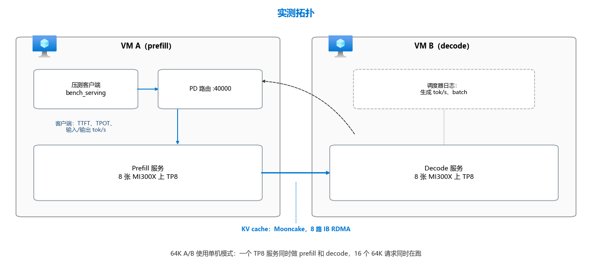

# 在 Azure GPU 虚拟机上优化大模型推理

[](#目的)
[](upstream/SOURCES.lock.json)
[](https://github.com/david-xinyuwei/david-share/actions/workflows/llm-inference-optimization-ci.yml)

作者：Xinyu Wei · [English](README.md) · [开始操作](#操作步骤)

## 目的

在 Azure MI300X 上部署固定版本的 MiMo-V2.5-Pro 推理栈，分清哪些优化有实测支持，并在排查推理性能前检查 GPU 通信链路。模型推理与可选的 RCCL 通信检查是两种独立负载，不能混算成绩。

| 要做的事 | 上游提供什么 | 本仓库补齐什么 |
|---|---|---|
| 启动推理 | SGLang 服务、AITER 等 kernel | 固定源码构建，以及单机 / prefill-decode 启动配置 |
| 选择优化 | 框架和算子的可配置开关 | 实测对照、对应代码和准确率边界 |
| 检查互连 | RCCL 的 `all_reduce_perf` | 宿主机 / 容器证据，以及失败时明确报错的测试入口 |



这是记录中 1P1D 结构的原创解释图，不是运行证明。图中的压测客户端和测量位置不代表生产环境需要额外部署这些服务。

| 指标 | 含义 |
|---|---|
| TTFT | 首个输出 token 的等待时间 |
| TPOT | 每个输出 token 的耗时，越低越好 |
| Input/output tok/s | 指定负载下的推理吞吐率 |
| RCCL busbw（GB/s） | 归一化集合通信带宽，不是模型吞吐率，也不是网卡利用率 |

Moby 是容器引擎的软件包名；ROCm 容器镜像提供用户态运行库，不会替换 VM 的 HPC 操作系统或 GPU 内核驱动。直接在宿主机上测 RCCL 不需要容器。

## 操作步骤

| 顺序 | 在哪里 | 做什么 | 入口 |
|---|---|---|---|
| 1 | 每台 MI300X VM | 检查 GPU、RDMA、存储和容器工具 | 下方原生命令 |
| 2 | 构建机，然后每台 VM | 构建一次、推送，拉取同一 digest | [Dockerfile](docker/Dockerfile) |
| 3 | 单台 VM，或 prefill/decode 两台 VM | 生成并启动服务角色 | [render_launch.py](tools/render_launch.py)、[run-role.sh](docker/run-role.sh) |
| 4 | 客户端 / 路由所在主机 | 等服务就绪，再发请求 | [wait-ready.sh](docker/wait-ready.sh) |
| 5 | 两台空闲 GPU VM，可选 | 检查宿主机和 Moby 容器的 AllReduce | [run-rccl.sh](docker/run-rccl.sh) |

**前提。** Linux x86-64、Bash、Python 3.10+、Git、已认证的模型下载 CLI、Azure CLI，以及带 BuildKit 的 Docker；单机推理需要一台 ND MI300X v5，1P1D 或 RCCL 需要两台。模型权重和镜像仓库由使用者提供。服务与 SSH 端口只走私网；外部客户端必须经认证网关。记录中的 Mooncake 路线需要宿主机权限，因此 GPU 角色只应运行在专用主机上。

**1. 检查每台主机，获取项目。**

```bash
rocm-smi --showproductname
ibv_devinfo -l
show_gids
docker buildx version
git clone --filter=blob:none --depth 1 https://github.com/david-xinyuwei/david-share.git
cd david-share/Deep-Learning/LLM-Inference-Optimization-on-Azure-GPU-VMs
```

应看到 8 张 MI300X；跨机时还应有 8 个活动的 IB 设备。根据所选设备确认有效 GID，不要照搬另一个网络的值。权重必须另有持久副本：VM 本地 NVMe 是临时盘，deallocate 后可能丢失。

**2. 集中填写自己的配置。** 执行前先填好下方空值，再按模板注释补全 `docker/mimo.env`，复制到每台服务主机。

```bash
export MODELS=/mnt/models
export MODEL_REPO=
export MODEL_REVISION=7208274e94787a92d7261675fb1de56ccb0e94b5
export ACR_NAME=
export REGISTRY="$ACR_NAME.azurecr.io"
cp docker/mimo.env.example docker/mimo.env
hf download "$MODEL_REPO" --revision "$MODEL_REVISION" --local-dir "$MODELS/MiMo-V2.5-Pro"
```

| 配置项 | 填什么 |
|---|---|
| `MODELS`、`MODEL_REPO` | 本地权重目录、模型提供方的仓库；先审阅模型的远程代码 |
| `IMAGE` | 第 3 步得到的镜像仓库 digest |
| `PREFILL_HOST`、`DECODE_HOST` | 1P1D 两台主机可互通的私网地址 |
| `IB_DEVICES`、`MC_GID_INDEX` | 在自己主机上确认的设备与有效 GID；这是 Mooncake 配置，不是通用 RCCL 配方 |

**3. 构建一次，按 digest 分发。**

```bash
az acr login --name "$ACR_NAME"
docker buildx build --platform linux/amd64 \
  --tag "$REGISTRY/mimo-mi300x:$(git rev-parse --short=12 HEAD)" \
  --metadata-file build-meta.json --push docker/
DIGEST=$(python3 -c 'import json; print(json.load(open("build-meta.json", encoding="utf-8"))["containerimage.digest"])')
sed -i "s|^IMAGE=.*|IMAGE=$REGISTRY/mimo-mi300x@$DIGEST|" docker/mimo.env
set -a; . docker/mimo.env; set +a
docker pull "$IMAGE"
```

成功时构建的 import 检查通过，每台主机拉取同一 digest。另一台拉取前先复制完整配置文件。已有一次 CPU 构建和路由连接检查记录，但本仓库没有执行重建推理镜像的 GPU 角色和镜像仓库分发；不能把历史吞吐率当成这次部署的实测结果。

**4. 生成所需路线的启动脚本。** 单机：

```bash
mkdir -p run
python3 tools/render_launch.py --profile rocm-mi300x-single --role server > run/server.sh
```

1P1D 在两台主机准备相同文件：

```bash
mkdir -p run
python3 tools/render_launch.py --profile rocm-mi300x-pd --role prefill --ablate simulated-acceptance > run/prefill.sh
python3 tools/render_launch.py --profile rocm-mi300x-pd --role decode --ablate simulated-acceptance > run/decode.sh
python3 tools/render_launch.py --profile rocm-mi300x-pd --role router > run/router.sh
```

1P1D 命令取消了固定 MTP 接受长度，但仍保留 profile 中的 INT8 Quick Reduce；需要关闭时，在两个 GPU 角色上都加 `--ablate int8-quick-reduce`。FP8 KV 和 INT8 Quick Reduce 可能改变输出，必须在自己的负载上检查准确率。

**5. 启动并等待就绪。** 单机：

```bash
set -a; . docker/mimo.env; set +a
bash docker/run-role.sh server run/server.sh
bash docker/wait-ready.sh 127.0.0.1 30001 3600 mimo-server
export API_BASE=http://127.0.0.1:30001
```

1P1D 在 VM A 启动 prefill、VM B 启动 decode，再在 VM A 等待并启动路由：

```bash
set -a; . docker/mimo.env; set +a
bash docker/run-role.sh prefill run/prefill.sh                    # VM A
bash docker/run-role.sh decode run/decode.sh                      # VM B
bash docker/wait-ready.sh "$PREFILL_HOST" 30000 3600 mimo-prefill  # VM A
bash docker/wait-ready.sh "$DECODE_HOST" 30001 3600               # VM A
bash docker/run-role.sh router run/router.sh                      # VM A
export API_BASE=http://127.0.0.1:40000
```

看到 `READY` 和有效的 `/server_info` 返回后才能继续。指定容器已退出就是失败，不应无限等待。30000/30001 只允许两台 VM 互通，40000 也保持私网访问。首次启动 GPU 服务需要加载权重，并可能编译 kernel。

**6. 发送冒烟请求。**

```bash
curl --fail-with-body -sS "$API_BASE/v1/chat/completions" \
  -H 'Content-Type: application/json' \
  -d '{"model":"default","messages":[{"role":"user","content":"What is 17 * 23? Reply with the number."}],"max_tokens":1024,"temperature":0}'
```

预期 `choices[0].message.content` 包含 `391`，且 `finish_reason=stop`。两条路线都要在原生日志中确认目标 kernel 已启用；只有 1P1D 还需检查服务间的 Mooncake RDMA，并排除 TCP 回退。单机服务没有跨服务 KV 传输，不需要这一项检查。

**7. 可选：不加载权重，单独验证通信。** 在两台没有其他 GPU 负载的 VM 上，把 `docker/rccl.env.example` 复制为 `docker/rccl.env`。填写节点地址、以 `/rccl-ssh` 结尾的专用绝对目录 `RCCL_SSH_DIR` 及其余配置。两台宿主机之间须已配置认证 SSH，并核验主机指纹。

```bash
cp docker/rccl.env.example docker/rccl.env
docker buildx build --platform linux/amd64 -f docker/rccl.Dockerfile \
  --tag "$REGISTRY/rccl-mi300x:$(git rev-parse --short=12 HEAD)" \
  --metadata-file rccl-build-meta.json --push docker/
RCCL_DIGEST=$(python3 -c 'import json; print(json.load(open("rccl-build-meta.json", encoding="utf-8"))["containerimage.digest"])')
sed -i "s|^RCCL_IMAGE=.*|RCCL_IMAGE=$REGISTRY/rccl-mi300x@$RCCL_DIGEST|" docker/rccl.env
```

把完整配置文件复制到 VM B。新 RCCL 镜像配方的源码 pin 已验证可获取，但本仓库**尚未构建或在 GPU 上重跑这个重新打包的镜像**，见[构建边界](evidence/rccl/build-status.json)。收录的实测来自同一基础镜像上的原先直接构建。

```bash
bash docker/run-rccl.sh prepare-ssh                  # VM A
bash docker/run-rccl.sh start                        # each VM
RCCL_OUTPUT_DIR="$PWD/run/host-$(date -u +%s)" bash docker/run-rccl.sh host
RCCL_OUTPUT_DIR="$PWD/run/container-$(date -u +%s)" bash docker/run-rccl.sh container
RCCL_OUTPUT_DIR="$PWD/run/check-$(date -u +%s)" bash docker/run-rccl.sh check
```

最后三条在 VM A 上逐条执行。成功后，新目录中会有 `output.log`、实际命令、退出码和解析后的 `result.json`。`check` 还要求每个进程选择 IB，并出现 GDRDMA 标记，不是只看进程退出码为 0。宿主机路线使用 HPC 镜像自带的程序；容器路线使用另行构建的 RCCL 镜像，不是推理服务镜像。

**8. 需要停止时，只停止自己启动的进程。**

```bash
docker stop mimo-server                              # single-server route
docker stop mimo-router mimo-prefill                 # 1P1D, VM A
docker stop mimo-decode                              # 1P1D, VM B
bash docker/run-rccl.sh stop                         # optional RCCL container, each VM
```

只执行自己启动过的角色对应的命令。停止容器保留可写层，删除容器会丢掉其中缓存。服务策略最多处理 3 次崩溃，不覆盖宿主机重启或进程卡死。按 digest 升级 / 回滚需要维护窗口，除非另起一组服务完成切换。VM deallocate 是另一项需要操作者明确授权的动作，本仓库脚本不会自动执行。

## 实现效果

下列推理结果各有范围：64K A/B 改了两个开关，每组 2 次；MoE 数据是一次阶段对比。相应的历史吞吐测试使用了固定 MTP 接受长度、FP8 KV 和 INT8 Quick Reduce。

<!-- BEGIN GENERATED: headline -->
| 改了什么 | 优化前 → 优化后（tok/s） | 变化 |
|---|---|---:|
| CK FP8 GEMM + unified verify<br>64K/1K decode，batch 16，单机<br>*两开关 A/B，各 2 次* | 743 → 934 | **+25.65%** |
| 调优 fused-MoE 表<br>8K prefill，并发 4，1P1D<br>*阶段对比，各 1 次* | 16,716 → 20,781 | **+24.32%** |
| 调优 fused-MoE 表<br>8K/1K decode，并发 128，1P1D<br>*阶段对比，各 1 次* | 2,209 → 2,487 | **+12.56%** |
<!-- END GENERATED: headline -->

通信对照使用同一对 MI300X VM，但两组 ROCm / RCCL 软件栈不同。数值是 busbw，不是模型吞吐率；16 GiB 列取 out-of-place。

<!-- BEGIN GENERATED: rccl-headline -->
| 运行方式 | 软件栈 | 平均<br>GB/s | 16 GiB<br>GB/s |
|---|---|---:|---:|
| 宿主机 | ROCm 6.4.4<br>RCCL 2.22.3 | 354.57 | 361.31 |
| Moby 容器 | ROCm 7.2.0<br>RCCL 2.27.7 | 359.24 | 364.28 |
<!-- END GENERATED: rccl-headline -->

公开运行记录索引（不是所有历史尝试；多测点推理实验选取代表测点，保留的完整结果见评审页）：

<!-- BEGIN GENERATED: run-index -->
| 运行 | 场景 | 记录结果 / 范围 |
|---|---|---|
| [S1](VALIDATION_CN.md#moe-调优前-s1) | MoE 调优前 | 8K prefill: 16,715.80 input tok/s |
| [S2](VALIDATION_CN.md#moe-调优后-s2) | MoE 调优后 | 8K prefill: 20,780.79 input tok/s |
| [S3](VALIDATION_CN.md#decode-并发扫描-s3) | Decode 并发扫描 | 并发 64：2,198.77 output tok/s；MTP 固定接受 3 |
| [S4](VALIDATION_CN.md#64k-双开关-ab-s4) | 64K 双开关 A/B | +25.65%；每组 2 次 |
| [S5](VALIDATION_CN.md#图捕获-ab-s5) | 图捕获 A/B | 107.4 → 334.0 output tok/s |
| [S6](VALIDATION_CN.md#基线软件栈-s6) | 基线软件栈 | C=64, 16K: TPOT 45.86 ms |
| [S7](VALIDATION_CN.md#实际-mtp-接受率-s7) | 实际 MTP 接受率 | C=64, 8K: TPOT 30.07 ms |
| [S8](VALIDATION_CN.md#上下文长度扫描-s8) | 上下文长度扫描 | 64K，1 个请求：18,057.01 input tok/s |
| [S9](VALIDATION_CN.md#prefill-副本-s9) | Prefill 副本 | 8K，2 个请求在途：41,201.86 input tok/s |
| [S10](VALIDATION_CN.md#公开基准子集准确率-s10) | 公开基准子集准确率 | 6 个基准子集；逐项分数见评审页 |
| [R1](VALIDATION_CN.md#宿主机-allreduce) | 宿主机 AllReduce | 354.57 GB/s；数据校验 NOT_RUN |
| [R2](VALIDATION_CN.md#moby-容器-allreduce) | Moby 容器 AllReduce | 359.24 GB/s；数据校验 NOT_RUN |
| [R3](VALIDATION_CN.md#容器数据校验与传输路径) | 容器数据校验与传输路径 | 345.307 GB/s；数据校验 PASS |
| [R4](VALIDATION_CN.md#不映射-ib-设备退回-socket) | 不映射 IB 设备：退回 Socket | 11.3114 GB/s；数据校验 PASS |
| [R5](VALIDATION_CN.md#映射-ib-设备使用-ib-传输) | 映射 IB 设备：使用 IB 传输 | 335.588 GB/s；数据校验 PASS |
| [R6](VALIDATION_CN.md#单机最少通道数设为-112) | 单机：最少通道数设为 112 | 301.688 GB/s；数据校验 PASS |
| [R7](VALIDATION_CN.md#单机不设置最少通道数) | 单机：不设置最少通道数 | 321.714 GB/s；数据校验 PASS |
<!-- END GENERATED: run-index -->

- `LOCAL_MEASUREMENT`：保留的 MI300X 观测，不是与其他加速器比较，也不能证明更新后的推理镜像有相同吞吐率。
- `LOCAL_MEASUREMENT`：AllReduce 是通信微基准。性能运行用 `-c 0`，正确性和传输路径由独立的 `-c 1` 运行检查。
- `NOT_MEASURED`：长期稳定性、当前推理镜像的 GPU 部署、重新打包的 RCCL 镜像构建 / 启动，以及 NVIDIA 模板的性能。
- `NOT_MEASURED`：开启 FP8 KV 时的准确率。固定 MTP 接受长度不是生产接受率；部分历史完整输入和原始日志无法公开提供。
- `SOURCE_FACT`：容器使用宿主机的 GPU 内核驱动。ROCm 软件版本字符串不能证明该驱动包的版本。

每组记录的输入、完整结果、机制与源码、可执行测试和边界见 [VALIDATION_CN.md](VALIDATION_CN.md)。

目录：[docker/](docker/) · [profiles/](profiles/) · [tools/](tools/) · [tests/](tests/) · [evidence/](evidence/) · [upstream/](upstream/) · [images/](images/)。
