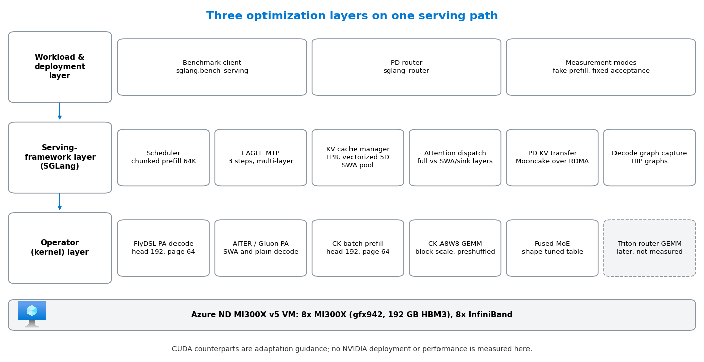

# How the Optimizations Work

[中文](optimizations_CN.md) · [README](../README.md) · **Optimizations** · [Deployment](deployment.md) · [Measure and verify](benchmark.md) · [Reference](reference.md) · [Results](results.md)

**How much faster can a 1M-context MoE model be served on the same GPUs, and which layer does the work?** This repository takes MiMo-V2.5-Pro (384 routed experts, hybrid sliding-window + grouped-query attention, 3-layer MTP) on Azure ND MI300X v5 VMs and shows every optimization in its serving stack. The optimizations fall into three layers: the serving framework, the operator (kernel) layer, and the workload and deployment layer. For each one you get the switch that turns it on, the code change in a pinned public commit where there is one, what it does to model output, and, where it was measured, how far it moved MI300X against MI300X itself.

Measured numbers and their conditions are on [Measured Results](results.md); the deployment commands are in the [README](../README.md#steps).

## Architecture



A request enters at the workload layer (the benchmark client and, in PD mode, the router), is scheduled by SGLang, and is executed by the kernels of the operator layer. The framework decides which kernel a layer uses; the kernels decide how fast that layer runs; the workload layer decides whether the measurement is representative. The dashed box is a later commit that is not part of any measured configuration.

## The Three Optimization Layers

Start with the overview: one row per technique, with what it did on MI300X and whether it can change model output. Each name links to a card with the switch, the NVIDIA counterpart, the code, the evidence and the effect on output, followed by an explanation and, where there is one, the real diff.

<!-- BEGIN GENERATED: technique-overview -->
**Serving-framework layer**

| Technique | What it did on MI300X | Output |
|---|---|---|
| [Per-layer attention dispatch for hybrid SWA + GQA](#per-layer-attention-dispatch-for-hybrid-swa--gqa) | partly on, not isolated | same math |
| [FP8 KV cache in a vectorized 5D page layout](#fp8-kv-cache-in-a-vectorized-5d-page-layout) | partly on, not isolated | lossy |
| [AITER unified attention for MTP target verify](#aiter-unified-attention-for-mtp-target-verify) | +25.65% decode, with CK GEMM (A/B) | same math |
| [Multi-layer EAGLE MTP speculative decoding and verifier fixes](#multi-layer-eagle-mtp-speculative-decoding-and-verifier-fixes) | on, not isolated | exact if correct |
| [Chunked prefill, page size and SWA pool sizing](#chunked-prefill-page-size-and-swa-pool-sizing) | final runtime, not measured | same math |
| [Decode graph capture (HIP graphs)](#decode-graph-capture-hip-graphs) | 3.11× decode (A/B) | same math |

**Operator (kernel) layer**

| Technique | What it did on MI300X | Output |
|---|---|---|
| [FlyDSL paged-attention decode kernel (head 192, page 64)](#flydsl-paged-attention-decode-kernel-head-192-page-64) | final runtime, not measured | same math |
| [Block-scale FP8 GEMM with pre-shuffled weights](#block-scale-fp8-gemm-with-pre-shuffled-weights) | +25.65% decode, with unified verify (A/B) | same math |
| [INT8 Quick Reduce for tensor-parallel all-reduce](#int8-quick-reduce-for-tensor-parallel-all-reduce) | on, not isolated | lossy |
| [Shape-tuned fused-MoE kernel table](#shape-tuned-fused-moe-kernel-table) | 8K prefill +24.32%, decode +12.56% (stage pair) | same math |
| [Head-192, page-64 FP8 batch-prefill tile](#head-192-page-64-fp8-batch-prefill-tile) | final runtime, not measured | same math |
| [Mixed-precision Triton router (MoE gate) GEMM](#mixed-precision-triton-router-moe-gate-gemm) | later commit, not measured | lossy |

**Workload and deployment layer**

| Technique | What it did on MI300X | Output |
|---|---|---|
| [Prefill/decode disaggregation (1P1D) over RDMA](#prefilldecode-disaggregation-1p1d-over-rdma) | on, not isolated | same math |
| [Prefill replicas behind one router (DP=2)](#prefill-replicas-behind-one-router-dp2) | 8K prefill 1.99× (two replicas) | same math |
| [Fake prefill for decode-only measurement](#fake-prefill-for-decode-only-measurement) | not used in the published runs | test method only |
| [Fixed MTP acceptance for performance runs](#fixed-mtp-acceptance-for-performance-runs) | on, not isolated | test method only |
| [Concurrency ladder against the saturation point](#concurrency-ladder-against-the-saturation-point) | finds the plateau (ladder) | same math |
<!-- END GENERATED: technique-overview -->

"On, not isolated" means the switch was on in the published runs but its own share was not measured; "partly on" means only part of it was, for example the AITER backend but not the FlyDSL split; "final runtime, not measured" means it is in the pinned runtime whose throughput this repository does not report.

## Serving-framework layer

### Per-layer attention dispatch for hybrid SWA + GQA

<!-- BEGIN GENERATED: card-attention-dispatch -->
- **Switch on MI300X**: `--attention-backend aiter`; full-attention verify goes to FlyDSL, SWA/sink layers and plain decode stay on AITER
- **On NVIDIA**: `--attention-backend fa3` or `flashinfer`; split per layer wherever one kernel does not cover both window types
- **Code**: [ba15db1](https://github.com/sammysun0711/sglang/commit/ba15db1a576dcdc8d51ba15bd069b9fd1f748d97), [0cfc48b](https://github.com/sammysun0711/sglang/commit/0cfc48b0e374d7e84c122f739182a39feea56d46)
- **Evidence**: AITER backend on in measured runs; FlyDSL split only in the pinned runtime
- **Effect on output**: same math. Different kernels for full and sliding-window layers; each computes exact attention.
<!-- END GENERATED: card-attention-dispatch -->

MiMo-V2.5-Pro mixes full-attention layers with sliding-window layers that also carry attention sinks. No single paged-attention kernel was fastest for both, so the backend decides per layer. During MTP target verification, full-attention layers go to the FlyDSL kernel while SWA and sink layers stay on the AITER path:

<!-- BEGIN GENERATED: excerpt-flydsl-layer-split -->
Diff excerpt from [`sammysun0711/sglang@ba15db1`](https://github.com/sammysun0711/sglang/commit/ba15db1a576dcdc8d51ba15bd069b9fd1f748d97), file `python/sglang/srt/layers/attention/aiter_backend.py` (local copy: [sammysun0711__sglang__ba15db1.patch](../upstream/patches/sammysun0711__sglang__ba15db1.patch)).

```diff
+                    is_swa_layer = (
+                        layer.sliding_window_size is not None
+                        and layer.sliding_window_size > -1
+                    )
+                    use_flydsl = (
+                        getattr(self, "_use_flydsl_pa_decode", False)
+                        and not is_swa_layer
+                        and sinks is None
+                    )
+                    target_verify_fn = (
+                        forward_target_verify_flydsl_5d
+                        if use_flydsl
+                        else forward_target_verify_vectorized_5d
+                    )
```
<!-- END GENERATED: excerpt-flydsl-layer-split -->

The same idea removes a copy on the prefill side: commit [`0cfc48b`](https://github.com/sammysun0711/sglang/commit/0cfc48b0e374d7e84c122f739182a39feea56d46) hands cached-prefill batches straight to the page-64 kernel instead of gathering the paged KV into a dense buffer first.

### FP8 KV cache in a vectorized 5D page layout

<!-- BEGIN GENERATED: card-fp8-kv-5d -->
- **Switch on MI300X**: `--kv-cache-dtype fp8_e4m3` + `SGLANG_AITER_KV_CACHE_LAYOUT=vectorized_5d`
- **On NVIDIA**: `--kv-cache-dtype fp8_e4m3`; FA3/FlashInfer paged layouts already keep a 16-byte inner vector
- **Code**: [78cd40c](https://github.com/sammysun0711/sglang/commit/78cd40c7a5102524536daf9a3178426777174d2d), [e11c515](https://github.com/sammysun0711/sglang/commit/e11c5155f0845079211c2a4d0b8a4ab3669039f9), [10a9401](https://github.com/sammysun0711/aiter/commit/10a94012efc1260dfdf16ba2f52fbda40a518a17)
- **Evidence**: FP8 KV on in measured runs; 5D layout only in the pinned runtime
- **Effect on output**: lossy. K and V are stored in FP8 E4M3 (3 mantissa bits) with one scale per tensor, so every cached token loses precision; the 5D layout itself only reorders bytes.
<!-- END GENERATED: card-fp8-kv-5d -->

At 1M context the KV cache, not the weights, decides how many requests fit. FP8 E4M3 storage halves the bytes per token. The vectorized 5D layout then reorders each page so that the innermost dimension is exactly one 16-byte vector, which lets every lane of a wavefront load its slice with one wide instruction:

<!-- BEGIN GENERATED: excerpt-kv-5d-vector-width -->
Diff excerpt from [`sammysun0711/sglang@78cd40c`](https://github.com/sammysun0711/sglang/commit/78cd40c7a5102524536daf9a3178426777174d2d), file `python/sglang/srt/mem_cache/memory_pool.py` (local copy: [sammysun0711__sglang__78cd40c.patch](../upstream/patches/sammysun0711__sglang__78cd40c.patch)).

```diff
+        if layout == "vectorized_5d":
+            # X is the inner vectorization width in the SHUFFLE layout,
+            # determined by the STORAGE dtype (not the compute dtype) since
+            # it controls how many elements fit in 16 bytes of the on-pool
+            # tensor. For fp8 storage X=16, for bf16/fp16 X=8.
+            self._kv_vector_x = 16 // self.store_dtype.itemsize
```
<!-- END GENERATED: excerpt-kv-5d-vector-width -->

The same commit lets the MTP draft model keep an ordinary token-major (NHD) pool while the target model uses the 5D pool, because the draft kernels do not read the 5D layout. On NVIDIA the flag `--kv-cache-dtype fp8_e4m3` is identical and the paged layouts of FA3 and FlashInfer already keep a 16-byte inner vector for 128-bit loads, so only the principle carries over, not the flag.

### AITER unified attention for MTP target verify

<!-- BEGIN GENERATED: card-unified-verify -->
- **Switch on MI300X**: `SGLANG_AITER_UNIFIED_VERIFY=1` on the decode server
- **On NVIDIA**: not needed; CUDA attention backends verify with their own kernels
- **Code**: no code change (configuration only)
- **Evidence**: measured A/B, together with the CK GEMM path
- **Effect on output**: same math. Selects which attention kernel verifies draft tokens; same exact attention.
<!-- END GENERATED: card-unified-verify -->

During MTP target verification, the decode server checks four positions per request at once. `SGLANG_AITER_UNIFIED_VERIFY=1` sends that step to AITER's unified attention kernel instead of the generic path. It is configuration only, and it was switched together with the CK GEMM path in the 64K A/B, so the gain belongs to the pair.

### Multi-layer EAGLE MTP speculative decoding and verifier fixes

<!-- BEGIN GENERATED: card-eagle-mtp -->
- **Switch on MI300X**: `--speculative-algorithm EAGLE --speculative-num-steps 3 --speculative-eagle-topk 1 --speculative-num-draft-tokens 4 --enable-multi-layer-eagle`
- **On NVIDIA**: same flags
- **Code**: [db840d9](https://github.com/sammysun0711/sglang/commit/db840d935a9f7097dbeb5f1b0dba4d261057a2bd), [f26ae30](https://github.com/sammysun0711/sglang/commit/f26ae30063143411f3ae552af1830fa46e3ee0fd), [878fff1](https://github.com/sammysun0711/sglang/commit/878fff15647fe3dabb32aa3a335b0ad16e3ee878)
- **Evidence**: on in measured runs with fixed acceptance; f26ae30 and 878fff1 only in the pinned runtime
- **Effect on output**: exact if correct. Speculative decoding keeps the target model's output distribution only if verification is right. On HIP, sampled verification silently fell back to greedy until 878fff1, so temperature had no effect.
<!-- END GENERATED: card-eagle-mtp -->

MiMo ships three MTP layers, so each decode step drafts three tokens and verifies four. Speculative decoding only pays if the draft and target agree often, and on ROCm three bugs kept agreement low or results wrong: the draft-extend step read the full-attention pool instead of the SWA pool and used a different kernel than target verify ([`db840d9`](https://github.com/sammysun0711/sglang/commit/db840d935a9f7097dbeb5f1b0dba4d261057a2bd)); verification results could differ between TP ranks and desynchronize collectives ([`f26ae30`](https://github.com/sammysun0711/sglang/commit/f26ae30063143411f3ae552af1830fa46e3ee0fd)); and on HIP, sampled (non-greedy) verification silently fell back to the greedy verifier, so `temperature` had no effect ([`878fff1`](https://github.com/sammysun0711/sglang/commit/878fff15647fe3dabb32aa3a335b0ad16e3ee878), opt-in through `SGLANG_MIMO_EAGLE_HIP_NONGREEDY_VERIFY=1`). The flags are the same on CUDA.

### Chunked prefill, page size and SWA pool sizing

<!-- BEGIN GENERATED: card-memory-sizing -->
- **Switch on MI300X**: `--chunked-prefill-size 65536 --page-size 64 --swa-full-tokens-ratio 0.01`
- **On NVIDIA**: same flags; re-derive the values from HBM size and kernel page support
- **Code**: no code change (configuration only)
- **Evidence**: measured runs used chunk 32768 and page 32
- **Effect on output**: same math. Chunk and page sizes change how work is split, not what is computed; the SWA ratio only sizes the pool.
<!-- END GENERATED: card-memory-sizing -->

These are configuration, not code, but they decide whether the kernels above run at all. The final runtime uses `--chunked-prefill-size 65536`, `--page-size 64` (the page size the FlyDSL and CK kernels were written for) and `--swa-full-tokens-ratio 0.01`, which shrinks the sliding-window pool to 1% of the full-attention pool because SWA layers only ever need the last window of tokens. The freed HBM goes to the full-attention KV pool and therefore to longer contexts.

### Decode graph capture (HIP graphs)

<!-- BEGIN GENERATED: card-decode-graph-capture -->
- **Switch on MI300X**: on by default on the decode server: do not pass `--disable-cuda-graph` there (the prefill server keeps it)
- **On NVIDIA**: same default with CUDA graphs; `--cuda-graph-max-bs` bounds the captured batch sizes
- **Code**: no code change (configuration only)
- **Evidence**: measured A/B on the baseline stack (Triton attention, no MTP)
- **Effect on output**: same math. The captured graph replays the same kernels; it removes launch overhead, not arithmetic.
<!-- END GENERATED: card-decode-graph-capture -->

A decode step runs hundreds of small kernels, and at small batch the time to launch them is comparable to the time they run. SGLang captures each decode batch size once as a HIP graph (a CUDA graph on NVIDIA) and afterwards replays the whole step with one launch. The baseline stack ran with it off (`--disable-cuda-graph`, a workaround for a multi-node hang); turning it back on for the decode server was the largest single step measured here, while the prefill server keeps `--disable-cuda-graph` because prefill batches are large and irregular. The capture needs HBM for each captured batch size, so it competes with the KV pool.

## Operator layer

### FlyDSL paged-attention decode kernel (head 192, page 64)

<!-- BEGIN GENERATED: card-flydsl-pa-decode -->
- **Switch on MI300X**: `SGLANG_AITER_PA_DECODE_IMPL=flydsl` + `SGLANG_FLYDSL_PA_NUM_PARTITIONS=16`
- **On NVIDIA**: CuTe DSL or FlashInfer decode; partitions correspond to split-KV
- **Code**: [c99d5cd](https://github.com/sammysun0711/FlyDSL/commit/c99d5cd97864c11e459cff9169d387d312790782), [ba15db1](https://github.com/sammysun0711/sglang/commit/ba15db1a576dcdc8d51ba15bd069b9fd1f748d97), [a2fd773](https://github.com/sammysun0711/sglang/commit/a2fd773ab43f960f5f2c29b5c592b0ca43c5ba8f)
- **Evidence**: pinned runtime; kernel not measured in isolation
- **Effect on output**: same math. Exact paged attention. The two fixed defects (unstaged query elements, 32-bit offset overflow) produced wrong output, not small drift, which is why the kernel refuses untested shapes.
<!-- END GENERATED: card-flydsl-pa-decode -->

FlyDSL is a Python DSL on MLIR in which a kernel is written as layouts (how a tensor is split across lanes, waves and tiles) rather than as index arithmetic; the compiler generates the addressing. The MiMo decode kernel had two defects at MiMo's shape, both fixed in [`c99d5cd`](https://github.com/sammysun0711/FlyDSL/commit/c99d5cd97864c11e459cff9169d387d312790782) and later merged upstream in ROCm/FlyDSL [#1064](https://github.com/ROCm/FlyDSL/commit/ed9885eca4ffc45e2ec1dc45fa00824baa6b56d3).

With head size 192, each of 16 lanes stages 12 query elements. The old rule rounded that to one 8-element load, so a third of every query row never reached LDS and the output contained NaNs. The fix loads 12 elements as three 4-element (64-bit) loads:

<!-- BEGIN GENERATED: excerpt-flydsl-query-load -->
Diff excerpt from [`sammysun0711/FlyDSL@c99d5cd`](https://github.com/sammysun0711/FlyDSL/commit/c99d5cd97864c11e459cff9169d387d312790782), file `kernels/attention/pa_decode_tile.py` (local copy: [sammysun0711__FlyDSL__c99d5cd.patch](../upstream/patches/sammysun0711__FlyDSL__c99d5cd.patch)).

```diff
         # Per-lane Q chunk (QCHUNK 16-bit elems) fetched in QLOAD_UNIT-wide
-        # pieces (128b max per buffer load): head_dim=256 needs 2 pieces.
-        QLOAD_UNIT = QCHUNK if QCHUNK < 8 else 8
+        # pieces (128b max per buffer load).  Use 64-bit loads when QCHUNK is
+        # not divisible by 8: head_dim=192 gives QCHUNK=12 and therefore needs
+        # three 4-element loads.  Rounding it down to one 8-element load leaves
+        # one third of every query row unstaged in LDS.
+        QLOAD_UNIT = 8 if QCHUNK % 8 == 0 else 4
         N_QLOADS = QCHUNK // QLOAD_UNIT
         _q_copy_op = fx.rocdl.BufferCopy128b() if QLOAD_UNIT == 8 else fx.rocdl.BufferCopy64b()
         _q_load_chunk = _make_flat_loader(query_ptr, Q_DTYPE, QLOAD_UNIT, _q_copy_op)
```
<!-- END GENERATED: excerpt-flydsl-query-load -->

Physical page ids fit in 32 bits, but a byte offset computed from them does not once a single KV cache exceeds 2 GiB, which it does at 1M context. The fix promotes the page id to 64 bits before any offset arithmetic:

<!-- BEGIN GENERATED: excerpt-flydsl-int64-offset -->
Diff excerpt from [`sammysun0711/FlyDSL@c99d5cd`](https://github.com/sammysun0711/FlyDSL/commit/c99d5cd97864c11e459cff9169d387d312790782), file `kernels/attention/pa_decode_tile.py` (local copy: [sammysun0711__FlyDSL__c99d5cd.patch](../upstream/patches/sammysun0711__FlyDSL__c99d5cd.patch)).

```diff
         def _k_ops(phys, a):
+            # Physical page ids fit in i32, but their byte/element offsets do
+            # not once an individual KV cache grows beyond 2 GiB.
+            phys = fx.Int64(phys)
             within_page_tok = (a * c16 + lane16) % block_size
```
<!-- END GENERATED: excerpt-flydsl-int64-offset -->

On the SGLang side ([`ba15db1`](https://github.com/sammysun0711/sglang/commit/ba15db1a576dcdc8d51ba15bd069b9fd1f748d97)) the kernel is opt-in and refuses to start on any shape it was not validated for, instead of silently producing wrong attention:

<!-- BEGIN GENERATED: excerpt-flydsl-dispatch-gate -->
Diff excerpt from [`sammysun0711/sglang@ba15db1`](https://github.com/sammysun0711/sglang/commit/ba15db1a576dcdc8d51ba15bd069b9fd1f748d97), file `python/sglang/srt/layers/attention/aiter_backend.py` (local copy: [sammysun0711__sglang__ba15db1.patch](../upstream/patches/sammysun0711__sglang__ba15db1.patch)).

```diff
+        incompatibilities = []
+        if self.use_mla:
+            incompatibilities.append("MLA is unsupported")
+        if self.topk != 1:
+            incompatibilities.append(f"top-k must be 1, got {self.topk}")
+        if self.page_size != 64:
+            incompatibilities.append(f"page size must be 64, got {self.page_size}")
+        if self.max_context_len > 1_048_576:
+            incompatibilities.append(
+                "maximum context must not exceed 1,048,576 tokens, got "
+                f"{self.max_context_len}"
+            )
+        if (self.num_head, self.num_kv_head, self.head_dim) != (16, 1, 192):
+            incompatibilities.append(
+                "TP-local shape must be 16Q/1KV/head-192, got "
+                f"{self.num_head}Q/{self.num_kv_head}KV/head-{self.head_dim}"
+            )
+        if self.input_dtype != torch.bfloat16:
+            incompatibilities.append(
+                f"model dtype must be BF16, got {self.input_dtype}"
+            )
+        if self.kv_cache_dtype != fp8_dtype:
+            incompatibilities.append(
+                f"KV cache dtype must be FP8 E4M3, got {self.kv_cache_dtype}"
+            )
+        if not is_gfx942_supported():
+            incompatibilities.append("phase 1 is validated only on gfx942")
+        if incompatibilities:
+            raise RuntimeError(
+                "SGLANG_AITER_PA_DECODE_IMPL=flydsl is incompatible with this "
+                "target backend: " + "; ".join(incompatibilities)
+            )
```
<!-- END GENERATED: excerpt-flydsl-dispatch-gate -->

[`a2fd773`](https://github.com/sammysun0711/sglang/commit/a2fd773ab43f960f5f2c29b5c592b0ca43c5ba8f) makes the number of context partitions configurable (8, 16, 24 or 32); the final runtime uses 16 so that long contexts are split across enough workgroups to occupy the 304 compute units. Upstream [#1065](https://github.com/ROCm/FlyDSL/commit/e46db6020b4560de82a7136d78cc33a5186338f4) later added BF16 KV and different K and V head sizes, so MiMo's 128-wide value head no longer has to be padded to 192. The NVIDIA counterpart of this kind of layout-first kernel is CuTe DSL; the partition count corresponds to split-KV.

### Block-scale FP8 GEMM with pre-shuffled weights

<!-- BEGIN GENERATED: card-ck-a8w8-gemm -->
- **Switch on MI300X**: `SGLANG_USE_AITER_CK_BLOCKSCALE_BPRESHUFFLE=1`
- **On NVIDIA**: DeepGEMM (`SGLANG_ENABLE_JIT_DEEPGEMM=1`) or CUTLASS block-scale GEMM
- **Code**: [2f9b9ae](https://github.com/sammysun0711/sglang/commit/2f9b9aedf32977bc5d088a86ec0a73bcf432a4d0), [fc96a4f](https://github.com/sammysun0711/aiter/commit/fc96a4f9f5f3e931cbb9de275c8aa01136417500)
- **Evidence**: measured A/B, together with unified verify
- **Effect on output**: same math. Both the Triton path and the CK path quantize activations to FP8 per 1x128 block against the same FP8 block-scale checkpoint; the switch changes the kernel, not the precision.
<!-- END GENERATED: card-ck-a8w8-gemm -->

MiMo's linear layers are FP8 with one scale per 128-wide block. On gfx942 SGLang used a Triton kernel for this GEMM. Commit [`2f9b9ae`](https://github.com/sammysun0711/sglang/commit/2f9b9aedf32977bc5d088a86ec0a73bcf432a4d0) adds a switch that selects AITER's Composable Kernel implementation instead, with the weights shuffled once at load time into the layout the matrix cores read:

<!-- BEGIN GENERATED: excerpt-ck-gemm-select -->
Diff excerpt from [`sammysun0711/sglang@2f9b9ae`](https://github.com/sammysun0711/sglang/commit/2f9b9aedf32977bc5d088a86ec0a73bcf432a4d0), file `python/sglang/srt/layers/quantization/fp8_utils.py` (local copy: [sammysun0711__sglang__2f9b9ae.patch](../upstream/patches/sammysun0711__sglang__2f9b9ae.patch)).

```diff
     elif _use_aiter_gfx95:
         use_triton = use_aiter_triton_gemm_w8a8_tuned_gfx950(n, k)
+    elif _use_aiter_ck_blockscale_bpreshuffle_gfx942:
+        use_triton = False
+    elif _use_aiter_ck_blockscale_gfx942:
+        use_triton = False
     else:
         use_triton = True
 
+    # The weight-preshuffled CK kernel consumes a transposed activation scale.
+    use_bpreshuffle = not use_triton and (
+        _use_aiter_bpreshuffle_gfx95 or _use_aiter_ck_blockscale_bpreshuffle_gfx942
+    )
+
```
<!-- END GENERATED: excerpt-ck-gemm-select -->

AITER [`fc96a4f`](https://github.com/sammysun0711/aiter/commit/fc96a4f9f5f3e931cbb9de275c8aa01136417500) adds per-shape tile configurations for MiMo's GEMM sizes on a 304-CU MI300X. This path is one of the two switches in the [measured 64K A/B](results.md#controlled-ab-block-scale-fp8-gemm-path-at-64k-context); the other is unified verify, so the gain is not attributed to the GEMM alone. On NVIDIA the same role is played by DeepGEMM (`SGLANG_ENABLE_JIT_DEEPGEMM=1`) or CUTLASS block-scale FP8 GEMM, whose pre-packed weights correspond to the pre-shuffle.

### INT8 Quick Reduce for tensor-parallel all-reduce

<!-- BEGIN GENERATED: card-int8-quick-reduce -->
- **Switch on MI300X**: `ROCM_QUICK_REDUCE_QUANTIZATION=INT8` (set by the base image; `NONE` turns it off)
- **On NVIDIA**: no default equivalent; NCCL and the SGLang custom all-reduce sum in full precision
- **Code**: no code change (configuration only)
- **Evidence**: on in the measured throughput runs, inherited from the base image; not isolated
- **Effect on output**: lossy. Tensor-parallel all-reduces that go through Quick Reduce are quantized to INT8 before the partial sums from the 8 GPUs are added.
<!-- END GENERATED: card-int8-quick-reduce -->

Tensor parallelism sums partial results from the 8 GPUs after every attention and MoE block. Quick Reduce is an all-reduce for ROCm in SGLang's custom all-reduce path; with `ROCM_QUICK_REDUCE_QUANTIZATION=INT8` it quantizes what it sends to INT8, so fewer bytes cross the GPU links. The captured environment of the stage-pair runs shows it on; the base image sets it, not a launch script; see the warning in [Which optimizations can change model output](#which-optimizations-can-change-model-output).

### Shape-tuned fused-MoE kernel table

<!-- BEGIN GENERATED: card-tuned-fused-moe -->
- **Switch on MI300X**: `mimo_v2_5_pro_b16_tuned_fmoe.csv` in AITER
- **On NVIDIA**: Triton fused-MoE JSON from `tuning_fused_moe_triton.py`
- **Code**: [d725746](https://github.com/sammysun0711/aiter/commit/d725746a0f8c233d8e46e2771a7c8dbcd06e40d9)
- **Evidence**: measured stage pair
- **Effect on output**: same math. Chooses among existing fused-MoE kernels per token count; the model math is unchanged.
<!-- END GENERATED: card-tuned-fused-moe -->

A MoE layer's cost depends on how many tokens land in one batch. AITER can pick a different fused-MoE kernel per token count, and [`d725746`](https://github.com/sammysun0711/aiter/commit/d725746a0f8c233d8e46e2771a7c8dbcd06e40d9) records the winner of an offline search for MiMo's expert shape (hidden size 6,144, expert intermediate size 256 per TP rank, 384 experts, top-8):

<!-- BEGIN GENERATED: moe-table -->
| Tokens | Kernel | Time (µs) | TFLOPS |
|---:|---|---:|---:|
| 2,048 | A | 703.2 | 219.9 |
| 4,096 | B | 1,069.8 | 289.1 |
| 8,192 | B | 1,412.0 | 438.0 |
| 16,384 | B | 2,680.7 | 461.4 |
| 32,768 | B | 4,816.4 | 513.6 |

Every row uses block_m = 64; time and TFLOPS are the tuner's own measurement at each token count. Kernel letters:

- A = `fmoe_bf16_blockscaleFp8_g1u1_vs_silu_64x256`
- B = `fmoe_bf16_blockscaleFp8_g1u1_vs_ps_silu_64x256`
<!-- END GENERATED: moe-table -->

From 4,096 tokens on, the search picks kernel B (the `_ps_` variant), and achieved TFLOPS keep rising with batch size. The table changes only which kernel runs, not the model math. The NVIDIA equivalent is SGLang's Triton fused-MoE configuration, generated per expert count, size, dtype and GPU with `benchmark/kernels/fused_moe_triton/tuning_fused_moe_triton.py`.

### Head-192, page-64 FP8 batch-prefill tile

<!-- BEGIN GENERATED: card-ck-prefill-tile -->
- **Switch on MI300X**: CK patch shipped in AITER `3f4ab48`, dispatched only for the exact shape
- **On NVIDIA**: check that the paged prefill path does not fall back to gather-then-dense
- **Code**: [3f4ab48](https://github.com/sammysun0711/aiter/commit/3f4ab482a2986919c784e469e23cfac7f93bb153), [0cfc48b](https://github.com/sammysun0711/sglang/commit/0cfc48b0e374d7e84c122f739182a39feea56d46)
- **Evidence**: pinned runtime, not throughput-tested here
- **Effect on output**: same math. Replaces the padded head-256 path with an exact head-192 tile.
<!-- END GENERATED: card-ck-prefill-tile -->

[`3f4ab48`](https://github.com/sammysun0711/aiter/commit/3f4ab482a2986919c784e469e23cfac7f93bb153) ships a temporary Composable Kernel patch that adds a batch-prefill tile for exactly MiMo's shape (head 192, FP8 or BF16, page 64, vectorized layout) and keeps the padded head-256 path as the fallback. Together with the cached-prefill route in the framework layer, long cached prefixes are read in place from the paged cache.

### Mixed-precision Triton router (MoE gate) GEMM

<!-- BEGIN GENERATED: card-mixed-router-gemm -->
- **Switch on MI300X**: `SGLANG_MIMO_MIXED_ROUTER=1` for router batches of at least 2,048 tokens
- **On NVIDIA**: the same Triton kernel compiles for CUDA; re-tune block sizes
- **Code**: [1f9bb2b](https://github.com/sammysun0711/sglang/commit/1f9bb2b4c55cdc7bd5de1ac7977f76afab101a97)
- **Evidence**: later commit, not measured
- **Effect on output**: lossy. Router weights drop from FP32 to FP16 and activations from BF16 to FP16 before accumulation. Router logits pick the top-8 experts, so a small change can flip which experts a token uses.
<!-- END GENERATED: card-mixed-router-gemm -->

The MoE router multiplies every token's hidden state by a 384 × 6,144 weight in FP32. [`1f9bb2b`](https://github.com/sammysun0711/sglang/commit/1f9bb2b4c55cdc7bd5de1ac7977f76afab101a97) adds an opt-in Triton kernel for batches of at least 2,048 tokens that keeps a cached FP16 copy of the router weight, converts BF16 activation tiles to FP16 in registers, and still accumulates and returns FP32:

<!-- BEGIN GENERATED: excerpt-router-gate -->
Diff excerpt from [`sammysun0711/sglang@1f9bb2b`](https://github.com/sammysun0711/sglang/commit/1f9bb2b4c55cdc7bd5de1ac7977f76afab101a97), file `python/sglang/srt/models/mimo_v2.py` (local copy: [sammysun0711__sglang__1f9bb2b.patch](../upstream/patches/sammysun0711__sglang__1f9bb2b.patch)).

```diff
     def forward(self, hidden_states):
+        if (
+            get_bool_env_var("SGLANG_MIMO_MIXED_ROUTER")
+            and hidden_states.is_cuda
+            and hidden_states.dtype == torch.bfloat16
+            and hidden_states.shape[0] >= 2048
+        ):
+            from sglang.srt.layers.moe.mixed_router_gemm import mixed_router_gemm
+
+            if self._mixed_router_weight is None:
+                self._mixed_router_weight = self.weight.detach().to(torch.float16)
+            return mixed_router_gemm(hidden_states, self._mixed_router_weight)
```
<!-- END GENERATED: excerpt-router-gate -->

<!-- BEGIN GENERATED: excerpt-router-kernel-dot -->
Diff excerpt from [`sammysun0711/sglang@1f9bb2b`](https://github.com/sammysun0711/sglang/commit/1f9bb2b4c55cdc7bd5de1ac7977f76afab101a97), file `python/sglang/srt/layers/moe/mixed_router_gemm.py` (local copy: [sammysun0711__sglang__1f9bb2b.patch](../upstream/patches/sammysun0711__sglang__1f9bb2b.patch)).

```diff
+    accumulator = tl.zeros((BLOCK_M, BLOCK_N), dtype=tl.float32)
+    for k_start in range(0, K, BLOCK_K):
+        x = tl.load(
+            x_ptrs,
+            mask=(offs_m[:, None] < M) & (k_start + offs_k[None, :] < K),
+            other=0.0,
+        )
+        weight = tl.load(
+            weight_ptrs,
+            mask=(offs_n[None, :] < N) & (k_start + offs_k[:, None] < K),
+            other=0.0,
+        )
+        accumulator = tl.dot(
+            x.to(tl.float16), weight, acc=accumulator, out_dtype=tl.float32
+        )
+        x_ptrs += BLOCK_K * stride_xk
+        weight_ptrs += BLOCK_K * stride_wk
```
<!-- END GENERATED: excerpt-router-kernel-dot -->

This commit sits on a later branch and is not in the pinned runtime, so no number in this repository includes it. Because the kernel is plain Triton, it compiles for CUDA as well; only the block sizes need re-tuning.

## Workload and deployment layer

### Prefill/decode disaggregation (1P1D) over RDMA

<!-- BEGIN GENERATED: card-pd-disaggregation -->
- **Switch on MI300X**: `--disaggregation-mode prefill|decode --disaggregation-transfer-backend mooncake` + `sglang_router --pd-disaggregation`
- **On NVIDIA**: same flags; mooncake or nixl over GPUDirect RDMA
- **Code**: no code change (configuration only)
- **Evidence**: on in measured runs, not isolated
- **Effect on output**: same math. The KV cache is copied between servers byte for byte.
<!-- END GENERATED: card-pd-disaggregation -->

Prefill is compute-bound and decode is memory-bound, and a long prefill stalls every decode step that shares its GPUs. The PD deployment gives each phase its own TP8 server and moves the KV cache with Mooncake over eight InfiniBand ports. Two operational facts matter more than the flags: the container needs `--privileged`, `/dev/mem` and `CAP_SYS_ADMIN`, otherwise Mooncake silently falls back from RDMA to TCP; and the router must only be started after both servers report ready. The flags are identical on NVIDIA with the `mooncake` or `nixl` transfer backend.

### Prefill replicas behind one router (DP=2)

<!-- BEGIN GENERATED: card-prefill-replicas -->
- **Switch on MI300X**: one complete TP8 server per VM, both registered with one `sglang_router`
- **On NVIDIA**: same router and flags; each replica needs its own full model copy
- **Code**: no code change (configuration only)
- **Evidence**: measured: 1 against 2 requests in flight on two replicas
- **Effect on output**: same math. Each request runs entirely on one replica; nothing is split or approximated.
<!-- END GENERATED: card-prefill-replicas -->

The router hands each request to one complete TP8 server, so no collective crosses the VMs, and two replicas nearly double prefill once two requests are in flight ([measured](results.md#adding-a-second-prefill-replica)). The price is a full model copy per replica. This is why replication came first here:

- **TP8 per VM** is the stable base: each VM has eight GPUs and the model's eight KV heads map one per GPU.
- **Expert parallelism** (EP), inside one VM or across VMs, is not part of any configuration measured here. Replication adds prefill capacity without new collectives; EP changes how every MoE layer communicates, so test it as its own A/B, not as a switch.

### Fake prefill for decode-only measurement

<!-- BEGIN GENERATED: card-fake-prefill -->
- **Switch on MI300X**: decode server `--disaggregation-transfer-backend fake`; client `--fake-prefill`
- **On NVIDIA**: same upstream SGLang feature
- **Code**: no code change (configuration only)
- **Evidence**: in the pinned runtime's scripts; not used in the published runs
- **Effect on output**: test method only. The decode server starts from a KV cache that was never computed from the prompt.
<!-- END GENERATED: card-fake-prefill -->

To study the decode kernels without a prefill server, the decode server runs with `--disaggregation-mode decode --disaggregation-transfer-backend fake` and the client adds `--fake-prefill`. The decode server then starts every request as if the KV had arrived. This isolates decode throughput at long context, where a real prefill would dominate the wall time, and it is an upstream SGLang feature on both platforms.

### Fixed MTP acceptance for performance runs

<!-- BEGIN GENERATED: card-simulated-acceptance -->
- **Switch on MI300X**: `SGLANG_SIMULATE_ACC_LEN=3 SGLANG_SIMULATE_ACC_METHOD=match-expected`
- **On NVIDIA**: same upstream SGLang variables
- **Code**: no code change (configuration only)
- **Evidence**: on in measured runs, not isolated
- **Effect on output**: test method only. Draft tokens are accepted by rule, not by the model, so the generated text is not the model's output.
<!-- END GENERATED: card-simulated-acceptance -->

`SGLANG_SIMULATE_ACC_LEN=3` makes every MTP step accept exactly three draft tokens. That removes acceptance noise from kernel measurements and makes runs comparable with each other, but it overstates throughput for a real workload. Accuracy runs must unset both variables, and throughput measured with a fixed acceptance should never be quoted as production throughput.

### Concurrency ladder against the saturation point

<!-- BEGIN GENERATED: card-concurrency-ladder -->
- **Switch on MI300X**: `bench_serving --max-concurrency 16 ... 256` with fixed prompts, warmup and seed
- **On NVIDIA**: same client
- **Code**: no code change (configuration only)
- **Evidence**: measured ladder
- **Effect on output**: same math. Changes the number of in-flight requests, not the model or its answers. Scoring eligibility depends on the dataset and whether a synthetic measurement mode is enabled.
<!-- END GENERATED: card-concurrency-ladder -->

Throughput only means something at a stated load. Sweep client concurrency with fixed prompts, warmup and seed until output throughput stops rising, then report that plateau together with its TTFT; the [measured concurrency ladder](results.md#where-decode-saturates-concurrency-ladder) is an example. Past the plateau, extra concurrency only adds queueing time.

### Sizing the decode batch from KV capacity

A label such as "batch 16" can mean four different things, and at long context they drift apart:

- **Client concurrency**: how many requests the client keeps in flight (`--max-concurrency`).
- **Prefill batch**: how many new requests and prompt tokens one prefill step takes, bounded by `--chunked-prefill-size` (one request's chunk), `--max-prefill-tokens` (tokens per step) and `--prefill-max-requests`.
- **Decode batch**: how many requests generate a token in one decode step; the server logs it as `#running-req`.
- **Admission limit**: `--max-running-requests`, an upper bound and not a promise.

The decode batch is bounded by the KV pool: the tokens of all running requests (input, generated tokens and reserve) have to fit. For identical requests the batch is at most `floor(KV pool tokens / (input + output tokens))`, and pages, MTP state and reserves make it lower in practice. More client concurrency or a higher `--max-running-requests` cannot push the batch past that bound. Two measurements on these VMs show it:

- With `--mem-fraction-static 0.95` one TP8 VM has a full-attention KV pool of 1,442,464 tokens. Sixteen requests of 64K input and 1K output need 1,064,960 tokens, 74% of the pool, so all sixteen decode together; that is the setup of the [64K A/B](results.md#controlled-ab-block-scale-fp8-gemm-path-at-64k-context).
- The PD decode server runs at `--mem-fraction-static 0.85` and holds 4 to 5 requests at 64K and one from 128K on ([context table](results.md#how-throughput-changes-with-context-length)).

Size memory and topology for context length × batch before tuning kernels, and report `#running-req` next to client concurrency.

## Which optimizations can change model output

A throughput gain only counts if the answers stay the same. Every technique above does one of four things to the numbers, and the class decides what has to be checked before it goes to production. The optimized throughput runs had FP8 KV and fixed MTP acceptance on, and the stage-pair runs record INT8 Quick Reduce on. The [measured accuracy scores](results.md#accuracy-measured-on-the-optimized-kernels) come from the same kernels with real MTP acceptance but with the FP8 KV cache off, so no published accuracy result covers FP8 KV. To check a lossy switch on your workload, see [Check a lossy switch on your model](benchmark.md#check-a-lossy-switch-on-your-model).

Each card above ends with the technique's effect on output. Grouped by class:

<!-- BEGIN GENERATED: precision-summary -->
- **Lossy — check accuracy before production**. Fewer bits somewhere on the data path. Can shift outputs systematically and must be checked with an accuracy benchmark before production. [FP8 KV cache in a vectorized 5D page layout](#fp8-kv-cache-in-a-vectorized-5d-page-layout); [INT8 Quick Reduce for tensor-parallel all-reduce](#int8-quick-reduce-for-tensor-parallel-all-reduce); [Mixed-precision Triton router (MoE gate) GEMM](#mixed-precision-triton-router-moe-gate-gemm)
- **Output-preserving only if the implementation is correct**. Designed to leave the output distribution unchanged, but only if the implementation is correct; a bug changes outputs without any error message. [Multi-layer EAGLE MTP speculative decoding and verifier fixes](#multi-layer-eagle-mtp-speculative-decoding-and-verifier-fixes)
- **Same arithmetic, different kernel or layout**. Same arithmetic contract; only kernel, layout or schedule changes. Results can differ in the last bits because the summation order changes, not systematically. [Per-layer attention dispatch for hybrid SWA + GQA](#per-layer-attention-dispatch-for-hybrid-swa--gqa); [AITER unified attention for MTP target verify](#aiter-unified-attention-for-mtp-target-verify); [Chunked prefill, page size and SWA pool sizing](#chunked-prefill-page-size-and-swa-pool-sizing); [Decode graph capture (HIP graphs)](#decode-graph-capture-hip-graphs); [FlyDSL paged-attention decode kernel (head 192, page 64)](#flydsl-paged-attention-decode-kernel-head-192-page-64); [Block-scale FP8 GEMM with pre-shuffled weights](#block-scale-fp8-gemm-with-pre-shuffled-weights); [Shape-tuned fused-MoE kernel table](#shape-tuned-fused-moe-kernel-table); [Head-192, page-64 FP8 batch-prefill tile](#head-192-page-64-fp8-batch-prefill-tile); [Prefill/decode disaggregation (1P1D) over RDMA](#prefilldecode-disaggregation-1p1d-over-rdma); [Prefill replicas behind one router (DP=2)](#prefill-replicas-behind-one-router-dp2); [Concurrency ladder against the saturation point](#concurrency-ladder-against-the-saturation-point)
- **Benchmark methods — never score their output**. Outputs produced in this mode are not model answers and must never be scored for accuracy. [Fake prefill for decode-only measurement](#fake-prefill-for-decode-only-measurement); [Fixed MTP acceptance for performance runs](#fixed-mtp-acceptance-for-performance-runs)
<!-- END GENERATED: precision-summary -->

INT8 Quick Reduce deserves a separate warning. None of the launch scripts used in the measured runs sets it: the `rocm/sgl-dev` base image exports `ROCM_QUICK_REDUCE_QUANTIZATION=INT8`, the captured environment of the measured runs shows it (hash in [`evidence/runs.json`](../evidence/runs.json)), and every server started from that image inherits it. The profiles in this repository export it explicitly so that the inherited value is visible and can be ablated; the accuracy role of the pinned runtime sets it back to `NONE`. The same base-image ENV mechanism also silently overrode a Dockerfile ARG during the clean build, which is why every pin there carries a `PIN_` prefix.

## Common misconceptions

- **"A faster kernel makes the model that much faster."** The FlyDSL kernel only runs for full-attention layers during target verification (see the dispatch excerpt); SWA and sink layers and the other operators keep their old cost, so any kernel speed-up is diluted by that share.
- **"The tuned MoE table improves both throughput and latency."** At decode concurrency 64 and 128 throughput rose by about 12% while TPOT also rose by 12.6–14.1%: the table trades per-token latency for batch throughput.
- **"More client concurrency means more throughput."** The ladder plateaus at concurrency 64; beyond it only time to first token grows.
- **"If the launch script does not set a precision switch, it is off."** `ROCM_QUICK_REDUCE_QUANTIZATION=INT8` comes from the base image's ENV and was on in the measured runs although none of their launch scripts sets it. Read the process environment, not the script.
- **"A 100% success count means every request worked."** With too small a `--context-length`, oversized prompts can return error payloads that the client counts as successes; the [context headroom rule](benchmark.md#exact-inputs-and-context-headroom) catches this.

## Porting the method to NVIDIA GPUs

The framework and workload layers are upstream SGLang: PD disaggregation, fake prefill, fixed acceptance, EAGLE MTP, FP8 KV, chunked prefill and the SWA ratio use the same flags on CUDA. The operator layer changes implementation but not method: pick the attention kernel per layer type, use a block-scale FP8 GEMM with pre-packed weights, and re-run the fused-MoE tuning for your GPU. [`profiles/cuda-hopper-pd.json`](../profiles/cuda-hopper-pd.json) encodes that mapping and renders the same roles as the MI300X profile:

```bash
python tools/render_launch.py --profile cuda-hopper-pd --role decode
python tools/render_launch.py --profile cuda-hopper-pd --role decode --ablate ck-a8w8-gemm
```

The CUDA profile is a template (`TEMPLATE_NOT_MEASURED`). Re-derive page size and the SWA ratio from your GPU's HBM, and measure each technique with the same A/B discipline before relying on it.
