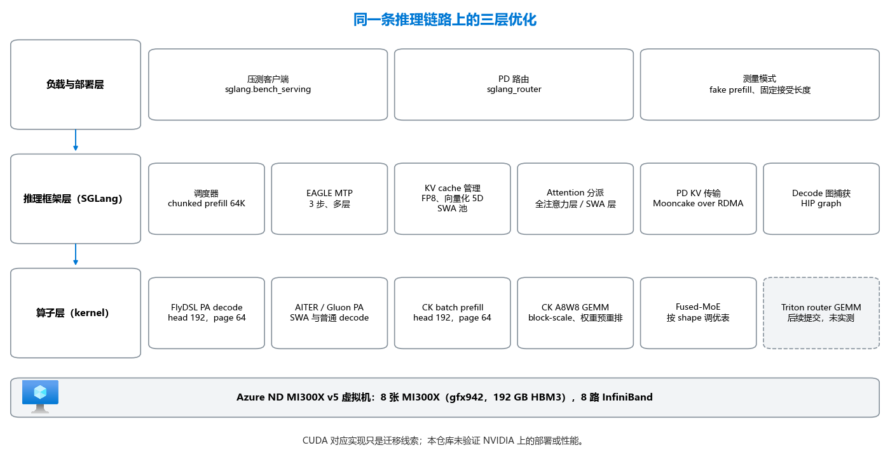

# 优化原理

[English](optimizations.md) · [README](../README_CN.md) · **优化原理** · [部署细节](deployment_CN.md) · [复测与核对](benchmark_CN.md) · [参考](reference_CN.md) · [实测结果](results_CN.md)

**同样的 GPU，一个支持 1M 上下文的 MoE 模型到底能提速多少？提速又落在哪一层？** 本仓库以 Azure ND MI300X v5 虚拟机上的 MiMo-V2.5-Pro 为例（384 个路由专家、滑动窗口与 GQA 混合注意力、3 层 MTP），把推理链路上用到的全部优化手段逐项讲清楚。这些手段分属三层：推理框架层、算子层、负载与部署层。每一项都给出打开它的开关、固定 commit 里真实的代码改动（有代码改动的话）、它对模型输出的影响；实测过的项目还给出它让 MI300X 相对 MI300X 自己快了多少。

实测数字及其条件见[实测结果](results_CN.md)；部署命令见 [README](../README_CN.md#操作步骤)。

## 架构



请求从负载层进入（压测客户端，PD 模式下还有 router），由 SGLang 调度，最终由算子层的 kernel 执行。框架层决定每一层用哪个 kernel，kernel 决定这一层跑多快，负载层决定这次测量有没有代表性。虚线框是后续提交，不在任何实测配置里。

## 三层优化逐项拆解

先看总览：每项技术一行，写明它在 MI300X 上的效果，以及会不会改变模型输出。点名字跳到这一项的卡片：开关、NVIDIA 上的对应做法、代码、证据、对输出的影响，后面是解释，有 diff 的附上真实 diff。

<!-- BEGIN GENERATED: technique-overview -->
**推理框架层**

| 优化手段 | 在 MI300X 上的效果 | 对输出 |
|---|---|---|
| [混合 SWA + GQA 的逐层 attention 分派](#混合-swa--gqa-的逐层-attention-分派) | 部分已打开，未单独拆分 | 算术不变 |
| [FP8 KV cache + 向量化 5D 分页布局](#fp8-kv-cache--向量化-5d-分页布局) | 部分已打开，未单独拆分 | 有损 |
| [MTP target verify 使用 AITER unified attention](#mtp-target-verify-使用-aiter-unified-attention) | decode +25.65%，与 CK GEMM 合计（A/B） | 算术不变 |
| [多层 EAGLE MTP 投机解码及校验修复](#多层-eagle-mtp-投机解码及校验修复) | 已打开，未单独拆分 | 实现正确则不变 |
| [Chunked prefill、page size 与 SWA 池容量](#chunked-prefillpage-size-与-swa-池容量) | 在最终 runtime 中，未实测 | 算术不变 |
| [Decode 图捕获（HIP graph）](#decode-图捕获hip-graph) | decode 3.11×（A/B） | 算术不变 |

**算子层**

| 优化手段 | 在 MI300X 上的效果 | 对输出 |
|---|---|---|
| [FlyDSL paged-attention decode kernel（head 192，page 64）](#flydsl-paged-attention-decode-kernelhead-192page-64) | 在最终 runtime 中，未实测 | 算术不变 |
| [权重预重排的 block-scale FP8 GEMM](#权重预重排的-block-scale-fp8-gemm) | decode +25.65%，与 unified verify 合计（A/B） | 算术不变 |
| [张量并行 all-reduce 使用 INT8 Quick Reduce](#张量并行-all-reduce-使用-int8-quick-reduce) | 已打开，未单独拆分 | 有损 |
| [按 shape 调优的 fused-MoE kernel 表](#按-shape-调优的-fused-moe-kernel-表) | 8K prefill +24.32%，decode +12.56%（阶段对比） | 算术不变 |
| [head 192、page 64 的 FP8 batch-prefill tile](#head-192page-64-的-fp8-batch-prefill-tile) | 在最终 runtime 中，未实测 | 算术不变 |
| [混合精度 Triton router（MoE gate）GEMM](#混合精度-triton-routermoe-gategemm) | 后续提交，未实测 | 有损 |

**负载与部署层**

| 优化手段 | 在 MI300X 上的效果 | 对输出 |
|---|---|---|
| [Prefill/Decode 分离（1P1D），KV 走 RDMA](#prefilldecode-分离1p1dkv-走-rdma) | 已打开，未单独拆分 | 算术不变 |
| [一个路由后挂多个 prefill 副本（DP=2）](#一个路由后挂多个-prefill-副本dp2) | 8K prefill 1.99×（两个副本） | 算术不变 |
| [Fake prefill：只测 decode](#fake-prefill只测-decode) | 已发布的测试中未使用 | 仅测试方法 |
| [性能测试固定 MTP 接受长度](#性能测试固定-mtp-接受长度) | 已打开，未单独拆分 | 仅测试方法 |
| [按饱和点设计并发阶梯](#按饱和点设计并发阶梯) | 找到饱和点（并发阶梯） | 算术不变 |
<!-- END GENERATED: technique-overview -->

「已打开，未单独拆分」指这个开关在已发布的测试中是打开的，但没有单独测出它的贡献；「部分已打开」指只有其中一部分是打开的，例如 AITER backend 打开了，FlyDSL 分派没有；「在最终 runtime 中，未实测」指它属于固定的最终 runtime，而本仓库没有发布这个 runtime 的吞吐。

## 推理框架层

### 混合 SWA + GQA 的逐层 attention 分派

<!-- BEGIN GENERATED: card-attention-dispatch -->
- **MI300X 上的开关**：`--attention-backend aiter`；全注意力层的 verify 走 FlyDSL，SWA/sink 层和普通 decode 留在 AITER
- **NVIDIA 上**：`--attention-backend fa3` 或 `flashinfer`；凡是一个 kernel 覆盖不了两种窗口类型的地方，都按层拆开
- **代码**：[ba15db1](https://github.com/sammysun0711/sglang/commit/ba15db1a576dcdc8d51ba15bd069b9fd1f748d97), [0cfc48b](https://github.com/sammysun0711/sglang/commit/0cfc48b0e374d7e84c122f739182a39feea56d46)
- **证据**：实测时已开 AITER 后端；FlyDSL 分派只在固定 runtime 中
- **对输出的影响**：算术不变。全注意力层和滑动窗口层用不同 kernel，每个都计算精确 attention。
<!-- END GENERATED: card-attention-dispatch -->

MiMo-V2.5-Pro 同时有全注意力层和带 attention sink 的滑动窗口层，没有哪一个 paged-attention kernel 在两种层上都最快，所以由后端按层分派。在 MTP target verify 阶段，全注意力层交给 FlyDSL kernel，SWA 层和 sink 层留在 AITER 路径上：

<!-- BEGIN GENERATED: excerpt-flydsl-layer-split -->
摘自 [`sammysun0711/sglang@ba15db1`](https://github.com/sammysun0711/sglang/commit/ba15db1a576dcdc8d51ba15bd069b9fd1f748d97) 的 diff，文件 `python/sglang/srt/layers/attention/aiter_backend.py`（本地副本：[sammysun0711__sglang__ba15db1.patch](../upstream/patches/sammysun0711__sglang__ba15db1.patch)）。

```diff
+                    is_swa_layer = (
+                        layer.sliding_window_size is not None
+                        and layer.sliding_window_size > -1
+                    )
+                    use_flydsl = (
+                        getattr(self, "_use_flydsl_pa_decode", False)
+                        and not is_swa_layer
+                        and sinks is None
+                    )
+                    target_verify_fn = (
+                        forward_target_verify_flydsl_5d
+                        if use_flydsl
+                        else forward_target_verify_vectorized_5d
+                    )
```
<!-- END GENERATED: excerpt-flydsl-layer-split -->

同样的思路也省掉了 prefill 端的一次拷贝：commit [`0cfc48b`](https://github.com/sammysun0711/sglang/commit/0cfc48b0e374d7e84c122f739182a39feea56d46) 把带缓存前缀的 prefill 直接交给 page-64 kernel，不再先把分页 KV 拼成一块连续缓冲区。

### FP8 KV cache + 向量化 5D 分页布局

<!-- BEGIN GENERATED: card-fp8-kv-5d -->
- **MI300X 上的开关**：`--kv-cache-dtype fp8_e4m3` + `SGLANG_AITER_KV_CACHE_LAYOUT=vectorized_5d`
- **NVIDIA 上**：`--kv-cache-dtype fp8_e4m3`；FA3/FlashInfer 的分页布局本来就保留 16 字节内层向量
- **代码**：[78cd40c](https://github.com/sammysun0711/sglang/commit/78cd40c7a5102524536daf9a3178426777174d2d), [e11c515](https://github.com/sammysun0711/sglang/commit/e11c5155f0845079211c2a4d0b8a4ab3669039f9), [10a9401](https://github.com/sammysun0711/aiter/commit/10a94012efc1260dfdf16ba2f52fbda40a518a17)
- **证据**：实测时已开 FP8 KV；5D 布局只在固定 runtime 中
- **对输出的影响**：有损。K、V 以 FP8 E4M3（3 位尾数）存储，每个张量一个缩放系数，每个缓存 token 都会损失精度；5D 布局本身只是重排字节。
<!-- END GENERATED: card-fp8-kv-5d -->

到了 1M 上下文，决定能同时放多少请求的是 KV cache，而不是权重。FP8 E4M3 存储让每个 token 的字节数减半。向量化 5D 布局再把每一页重新排列，让最内层维度正好是一个 16 字节的向量，这样一个 wavefront 里每个 lane 用一条宽加载指令就能取到自己那一段：

<!-- BEGIN GENERATED: excerpt-kv-5d-vector-width -->
摘自 [`sammysun0711/sglang@78cd40c`](https://github.com/sammysun0711/sglang/commit/78cd40c7a5102524536daf9a3178426777174d2d) 的 diff，文件 `python/sglang/srt/mem_cache/memory_pool.py`（本地副本：[sammysun0711__sglang__78cd40c.patch](../upstream/patches/sammysun0711__sglang__78cd40c.patch)）。

```diff
+        if layout == "vectorized_5d":
+            # X is the inner vectorization width in the SHUFFLE layout,
+            # determined by the STORAGE dtype (not the compute dtype) since
+            # it controls how many elements fit in 16 bytes of the on-pool
+            # tensor. For fp8 storage X=16, for bf16/fp16 X=8.
+            self._kv_vector_x = 16 // self.store_dtype.itemsize
```
<!-- END GENERATED: excerpt-kv-5d-vector-width -->

同一个 commit 还让 MTP 草稿模型继续使用普通的按 token 排列（NHD）的 KV 池，而目标模型使用 5D 池，因为草稿用的 kernel 读不了 5D 布局。在 NVIDIA 上，`--kv-cache-dtype fp8_e4m3` 这个开关完全一样；FA3 和 FlashInfer 的分页布局本来就保留 16 字节内层向量以便 128 位加载，所以能搬过去的是原理，而不是开关。

### MTP target verify 使用 AITER unified attention

<!-- BEGIN GENERATED: card-unified-verify -->
- **MI300X 上的开关**：decode 服务上设 `SGLANG_AITER_UNIFIED_VERIFY=1`
- **NVIDIA 上**：不需要；CUDA 的 attention 后端用自己的 kernel 做 verify
- **代码**：无代码改动（仅配置）
- **证据**：实测 A/B，与 CK GEMM 路径一起打开
- **对输出的影响**：算术不变。只决定用哪个 attention kernel 校验草稿 token，计算的仍是精确 attention。
<!-- END GENERATED: card-unified-verify -->

MTP 做 target verify 时，decode 服务要一次校验每个请求的 4 个位置。`SGLANG_AITER_UNIFIED_VERIFY=1` 把这一步交给 AITER 的 unified attention kernel，而不是通用路径。它只是配置；在 64K A/B 里它和 CK GEMM 路径一起打开，所以收益属于这两个开关的组合。

### 多层 EAGLE MTP 投机解码及校验修复

<!-- BEGIN GENERATED: card-eagle-mtp -->
- **MI300X 上的开关**：`--speculative-algorithm EAGLE --speculative-num-steps 3 --speculative-eagle-topk 1 --speculative-num-draft-tokens 4 --enable-multi-layer-eagle`
- **NVIDIA 上**：同一组开关
- **代码**：[db840d9](https://github.com/sammysun0711/sglang/commit/db840d935a9f7097dbeb5f1b0dba4d261057a2bd), [f26ae30](https://github.com/sammysun0711/sglang/commit/f26ae30063143411f3ae552af1830fa46e3ee0fd), [878fff1](https://github.com/sammysun0711/sglang/commit/878fff15647fe3dabb32aa3a335b0ad16e3ee878)
- **证据**：实测时以固定接受长度打开；f26ae30、878fff1 只在固定 runtime 中
- **对输出的影响**：实现正确则不变。投机解码只有在校验正确时才保持目标模型的输出分布。在 HIP 上，878fff1 之前采样校验会悄悄退回贪心，temperature 实际不起作用。
<!-- END GENERATED: card-eagle-mtp -->

MiMo 自带 3 层 MTP，每个 decode 步起草 3 个 token、一次校验 4 个。投机解码只有在草稿和目标模型经常一致时才划算，而在 ROCm 上有三个问题让一致率偏低甚至结果出错：draft-extend 读的是全注意力池而不是 SWA 池，用的 kernel 也和 target verify 不同（[`db840d9`](https://github.com/sammysun0711/sglang/commit/db840d935a9f7097dbeb5f1b0dba4d261057a2bd)）；各 TP rank 的校验结果可能不一致，导致集合通信错位（[`f26ae30`](https://github.com/sammysun0711/sglang/commit/f26ae30063143411f3ae552af1830fa46e3ee0fd)）；在 HIP 上，采样（非贪心）校验会悄悄退回贪心校验，`temperature` 实际不起作用（[`878fff1`](https://github.com/sammysun0711/sglang/commit/878fff15647fe3dabb32aa3a335b0ad16e3ee878)，需通过 `SGLANG_MIMO_EAGLE_HIP_NONGREEDY_VERIFY=1` 显式打开）。这些开关在 CUDA 上相同。

### Chunked prefill、page size 与 SWA 池容量

<!-- BEGIN GENERATED: card-memory-sizing -->
- **MI300X 上的开关**：`--chunked-prefill-size 65536 --page-size 64 --swa-full-tokens-ratio 0.01`
- **NVIDIA 上**：同一组开关；具体数值按 HBM 容量和 kernel 支持的 page size 重新推算
- **代码**：无代码改动（仅配置）
- **证据**：实测时为 chunk 32768、page 32
- **对输出的影响**：算术不变。chunk 和 page 大小改变的是切分方式，不是计算内容；SWA 比例只决定池子大小。
<!-- END GENERATED: card-memory-sizing -->

这几项是配置而不是代码，但它们决定上面那些 kernel 能不能跑起来。最终 runtime 用 `--chunked-prefill-size 65536`、`--page-size 64`（FlyDSL 和 CK kernel 就是按这个 page size 写的）和 `--swa-full-tokens-ratio 0.01`。最后这一项把滑动窗口池压到全注意力池的 1%，因为 SWA 层永远只需要最后一个窗口的 token，省下来的 HBM 给了全注意力 KV 池，也就换来了更长的上下文。

### Decode 图捕获（HIP graph）

<!-- BEGIN GENERATED: card-decode-graph-capture -->
- **MI300X 上的开关**：decode 服务上默认打开：不要给 decode 服务传 `--disable-cuda-graph`（prefill 服务保留该参数）
- **NVIDIA 上**：默认行为相同，使用 CUDA graph；`--cuda-graph-max-bs` 限定捕获的 batch 上限
- **代码**：无代码改动（仅配置）
- **证据**：在基线栈上实测 A/B（Triton attention，无 MTP）
- **对输出的影响**：算术不变。捕获的图重放的是同一批 kernel；省掉的是 launch 开销，算术不变。
<!-- END GENERATED: card-decode-graph-capture -->

一个 decode step 要跑几百个小 kernel，batch 小的时候，launch 它们的时间和它们实际运行的时间差不多。SGLang 对每个 decode batch size 先捕获一次 HIP graph（NVIDIA 上是 CUDA graph），之后整步只需一次 launch 重放。基线栈为了绕开多机挂起问题用 `--disable-cuda-graph` 关掉了它；在 decode 服务上重新打开，是本仓库实测到的最大的一步。prefill 服务仍保留 `--disable-cuda-graph`，因为 prefill 的 batch 大且不规则。每个被捕获的 batch size 都要占 HBM，会和 KV 池争显存。

## 算子层

### FlyDSL paged-attention decode kernel（head 192，page 64）

<!-- BEGIN GENERATED: card-flydsl-pa-decode -->
- **MI300X 上的开关**：`SGLANG_AITER_PA_DECODE_IMPL=flydsl` + `SGLANG_FLYDSL_PA_NUM_PARTITIONS=16`
- **NVIDIA 上**：CuTe DSL 或 FlashInfer 的 decode kernel；partition 数对应 split-KV
- **代码**：[c99d5cd](https://github.com/sammysun0711/FlyDSL/commit/c99d5cd97864c11e459cff9169d387d312790782), [ba15db1](https://github.com/sammysun0711/sglang/commit/ba15db1a576dcdc8d51ba15bd069b9fd1f748d97), [a2fd773](https://github.com/sammysun0711/sglang/commit/a2fd773ab43f960f5f2c29b5c592b0ca43c5ba8f)
- **证据**：在固定 runtime 中；kernel 未单独测试
- **对输出的影响**：算术不变。精确 paged attention。已修复的两个缺陷（query 元素未搬入、32 位偏移溢出）产生的是错误输出，而不是小幅漂移，所以这个 kernel 会拒绝没测过的 shape。
<!-- END GENERATED: card-flydsl-pa-decode -->

FlyDSL 是构建在 MLIR 上的 Python DSL，写 kernel 时描述的是布局（一个张量如何切分到 lane、wave 和 tile 上），而不是手写下标运算，地址由编译器生成。MiMo 的 decode kernel 在 MiMo 的 shape 上有两个缺陷，都在 [`c99d5cd`](https://github.com/sammysun0711/FlyDSL/commit/c99d5cd97864c11e459cff9169d387d312790782) 中修复，之后合入上游 ROCm/FlyDSL [#1064](https://github.com/ROCm/FlyDSL/commit/ed9885eca4ffc45e2ec1dc45fa00824baa6b56d3)。

head size 为 192 时，16 个 lane 各自要搬 12 个 query 元素。旧规则把它舍成一次 8 元素加载，于是每行 query 有三分之一没有进 LDS，输出出现 NaN。修复后改为三次 4 元素（64 位）加载：

<!-- BEGIN GENERATED: excerpt-flydsl-query-load -->
摘自 [`sammysun0711/FlyDSL@c99d5cd`](https://github.com/sammysun0711/FlyDSL/commit/c99d5cd97864c11e459cff9169d387d312790782) 的 diff，文件 `kernels/attention/pa_decode_tile.py`（本地副本：[sammysun0711__FlyDSL__c99d5cd.patch](../upstream/patches/sammysun0711__FlyDSL__c99d5cd.patch)）。

```diff
         # Per-lane Q chunk (QCHUNK 16-bit elems) fetched in QLOAD_UNIT-wide
-        # pieces (128b max per buffer load): head_dim=256 needs 2 pieces.
-        QLOAD_UNIT = QCHUNK if QCHUNK < 8 else 8
+        # pieces (128b max per buffer load).  Use 64-bit loads when QCHUNK is
+        # not divisible by 8: head_dim=192 gives QCHUNK=12 and therefore needs
+        # three 4-element loads.  Rounding it down to one 8-element load leaves
+        # one third of every query row unstaged in LDS.
+        QLOAD_UNIT = 8 if QCHUNK % 8 == 0 else 4
         N_QLOADS = QCHUNK // QLOAD_UNIT
         _q_copy_op = fx.rocdl.BufferCopy128b() if QLOAD_UNIT == 8 else fx.rocdl.BufferCopy64b()
         _q_load_chunk = _make_flat_loader(query_ptr, Q_DTYPE, QLOAD_UNIT, _q_copy_op)
```
<!-- END GENERATED: excerpt-flydsl-query-load -->

物理页号用 32 位放得下，但一旦单个 KV cache 超过 2 GiB（1M 上下文时就会超过），由页号算出的字节偏移就会溢出。修复是在任何偏移运算之前先把页号提升到 64 位：

<!-- BEGIN GENERATED: excerpt-flydsl-int64-offset -->
摘自 [`sammysun0711/FlyDSL@c99d5cd`](https://github.com/sammysun0711/FlyDSL/commit/c99d5cd97864c11e459cff9169d387d312790782) 的 diff，文件 `kernels/attention/pa_decode_tile.py`（本地副本：[sammysun0711__FlyDSL__c99d5cd.patch](../upstream/patches/sammysun0711__FlyDSL__c99d5cd.patch)）。

```diff
         def _k_ops(phys, a):
+            # Physical page ids fit in i32, but their byte/element offsets do
+            # not once an individual KV cache grows beyond 2 GiB.
+            phys = fx.Int64(phys)
             within_page_tok = (a * c16 + lane16) % block_size
```
<!-- END GENERATED: excerpt-flydsl-int64-offset -->

在 SGLang 一侧（[`ba15db1`](https://github.com/sammysun0711/sglang/commit/ba15db1a576dcdc8d51ba15bd069b9fd1f748d97)），这个 kernel 需要显式打开；遇到没有验证过的 shape 会直接拒绝启动，而不是悄悄算出错误的 attention：

<!-- BEGIN GENERATED: excerpt-flydsl-dispatch-gate -->
摘自 [`sammysun0711/sglang@ba15db1`](https://github.com/sammysun0711/sglang/commit/ba15db1a576dcdc8d51ba15bd069b9fd1f748d97) 的 diff，文件 `python/sglang/srt/layers/attention/aiter_backend.py`（本地副本：[sammysun0711__sglang__ba15db1.patch](../upstream/patches/sammysun0711__sglang__ba15db1.patch)）。

```diff
+        incompatibilities = []
+        if self.use_mla:
+            incompatibilities.append("MLA is unsupported")
+        if self.topk != 1:
+            incompatibilities.append(f"top-k must be 1, got {self.topk}")
+        if self.page_size != 64:
+            incompatibilities.append(f"page size must be 64, got {self.page_size}")
+        if self.max_context_len > 1_048_576:
+            incompatibilities.append(
+                "maximum context must not exceed 1,048,576 tokens, got "
+                f"{self.max_context_len}"
+            )
+        if (self.num_head, self.num_kv_head, self.head_dim) != (16, 1, 192):
+            incompatibilities.append(
+                "TP-local shape must be 16Q/1KV/head-192, got "
+                f"{self.num_head}Q/{self.num_kv_head}KV/head-{self.head_dim}"
+            )
+        if self.input_dtype != torch.bfloat16:
+            incompatibilities.append(
+                f"model dtype must be BF16, got {self.input_dtype}"
+            )
+        if self.kv_cache_dtype != fp8_dtype:
+            incompatibilities.append(
+                f"KV cache dtype must be FP8 E4M3, got {self.kv_cache_dtype}"
+            )
+        if not is_gfx942_supported():
+            incompatibilities.append("phase 1 is validated only on gfx942")
+        if incompatibilities:
+            raise RuntimeError(
+                "SGLANG_AITER_PA_DECODE_IMPL=flydsl is incompatible with this "
+                "target backend: " + "; ".join(incompatibilities)
+            )
```
<!-- END GENERATED: excerpt-flydsl-dispatch-gate -->

[`a2fd773`](https://github.com/sammysun0711/sglang/commit/a2fd773ab43f960f5f2c29b5c592b0ca43c5ba8f) 让上下文 partition 数可配（8、16、24 或 32）。最终 runtime 用 16，让长上下文拆到足够多的 workgroup 上，把 304 个计算单元占满。上游 [#1065](https://github.com/ROCm/FlyDSL/commit/e46db6020b4560de82a7136d78cc33a5186338f4) 后来又支持了 BF16 KV 以及 K、V 不同的 head size，MiMo 128 维的 value head 不必再补齐到 192。这类先写布局的 kernel，在 NVIDIA 上对应的是 CuTe DSL；partition 数对应 split-KV。

### 权重预重排的 block-scale FP8 GEMM

<!-- BEGIN GENERATED: card-ck-a8w8-gemm -->
- **MI300X 上的开关**：`SGLANG_USE_AITER_CK_BLOCKSCALE_BPRESHUFFLE=1`
- **NVIDIA 上**：DeepGEMM（`SGLANG_ENABLE_JIT_DEEPGEMM=1`）或 CUTLASS 的 block-scale GEMM
- **代码**：[2f9b9ae](https://github.com/sammysun0711/sglang/commit/2f9b9aedf32977bc5d088a86ec0a73bcf432a4d0), [fc96a4f](https://github.com/sammysun0711/aiter/commit/fc96a4f9f5f3e931cbb9de275c8aa01136417500)
- **证据**：实测 A/B，与 unified verify 一起打开
- **对输出的影响**：算术不变。Triton 路径和 CK 路径都按 1x128 块把激活量化成 FP8，权重都是同一份 FP8 block-scale checkpoint；这个开关换的是 kernel，不是精度。
<!-- END GENERATED: card-ck-a8w8-gemm -->

MiMo 的线性层是 FP8，每 128 宽的块一个缩放系数。在 gfx942 上，SGLang 原本用 Triton kernel 做这个 GEMM。Commit [`2f9b9ae`](https://github.com/sammysun0711/sglang/commit/2f9b9aedf32977bc5d088a86ec0a73bcf432a4d0) 加了一个开关，改用 AITER 里的 Composable Kernel 实现，并在加载时把权重一次性重排成矩阵核心读取的布局：

<!-- BEGIN GENERATED: excerpt-ck-gemm-select -->
摘自 [`sammysun0711/sglang@2f9b9ae`](https://github.com/sammysun0711/sglang/commit/2f9b9aedf32977bc5d088a86ec0a73bcf432a4d0) 的 diff，文件 `python/sglang/srt/layers/quantization/fp8_utils.py`（本地副本：[sammysun0711__sglang__2f9b9ae.patch](../upstream/patches/sammysun0711__sglang__2f9b9ae.patch)）。

```diff
     elif _use_aiter_gfx95:
         use_triton = use_aiter_triton_gemm_w8a8_tuned_gfx950(n, k)
+    elif _use_aiter_ck_blockscale_bpreshuffle_gfx942:
+        use_triton = False
+    elif _use_aiter_ck_blockscale_gfx942:
+        use_triton = False
     else:
         use_triton = True
 
+    # The weight-preshuffled CK kernel consumes a transposed activation scale.
+    use_bpreshuffle = not use_triton and (
+        _use_aiter_bpreshuffle_gfx95 or _use_aiter_ck_blockscale_bpreshuffle_gfx942
+    )
+
```
<!-- END GENERATED: excerpt-ck-gemm-select -->

AITER [`fc96a4f`](https://github.com/sammysun0711/aiter/commit/fc96a4f9f5f3e931cbb9de275c8aa01136417500) 为 304 CU 的 MI300X 补充了 MiMo 各 GEMM 尺寸的 tile 配置。[实测的 64K A/B](results_CN.md#受控-ab64k-上下文下的-block-scale-fp8-gemm-路径)同时打开了两个开关，这条路径是其一，另一个是 unified verify，所以收益不能全部算在 GEMM 头上。在 NVIDIA 上承担同样角色的是 DeepGEMM（`SGLANG_ENABLE_JIT_DEEPGEMM=1`）或 CUTLASS 的 block-scale FP8 GEMM，它们的权重预打包就相当于这里的预重排。

### 张量并行 all-reduce 使用 INT8 Quick Reduce

<!-- BEGIN GENERATED: card-int8-quick-reduce -->
- **MI300X 上的开关**：`ROCM_QUICK_REDUCE_QUANTIZATION=INT8`（基础镜像默认设置；设为 `NONE` 即关闭）
- **NVIDIA 上**：默认没有对应功能；NCCL 和 SGLang 自定义 all-reduce 都按全精度求和
- **代码**：无代码改动（仅配置）
- **证据**：实测吞吐时已打开，继承自基础镜像；未单独拆分
- **对输出的影响**：有损。走 Quick Reduce 的张量并行 all-reduce，会先把各卡的部分和量化成 INT8，再在 8 张卡之间相加。
<!-- END GENERATED: card-int8-quick-reduce -->

张量并行在每个 attention 和 MoE 块之后都要把 8 张 GPU 的部分结果加起来。Quick Reduce 是 SGLang 自定义 all-reduce 路径里给 ROCm 用的 all-reduce；设置 `ROCM_QUICK_REDUCE_QUANTIZATION=INT8` 后，它把要发送的数据量化成 INT8，GPU 之间传的字节更少。阶段对比那几次运行记录的环境显示它是打开的；设置它的是基础镜像，不是启动脚本；见[哪些优化可能改变模型输出](#哪些优化可能改变模型输出)里的提醒。

### 按 shape 调优的 fused-MoE kernel 表

<!-- BEGIN GENERATED: card-tuned-fused-moe -->
- **MI300X 上的开关**：AITER 里的 `mimo_v2_5_pro_b16_tuned_fmoe.csv`
- **NVIDIA 上**：用 `tuning_fused_moe_triton.py` 生成的 Triton fused-MoE JSON
- **代码**：[d725746](https://github.com/sammysun0711/aiter/commit/d725746a0f8c233d8e46e2771a7c8dbcd06e40d9)
- **证据**：实测阶段对比
- **对输出的影响**：算术不变。按 token 数在已有 fused-MoE kernel 中选择，模型计算不变。
<!-- END GENERATED: card-tuned-fused-moe -->

MoE 层的开销取决于一个 batch 里落了多少 token。AITER 可以按 token 数选用不同的 fused-MoE kernel，[`d725746`](https://github.com/sammysun0711/aiter/commit/d725746a0f8c233d8e46e2771a7c8dbcd06e40d9) 记录的是针对 MiMo 专家 shape（hidden size 6,144，单个 TP rank 看到的专家中间维度 256，384 个专家，top-8）离线搜索出的最优结果：

<!-- BEGIN GENERATED: moe-table -->
| Token 数 | Kernel | 耗时（µs） | TFLOPS |
|---:|---|---:|---:|
| 2,048 | A | 703.2 | 219.9 |
| 4,096 | B | 1,069.8 | 289.1 |
| 8,192 | B | 1,412.0 | 438.0 |
| 16,384 | B | 2,680.7 | 461.4 |
| 32,768 | B | 4,816.4 | 513.6 |

每一行的 block_m 都是 64；耗时和 TFLOPS 是调优器自己在每个 token 数下测到的值。Kernel 字母含义：

- A = `fmoe_bf16_blockscaleFp8_g1u1_vs_silu_64x256`
- B = `fmoe_bf16_blockscaleFp8_g1u1_vs_ps_silu_64x256`
<!-- END GENERATED: moe-table -->

从 4,096 个 token 起，搜索都选中了 kernel B（带 `_ps_` 的变体），而且 batch 越大实际 TFLOPS 越高。这张表只改变跑哪个 kernel，不改变模型计算。NVIDIA 上的对应做法是 SGLang 的 Triton fused-MoE 配置，用 `benchmark/kernels/fused_moe_triton/tuning_fused_moe_triton.py` 按专家数、尺寸、数据类型和 GPU 分别生成。

### head 192、page 64 的 FP8 batch-prefill tile

<!-- BEGIN GENERATED: card-ck-prefill-tile -->
- **MI300X 上的开关**：AITER `3f4ab48` 自带的 CK patch，只对这个精确 shape 分派
- **NVIDIA 上**：确认分页 prefill 路径没有退回到「先 gather 再算稠密 attention」
- **代码**：[3f4ab48](https://github.com/sammysun0711/aiter/commit/3f4ab482a2986919c784e469e23cfac7f93bb153), [0cfc48b](https://github.com/sammysun0711/sglang/commit/0cfc48b0e374d7e84c122f739182a39feea56d46)
- **证据**：在固定 runtime 中，本仓库未测吞吐
- **对输出的影响**：算术不变。去掉补齐到 head 256 的路径，改用精确的 head-192 tile。
<!-- END GENERATED: card-ck-prefill-tile -->

[`3f4ab48`](https://github.com/sammysun0711/aiter/commit/3f4ab482a2986919c784e469e23cfac7f93bb153) 带了一个临时的 Composable Kernel patch，专门为 MiMo 的 shape（head 192、FP8 或 BF16、page 64、向量化布局）增加一个 batch-prefill tile，同时保留补齐到 head 256 的旧路径作为兜底。配合框架层的缓存前缀直通，长的缓存前缀可以直接在分页缓存里原地读取。

### 混合精度 Triton router（MoE gate）GEMM

<!-- BEGIN GENERATED: card-mixed-router-gemm -->
- **MI300X 上的开关**：`SGLANG_MIMO_MIXED_ROUTER=1`，用于 token 数不少于 2,048 的 router batch
- **NVIDIA 上**：同一个 Triton kernel 在 CUDA 上也能编译；重新调 block 大小即可
- **代码**：[1f9bb2b](https://github.com/sammysun0711/sglang/commit/1f9bb2b4c55cdc7bd5de1ac7977f76afab101a97)
- **证据**：后续提交，未实测
- **对输出的影响**：有损。router 权重从 FP32 降到 FP16，激活从 BF16 转成 FP16 后再累加。router logits 决定选哪 8 个专家，微小变化就可能换掉 token 用的专家。
<!-- END GENERATED: card-mixed-router-gemm -->

MoE router 要把每个 token 的 hidden state 乘上一个 384 × 6,144 的 FP32 权重。[`1f9bb2b`](https://github.com/sammysun0711/sglang/commit/1f9bb2b4c55cdc7bd5de1ac7977f76afab101a97) 为 token 数不少于 2,048 的 batch 加了一个可选的 Triton kernel：缓存一份 FP16 的 router 权重，在寄存器里把 BF16 激活转成 FP16，累加和输出仍然是 FP32：

<!-- BEGIN GENERATED: excerpt-router-gate -->
摘自 [`sammysun0711/sglang@1f9bb2b`](https://github.com/sammysun0711/sglang/commit/1f9bb2b4c55cdc7bd5de1ac7977f76afab101a97) 的 diff，文件 `python/sglang/srt/models/mimo_v2.py`（本地副本：[sammysun0711__sglang__1f9bb2b.patch](../upstream/patches/sammysun0711__sglang__1f9bb2b.patch)）。

```diff
     def forward(self, hidden_states):
+        if (
+            get_bool_env_var("SGLANG_MIMO_MIXED_ROUTER")
+            and hidden_states.is_cuda
+            and hidden_states.dtype == torch.bfloat16
+            and hidden_states.shape[0] >= 2048
+        ):
+            from sglang.srt.layers.moe.mixed_router_gemm import mixed_router_gemm
+
+            if self._mixed_router_weight is None:
+                self._mixed_router_weight = self.weight.detach().to(torch.float16)
+            return mixed_router_gemm(hidden_states, self._mixed_router_weight)
```
<!-- END GENERATED: excerpt-router-gate -->

<!-- BEGIN GENERATED: excerpt-router-kernel-dot -->
摘自 [`sammysun0711/sglang@1f9bb2b`](https://github.com/sammysun0711/sglang/commit/1f9bb2b4c55cdc7bd5de1ac7977f76afab101a97) 的 diff，文件 `python/sglang/srt/layers/moe/mixed_router_gemm.py`（本地副本：[sammysun0711__sglang__1f9bb2b.patch](../upstream/patches/sammysun0711__sglang__1f9bb2b.patch)）。

```diff
+    accumulator = tl.zeros((BLOCK_M, BLOCK_N), dtype=tl.float32)
+    for k_start in range(0, K, BLOCK_K):
+        x = tl.load(
+            x_ptrs,
+            mask=(offs_m[:, None] < M) & (k_start + offs_k[None, :] < K),
+            other=0.0,
+        )
+        weight = tl.load(
+            weight_ptrs,
+            mask=(offs_n[None, :] < N) & (k_start + offs_k[:, None] < K),
+            other=0.0,
+        )
+        accumulator = tl.dot(
+            x.to(tl.float16), weight, acc=accumulator, out_dtype=tl.float32
+        )
+        x_ptrs += BLOCK_K * stride_xk
+        weight_ptrs += BLOCK_K * stride_wk
```
<!-- END GENERATED: excerpt-router-kernel-dot -->

这个提交在后来的分支上，不在固定的 runtime 里，本仓库任何数字都不包含它。因为是纯 Triton kernel，它在 CUDA 上同样能编译，只需要重新调 block 大小。

## 负载与部署层

### Prefill/Decode 分离（1P1D），KV 走 RDMA

<!-- BEGIN GENERATED: card-pd-disaggregation -->
- **MI300X 上的开关**：`--disaggregation-mode prefill|decode --disaggregation-transfer-backend mooncake` + `sglang_router --pd-disaggregation`
- **NVIDIA 上**：同一组开关；通过 GPUDirect RDMA 使用 mooncake 或 nixl
- **代码**：无代码改动（仅配置）
- **证据**：实测时已打开，未单独拆分
- **对输出的影响**：算术不变。KV cache 在两个服务之间逐字节拷贝。
<!-- END GENERATED: card-pd-disaggregation -->

Prefill 受算力限制，decode 受访存限制；一次长 prefill 会拖住同一组 GPU 上的每一个 decode 步。PD 部署让两个阶段各用一个 TP8 服务，KV cache 通过 Mooncake 走 8 路 InfiniBand 传输。比开关更重要的是两件运维上的事：容器必须带 `--privileged`、`/dev/mem` 和 `CAP_SYS_ADMIN`，否则 Mooncake 会悄悄从 RDMA 退回 TCP；router 必须等两个服务都就绪后再启动。在 NVIDIA 上，这些开关完全相同，传输后端可选 `mooncake` 或 `nixl`。

### 一个路由后挂多个 prefill 副本（DP=2）

<!-- BEGIN GENERATED: card-prefill-replicas -->
- **MI300X 上的开关**：每台 VM 一个完整的 TP8 服务，两个服务注册到同一个 `sglang_router`
- **NVIDIA 上**：路由和参数相同；每个副本都要一份完整模型
- **代码**：无代码改动（仅配置）
- **证据**：实测：两个副本上 1 个与 2 个请求同时在跑的对比
- **对输出的影响**：算术不变。每个请求完整地跑在一个副本上，没有任何切分或近似。
<!-- END GENERATED: card-prefill-replicas -->

路由把每个请求整个交给一个完整的 TP8 服务，没有任何集合通信跨 VM，所以只要有 2 个请求在途，两个副本就能让 prefill 接近翻倍（[实测](results_CN.md#增加第二个-prefill-副本)）。代价是每个副本都要一份完整模型。这里先做副本的原因是：

- **每台 VM 一个 TP8** 是稳定的基础：每台 VM 有 8 张 GPU，模型的 8 个 KV head 正好每张 GPU 一个。
- **专家并行**（EP），无论是单台 VM 内还是跨 VM，都不在这里任何一组实测配置中。副本不引入新的集合通信就能增加 prefill 容量；EP 会改变每个 MoE 层的通信方式，所以要单独做 A/B，而不是当作一个开关。

### Fake prefill：只测 decode

<!-- BEGIN GENERATED: card-fake-prefill -->
- **MI300X 上的开关**：decode 服务 `--disaggregation-transfer-backend fake`；客户端 `--fake-prefill`
- **NVIDIA 上**：上游 SGLang 的同一功能
- **代码**：无代码改动（仅配置）
- **证据**：在固定 runtime 的脚本里；已发布的测试没有用到
- **对输出的影响**：仅测试方法。decode 服务从一份并非由 prompt 算出来的 KV cache 开始。
<!-- END GENERATED: card-fake-prefill -->

想在没有 prefill 服务的情况下研究 decode kernel，就让 decode 服务带上 `--disaggregation-mode decode --disaggregation-transfer-backend fake`，客户端加 `--fake-prefill`。这样 decode 服务会把每个请求当作 KV 已经到位直接开始解码。在长上下文下，真实 prefill 会占掉大部分时间，这个办法能把 decode 吞吐单独拎出来；它是上游 SGLang 的功能，两个平台都能用。

### 性能测试固定 MTP 接受长度

<!-- BEGIN GENERATED: card-simulated-acceptance -->
- **MI300X 上的开关**：`SGLANG_SIMULATE_ACC_LEN=3 SGLANG_SIMULATE_ACC_METHOD=match-expected`
- **NVIDIA 上**：上游 SGLang 的同一组变量
- **代码**：无代码改动（仅配置）
- **证据**：实测时已打开，未单独拆分
- **对输出的影响**：仅测试方法。草稿 token 按规则被接受，而不是由模型决定，生成的文本不是模型的输出。
<!-- END GENERATED: card-simulated-acceptance -->

`SGLANG_SIMULATE_ACC_LEN=3` 让每个 MTP 步都正好接受 3 个草稿 token。这样 kernel 测量不受接受率波动影响，不同轮次的结果可以直接比较，但对真实负载来说吞吐会偏高。准确率测试必须去掉这两个变量；用固定接受长度测出的吞吐，不能当作生产吞吐引用。

### 按饱和点设计并发阶梯

<!-- BEGIN GENERATED: card-concurrency-ladder -->
- **MI300X 上的开关**：`bench_serving --max-concurrency 16 ... 256`，固定 prompt、预热请求和 seed
- **NVIDIA 上**：同一个客户端
- **代码**：无代码改动（仅配置）
- **证据**：实测并发阶梯
- **对输出的影响**：算术不变。只改变同时在途的请求数，不改变模型或人为替换回答。能否评分取决于数据集，以及是否开启了模拟测量模式。
<!-- END GENERATED: card-concurrency-ladder -->

吞吐只有在说明负载时才有意义。固定 prompt、warmup 和 seed，逐级提高客户端并发，直到输出吞吐不再上升，再把这个平台值连同它的 TTFT 一起报告；[实测的并发阶梯](results_CN.md#decode-在哪里饱和并发阶梯)就是例子。过了平台期，多加的并发只会增加排队时间。

### 按 KV 容量估算 decode batch

"batch 16" 这样的说法可以指四种不同的东西，长上下文下它们会分开：

- **客户端并发**：客户端同时保持在途的请求数（`--max-concurrency`）。
- **Prefill batch**：一个 prefill 步接收多少个新请求、多少个 prompt token，受 `--chunked-prefill-size`（单个请求的一块）、`--max-prefill-tokens`（每步 token 数）和 `--prefill-max-requests` 限制。
- **Decode batch**：一个 decode 步里有多少个请求在生成 token，服务端日志里记为 `#running-req`。
- **准入上限**：`--max-running-requests`，是上限，不是保证。

Decode batch 受 KV 池限制：所有运行中请求的 token（输入、已生成的 token 和预留）都要放得下。请求长度相同时，batch 最多是 `floor(KV 池 token 数 / (输入 + 输出 token 数))`，分页、MTP 状态和预留会让实际值更低。提高客户端并发或 `--max-running-requests` 都不能让 batch 超过这个上限。这些 VM 上的两个实测说明了这一点：

- `--mem-fraction-static 0.95` 时，一台 TP8 VM 的全注意力 KV 池有 1,442,464 个 token。16 个 64K 输入、1K 输出的请求需要 1,064,960 个 token，占池子的 74%，所以 16 个请求能同时 decode；这就是 [64K A/B](results_CN.md#受控-ab64k-上下文下的-block-scale-fp8-gemm-路径) 的设置。
- PD 的 decode 服务用 `--mem-fraction-static 0.85`，64K 时同时只跑 4 到 5 个请求，从 128K 起只跑 1 个（[上下文长度表](results_CN.md#吞吐怎样随上下文长度变化)）。

先按"上下文长度 × batch"规划显存和拓扑，再去调 kernel；报告结果时把 `#running-req` 和客户端并发写在一起。

## 哪些优化可能改变模型输出

吞吐提升的前提是答案不变。上面每一项技术对数值的影响可以归成四类，类别决定了上线前要核对什么。优化后的吞吐测试打开了 FP8 KV 和固定 MTP 接受长度，阶段对比那几次运行还记录到 INT8 Quick Reduce 是打开的。[实测的准确率](results_CN.md#在优化后的-kernel-上实测的准确率)用的是同一批 kernel、按实际接受的 MTP，但没有打开 FP8 KV cache，所以已发布的准确率结果都不覆盖 FP8 KV。

上面每张卡片最后一行写了该项对输出的影响。按类别归总：

<!-- BEGIN GENERATED: precision-summary -->
- **有损——上线前必须核对准确率**。数据通路上某处用了更少的比特，可能让输出产生系统性偏移，上线前必须用准确率基准核对。 [FP8 KV cache + 向量化 5D 分页布局](#fp8-kv-cache--向量化-5d-分页布局)；[张量并行 all-reduce 使用 INT8 Quick Reduce](#张量并行-all-reduce-使用-int8-quick-reduce)；[混合精度 Triton router（MoE gate）GEMM](#混合精度-triton-routermoe-gategemm)
- **只有实现正确时才不改变输出**。设计上不改变输出分布，但前提是实现正确；一旦有 bug，输出会变而且不报错。 [多层 EAGLE MTP 投机解码及校验修复](#多层-eagle-mtp-投机解码及校验修复)
- **算术不变，只换 kernel 或布局**。算术约定不变，只换 kernel、布局或调度。求和顺序变了，结果可能在最后几位有差异，但不是系统性偏差。 [混合 SWA + GQA 的逐层 attention 分派](#混合-swa--gqa-的逐层-attention-分派)；[MTP target verify 使用 AITER unified attention](#mtp-target-verify-使用-aiter-unified-attention)；[Chunked prefill、page size 与 SWA 池容量](#chunked-prefillpage-size-与-swa-池容量)；[Decode 图捕获（HIP graph）](#decode-图捕获hip-graph)；[FlyDSL paged-attention decode kernel（head 192，page 64）](#flydsl-paged-attention-decode-kernelhead-192page-64)；[权重预重排的 block-scale FP8 GEMM](#权重预重排的-block-scale-fp8-gemm)；[按 shape 调优的 fused-MoE kernel 表](#按-shape-调优的-fused-moe-kernel-表)；[head 192、page 64 的 FP8 batch-prefill tile](#head-192page-64-的-fp8-batch-prefill-tile)；[Prefill/Decode 分离（1P1D），KV 走 RDMA](#prefilldecode-分离1p1dkv-走-rdma)；[一个路由后挂多个 prefill 副本（DP=2）](#一个路由后挂多个-prefill-副本dp2)；[按饱和点设计并发阶梯](#按饱和点设计并发阶梯)
- **测试方法——生成内容不能算分**。这种模式下生成的内容不是模型的回答，绝不能拿来算准确率。 [Fake prefill：只测 decode](#fake-prefill只测-decode)；[性能测试固定 MTP 接受长度](#性能测试固定-mtp-接受长度)
<!-- END GENERATED: precision-summary -->

INT8 Quick Reduce 要单独提醒。实测时用的启动脚本都没有设置它：`rocm/sgl-dev` 基础镜像自带 `ROCM_QUICK_REDUCE_QUANTIZATION=INT8`，实测时记录下来的容器环境里就有它（哈希见 [`evidence/runs.json`](../evidence/runs.json)），从这个镜像启动的每个服务都会继承。本仓库的 profile 把它显式写了出来，让这个继承值可见、可以消融；固定 runtime 的准确率角色把它重新设成 `NONE`。在干净构建时，同样的基础镜像 ENV 机制还悄悄覆盖了 Dockerfile 的一个 ARG，所以那里的每个版本参数都加了 `PIN_` 前缀。

## 常见误解

- **「kernel 快多少倍，模型就快多少倍。」** FlyDSL kernel 只在 target verify 阶段的全注意力层上运行（见上面的分派代码），SWA 层、sink 层和其他算子的开销没变，kernel 的加速会被这部分占比稀释。
- **「调优 MoE 表同时改善了吞吐和延迟。」** decode 并发 64 和 128 时吞吐提升约 12%，TPOT 同时上升 12.6%–14.1%：这张表是用单 token 延迟换整批吞吐。
- **「客户端并发越高，吞吐越高。」** 并发阶梯在 64 就到平台期，再往上只有首 token 时间在增长。
- **「启动脚本没设的精度开关，就是关着的。」** `ROCM_QUICK_REDUCE_QUANTIZATION=INT8` 来自基础镜像的 ENV，实测时用的启动脚本都没有设置它，但它是打开的。要看进程环境，而不是看脚本。
- **「成功数 100% 就说明每个请求都正常。」** `--context-length` 太小时，超长 prompt 可能返回错误内容却被客户端记为成功；上下文余量规则就是为了拦住这种情况。

## 迁移到 NVIDIA GPU

框架层和负载层都是上游 SGLang：PD 分离、fake prefill、固定接受长度、EAGLE MTP、FP8 KV、chunked prefill 和 SWA 比例在 CUDA 上用的是同一组开关。算子层换的是实现，方法不变：按层类型选 attention kernel，用权重预打包的 block-scale FP8 GEMM，并在你自己的 GPU 上重新跑 fused-MoE 调优。[`profiles/cuda-hopper-pd.json`](../profiles/cuda-hopper-pd.json) 把这套对应关系写成了配置，渲染出的角色与 MI300X profile 一致：

```bash
python tools/render_launch.py --profile cuda-hopper-pd --role decode
python tools/render_launch.py --profile cuda-hopper-pd --role decode --ablate ck-a8w8-gemm
```

CUDA profile 只是模板（`TEMPLATE_NOT_MEASURED`）。page size 和 SWA 比例要按你的 GPU 显存重新推算；每一项技术在采用之前，都应该按同样的 A/B 规则测一遍。
