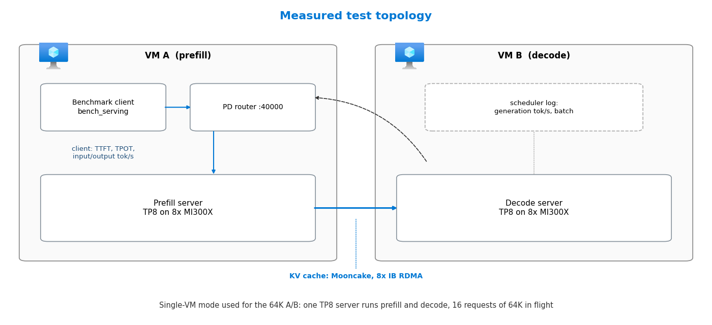
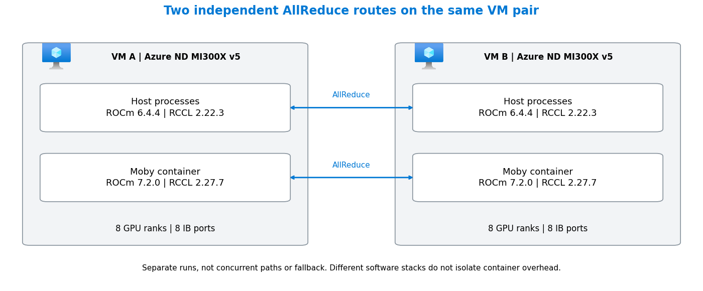

# Measured Results

[中文](results_CN.md) · [README](../README.md) · [Optimizations](optimizations.md) · [Deployment](deployment.md) · [Measure and verify](benchmark.md) · [Reference](reference.md) · **Results**

Every measurement behind the numbers in the README: the test setup, the overall gain, each run's question, recorded input, controlled variables, result and boundary, and the separate RCCL communication runs. Inference and RCCL are independent experiments and cannot be combined into one throughput measurement.

## Test setup



The stage pair and the concurrency ladder ran on two ND MI300X v5 VMs: VM A hosts the prefill server (TP8), the PD router and the benchmark client; VM B hosts the decode server (TP8); the KV cache moves from prefill to decode through Mooncake over eight InfiniBand ports. Client metrics (TTFT, TPOT, input and output tokens per second) are taken by `sglang.bench_serving` on VM A. The 64K A/B ran on one VM with a single TP8 server doing both prefill and decode, measured from the scheduler log.

## Measurements on MI300X

How much faster the optimized stack is than the baseline stack, measured on MI300X against MI300X itself:

<!-- BEGIN GENERATED: cumulative -->
| Measured on MI300X | Before → after | Factor |
|---|---|---:|
| Decode graph capture, one switch<br>16K/1K, 16 in flight, baseline stack | 107.4 → 334.0 tok/s | **3.11×** |
| 128K prefill, 1 request, 8 GPUs<br>one VM → 1P1D prefill server | 6,915 → 16,390 tok/s | **2.37×** |
| Decode time per token, 64 in flight<br>MTP at fixed acceptance 3, lower is better | 45.86 → 17.00 ms | **2.70×** |
| Decode time per token, 64 in flight<br>MTP at actual acceptance, lower is better | 45.86 → 30.07 ms | **1.53×** |
| 64K prefill, 4 in flight<br>baseline prompts averaged 60,610 tokens | 13,919 → 19,023 tok/s | **1.37×** |
| 8K prefill, 4 in flight<br>baseline prompts averaged 7,792 tokens | 16,644 → 20,781 tok/s | **1.25×** |
<!-- END GENERATED: cumulative -->

<!-- BEGIN GENERATED: glance -->
- Single optimizations on an otherwise fixed stack: decode at 64K context **+25.65%** from the block-scale FP8 GEMM and unified-verify switches (in-session A/B); 8K prefill **+24.32%** from a shape-tuned fused-MoE table ([details](#what-single-optimizations-added)).
- The factors do not multiply: each row compares a different pair of runs. Workload and topology of every row are in [Baseline to optimized stack](#baseline-to-optimized-stack-the-cumulative-gain). No performance number compares MI300X with another accelerator.
<!-- END GENERATED: glance -->

The framework/workload concepts and CUDA counterparts on the cards in [How the optimizations work](optimizations.md) are adaptation guidance, not measured NVIDIA portability or performance.

## Measured Results on MI300X

Every number compares MI300X with MI300X. Read this section top-down: first the total gain from the baseline stack to the optimized stack, then what single optimizations added, then the detail of each comparison. The FP8 KV cache was on in the optimized runs, and the captured environment of the stage-pair runs shows INT8 Quick Reduce on. Both are lossy, and their accuracy effect is not measured here; see [Which optimizations can change model output](optimizations.md#which-optimizations-can-change-model-output).

### Baseline to optimized stack: the cumulative gain

**Question.** With every optimization on, how much faster is the same model on the same MI300X VMs than on the first stack that served it?

**Input.** Baseline stack, the first configuration that served the model: SGLang v0.5.11 with Triton FP8 GEMM, no speculative decoding and the default KV cache type. Its decode and 128K prefill points used Triton attention; its 8K/64K prefill points already used AITER attention. Its 128K prefill point ran on one VM; all its other points ran on the same two-VM 1P1D layout as the optimized runs. Optimized stack: the stack of the [stage pair](#stage-pair-shape-tuned-fused-moe-table) below, with AITER attention, the CK FP8 GEMM, FP8 KV, EAGLE MTP, the tuned fused-MoE table and 1P1D over eight InfiniBand ports. The one-switch row compares two runs of the baseline stack in the same session.

The factors of this comparison are in the table at the top of the page.

The decode factor depends strongly on how often MTP draft tokens are accepted. The optimized throughput runs fixed the acceptance at three tokens per step, which is favorable. A related run on an older build of the same stack, with the acceptance the draft model actually achieved on the same random prompts, gives a reference point. Both are shown per point ("Actual MTP" and "Fixed MTP 3"; the factor under each value is against the baseline):

<!-- BEGIN GENERATED: cumulative-decode -->
| Metric | Baseline<br>16K in | Actual<br>MTP | Fixed<br>MTP 3 |
|---|---:|---:|---:|
| TPOT ms<br>at 32 | 29.41 | 23.20<br>1.27× | 13.65<br>2.15× |
| TPOT ms<br>at 64 | 45.86 | 30.07<br>1.53× | 17.00<br>2.70× |
| tok/s<br>at 32 | 658 | 1,238<br>1.88× | 1,936<br>2.94× |
| tok/s<br>at 64 | 1,396 | 1,645<br>1.18× | 2,458<br>1.76× |
<!-- END GENERATED: cumulative-decode -->

**Boundary.** This is a before/after, not an A/B: kernels, library versions and launch settings changed together, so the factors belong to the whole stack, not to one change. The baseline decode used 16K input tokens and the optimized runs 8K. A shorter context makes each decode step cheaper, so part of the decode factor comes from the workload, not the stack. The actual-acceptance run used an earlier AITER build without the tuned fused-MoE table and without unified verify, and random prompts are hard to draft, so it says little about acceptance on real traffic. The baseline 8K and 64K prompts averaged 7,792 and 60,610 tokens against exactly 8,192 and 65,536 in the optimized runs, so those two factors are approximate. The baseline 128K point ran on one VM with prefill and decode in one server, the optimized point on the prefill server of 1P1D; both prefill on 8 GPUs. The baseline decode and 128K values come from a summary report; the graph-capture pair and the baseline 8K/64K prefill points are raw client output. The baseline client stopped requests at about 340 of 1,024 output tokens, so the graph-capture factor compares those two runs with each other only. Sources and hashes are in [`evidence/runs.json`](../evidence/runs.json) and [`evidence/raw-manifest.json`](../evidence/raw-manifest.json).

### What single optimizations added

Each row isolates one change on an otherwise fixed stack. An A/B changes named switches inside one session. A stage pair repeats the same captured launch and benchmark scripts before and after one library update. These runs fixed MTP acceptance at three draft tokens, so read them as relative gains, not as production throughput. The first row is scheduler generation throughput; the other two are client-side input and output throughput.

**Input.** Each row names its workload, concurrency and topology; the full input of each comparison is in its own section below.

<!-- BEGIN GENERATED: headline -->
| What changed | Before → after (tok/s) | Change |
|---|---|---:|
| CK FP8 GEMM + unified verify<br>64K/1K decode, batch 16, one VM<br>*A/B, two switches, N=2* | 743 → 934 | **+25.65%** |
| Tuned fused-MoE table<br>8K prefill, concurrency 4, 1P1D<br>*stage pair, N=1* | 16,716 → 20,781 | **+24.32%** |
| Tuned fused-MoE table<br>8K/1K decode, concurrency 128, 1P1D<br>*stage pair, N=1* | 2,209 → 2,487 | **+12.56%** |
<!-- END GENERATED: headline -->

**Boundary.** Each gain belongs to the change named in its row, on the stack it was measured on. The rows were measured on different stacks and workloads, so they do not multiply into the cumulative factors above.

### Controlled A/B: block-scale FP8 GEMM path at 64K context

**Question.** On one MI300X VM, how much steady-state decode throughput does the final GEMM and verify path add at long context?

**Input.** Each request carries exactly 65,536 input token IDs and generates 1,024 tokens; 16 requests are in flight so the scheduler holds a batch of 16. MTP runs with a fixed acceptance of three draft tokens (`SGLANG_SIMULATE_ACC_LEN=3`, `SGLANG_SIMULATE_ACC_METHOD=match-expected`). The KV pool is enlarged with `--mem-fraction-static 0.95` so that sixteen 64K contexts fit at once. Throughput is the scheduler's generation rate while all 16 requests are running; the first full-batch sample of each run is the prefill-to-decode transition and is excluded by a rule fixed before the runs.

**What varied.** Two environment variables, switched together: the optimized arm adds `SGLANG_USE_AITER_CK_BLOCKSCALE_BPRESHUFFLE=1` and `SGLANG_AITER_UNIFIED_VERIFY=1`. Host, container, image, model, flags, benchmark command and KV setting are identical, each arm gets two fresh-service runs, and the two arms ran back-to-back.

<!-- BEGIN GENERATED: ab-table -->
| Arm | Run 1, run 2 | Mean |
|---|---:|---:|
| Baseline | 740.29, 745.95 | 743.12 |
| Optimized | 931.58, 935.92 | 933.75 |
| Change |  | **+25.65%** |
<!-- END GENERATED: ab-table -->

The two runs of each arm agree within 1%, so the difference is far outside run-to-run noise. Both arms in scheduler generation tokens per second. Dividing the batch by the throughput gives the time each of the 16 requests waits per token:

<!-- BEGIN GENERATED: ab-tpot -->
| Arm | Implied TPOT (ms) |
|---|---:|
| Baseline | 21.53 |
| Optimized | 17.14 |
| Change | **-20.42%** |
<!-- END GENERATED: ab-tpot -->

The implied TPOT is `1000 × 16 / tok/s`, not a client-measured latency.

**Boundary.** The two variables were switched together, so the gain belongs to the pair, not to either flag alone. The run is single-VM with prefill and decode in one server; it says nothing about PD deployments. The raw samples are in [`evidence/raw/ab-64k-bs16.json`](../evidence/raw/ab-64k-bs16.json) and trace back to the audit file whose SHA-256 is recorded there.

### Stage pair: shape-tuned fused-MoE table

**Question.** In the two-VM PD deployment, what did the MiMo-specific fused-MoE tuning table change?

**Input.** Prefill: random prompts of 8,192 or 65,536 tokens, output 1 token, 16 prompts at concurrency 4, one warmup request, cache flushed, seed 12345. Decode: random prompts of 8,192 tokens with 1,024 output tokens, 256 prompts at concurrency 16 to 128, 32 warmup requests, cache flushed, seed 12345. The exact client arguments of every run are kept in [`evidence/raw/`](../evidence/raw/).

**What varied.** AITER moved from `fc96a4f` to a build that adds the tuned table from [`d725746`](https://github.com/sammysun0711/aiter/commit/d725746a0f8c233d8e46e2771a7c8dbcd06e40d9) (the served CSV has the same SHA-256 as the file in that commit). The prefill launch script, the router script and both benchmark scripts have the same SHA-256 in both runs, and the captured environment lines of the decode server match. The full decode launch script was hashed only in the after run, and the sglang commit only in the before run, so the attribution to the table is strong but not proven by an in-session A/B.

Prefill, measured at the client (throughput rounded to whole tokens; exact values in `evidence/measurements.json`):

<!-- BEGIN GENERATED: stage-prefill -->
| Input tokens | tok/s<br>before → after | Change |
|---:|---:|---:|
| 8,192 | 16,716 → 20,781 | **+24.32%**<br>TTFT -15.15% |
| 65,536 | 17,254 → 19,023 | **+10.25%**<br>TTFT -9.36% |
<!-- END GENERATED: stage-prefill -->

Decode, same runs:

<!-- BEGIN GENERATED: stage-decode -->
| Concurrency | tok/s<br>before → after | Change |
|---:|---:|---:|
| 16 | 1,299 → 1,332 | **+2.52%**<br>TPOT +1.79% |
| 32 | 1,911 → 1,936 | **+1.33%**<br>TPOT +1.11% |
| 64 | 2,188 → 2,458 | **+12.33%**<br>TPOT +12.58% |
| 128 | 2,209 → 2,487 | **+12.56%**<br>TPOT +14.05% |
<!-- END GENERATED: stage-decode -->

Prefill gains come with shorter time to first token. At decode concurrency 64 and 128 the table raises output throughput by about an eighth while TPOT rises by a similar amount: the server holds more requests per step, so each request waits a little longer per token but the batch as a whole finishes sooner.

**Boundary.** Each point is one run before and one run after, not an interleaved A/B. The 256K prefill point is excluded from both runs: with `--context-length 262144`, a 262,144-token prompt plus MiMo's special tokens does not fit, and the server can answer with error payloads that the client still counts as successes. A separate attempt to measure the same table with `AITER_BYPASS_TUNE_CONFIG=1` as the baseline hit a GPU memory fault at 64K and was rejected, so no in-session A/B of this table exists.

### Where decode saturates: concurrency ladder

**Question.** Past which client concurrency does the 1P1D decode path stop gaining throughput, and what does extra concurrency cost?

**Input.** The same 8K-in / 1K-out decode workload and stack as the before run above, 256 prompts per point, client concurrency 16 to 256.

<!-- BEGIN GENERATED: ladder -->
| In flight<br>(observed) | Output<br>tok/s | TPOT<br>(ms) | TTFT (s)<br>mean / P99 |
|---:|---:|---:|---:|
| 16<br>(15.8) | 1,322 | 10.79 | 1.2 / 7.1 |
| 32<br>(30.9) | 1,914 | 13.37 | 2.8 / 14.1 |
| 64<br>(59.5) | 2,199 | 15.49 | 11.9 / 27.6 |
| 96<br>(84.0) | 2,201 | 15.06 | 23.7 / 40.8 |
| 128<br>(104.6) | 2,204 | 14.83 | 33.4 / 54.4 |
| 192<br>(135.4) | 2,203 | 14.72 | 47.9 / 81.3 |
| 256<br>(151.8) | 2,208 | 14.60 | 55.5 / 107.3 |
<!-- END GENERATED: ladder -->

Throughput reaches its plateau at concurrency 64. Above that, TPOT stays flat while mean and P99 time to first token keep growing: additional requests wait longer before their first token instead of adding throughput. The observed concurrency (in brackets, the client's time-averaged number of requests in flight) also stops following the configured value. That is consistent with the server's running-request limit and KV capacity taking over, but these runs have no scheduler trace to confirm it.

**Boundary.** One run per point on the stack before the tuned MoE table. The saturation point moves with context length, KV capacity and `--max-running-requests`, so measure it again for any other configuration.

### How throughput changes with context length

**Question.** On the optimized PD stack, how do prefill speed and the decode batch change as the context grows from 8K to 256K tokens?

**Input.** Two VMs in 1P1D with the image of the optimized stack and `--context-length 262151`. Prefill: random prompts with one output token, 16 requests per point, client concurrency 1 to 8; the 256K points send exact token IDs. Decode: 1,024 output tokens with MTP at a fixed acceptance of 3. The decode batch and the generation rate come from the decode server's scheduler log (`#running-req`), not from the client. The table lists prefill at one request and decode at the highest client concurrency measured for that length; the decode columns show the batch the server actually ran and its total generation rate, and that rate divided by the batch.

<!-- BEGIN GENERATED: context-table -->
| Input | Prefill tok/s<br>1 request | Decode batch<br>steady / peak | Decode tok/s<br>total / each |
|---|---:|---:|---:|
| 8K | 16,835 | 51 / 54<br>128 in flight | 2,333<br>45.8 |
| 64K | 18,057 | 4 / 5<br>96 in flight | 288<br>71.9 |
| 128K | 16,390 | 1 / 1<br>32 in flight | 138<br>138.2 |
| 192K | 13,827 | 1 / 1<br>16 in flight | 125<br>125.0 |
| 256K | 12,632 | 1 / 1<br>4 in flight | 128<br>127.8 |
<!-- END GENERATED: context-table -->

Prefill holds between about 12,600 and 18,100 input tokens per second across the whole range, so one 256K prompt is ready in about 21 seconds. Decode behaves differently. At 64K the decode server keeps only 4 to 5 requests running with 96 in flight, and from 128K on it runs one request at a time, even with 32 in flight. Each request still decodes quickly, 125 to 140 tokens per second, but the server's total falls from about 2,300 tokens per second at 8K to about 130. At long context the KV pool, not kernel speed, sets the throughput; see [Sizing the decode batch from KV capacity](optimizations.md#sizing-the-decode-batch-from-kv-capacity).

**Boundary.** The 8K and 64K rows come from one measurement series and the 128K to 256K rows from a second one on the same image; every point is a single run. The 256K prefill point with four requests in flight was rejected after two service lifecycles hit GPU memory-access faults, so no value is reported for it. The 256K decode row uses 261,120 input tokens so that the 1,024 output tokens still fit the context. Decode ran at a fixed MTP acceptance of 3, which is favorable.

### Adding a second prefill replica

**Question.** When prefill is the bottleneck, how much does a second complete TP8 server behind the same router add?

**Input.** Two replicas: two VMs, each running one ordinary TP8 server of the optimized stack (no PD mode), both registered with one `sglang_router` using round-robin; 32 requests per point. One server: the prefill server of the 1P1D deployment in the same measurement series; 16 requests per point. Random prompts with one output token in both. The table compares one and two requests in flight on each.

<!-- BEGIN GENERATED: replicas-table -->
| Input tokens | One server<br>1 → 2 in flight | Two replicas<br>1 → 2 in flight |
|---:|---:|---:|
| 8,192 | 16,835 → 19,618<br>1.17× | 20,752 → 41,202<br>**1.99×** |
| 65,536 | 18,057 → 19,860<br>1.10× | 19,695 → 38,984<br>**1.98×** |
| 262,144 | 12,382 → 12,378<br>1.00× | 12,783 → 25,064<br>**1.96×** |
<!-- END GENERATED: replicas-table -->

One server gains 0% to 17% from a second request in flight, because both requests share the same eight GPUs. Two replicas nearly double, because the second request lands on the idle replica; time to first token stays where it was (3.33 s and 3.35 s at 64K). Going further, to 8 or 16 in flight, adds at most 13% more (8K) and nothing at 64K and 256K.

**Boundary.** This measures prefill capacity with output length 1. The replicas were plain servers and the single-server reference was a PD prefill server, so the two columns differ in serving mode as well as in replica count. It is not a 2P1D result: no decode server and no KV transfer were in the loop. Each point is one run.

### Accuracy measured on the optimized kernels

**Question.** With the optimized kernels and real MTP acceptance, does the model still answer public benchmarks correctly?

**Input.** Two VMs, each running one independent TP8 server (prefill and decode in one server) with the kernels of the optimized stack: AITER attention, the CK block-scale FP8 GEMM, the tuned fused-MoE table (hash-checked before start) and multi-layer EAGLE MTP at the acceptance the draft model actually achieves (the fixed-acceptance variables are unset and checked). FP8 weights, KV cache at the model's default precision (no `--kv-cache-dtype`), page size 1, 1M context. AIME runs at temperature 1.0, top-p 0.95 and up to 65,536 tokens with thinking on; the other five run at temperature 0 and up to 16,384 tokens. Each benchmark was scored on its first questions in their original order, with the number of passes shown. A response that hit the token limit empty counts as wrong.

<!-- BEGIN GENERATED: accuracy-table -->
| Benchmark | Scored | Accuracy |
|---|---|---:|
| AIME24_25 | first 16 questions × 1 pass | **100.00%**<br>16 / 16 |
| CMMLU | first 128 questions × 3 passes | **89.84%**<br>345 / 384 |
| MinervaMath | first 1,536 questions × 3 passes | **97.61%**<br>4,498 / 4,608 |
| MMLU-Pro | first 512 questions × 2 passes | **89.36%**<br>915 / 1,024 |
| MMLU-Redux | first 512 questions × 3 passes | **96.22%**<br>1,478 / 1,536 |
| SuperGPQA | first 512 questions × 1 pass | **70.31%**<br>360 / 512 |
<!-- END GENERATED: accuracy-table -->

**Boundary.** These are absolute scores on subsets (3,216 questions and 8,080 scored responses in total), not an A/B. No run with the optimizations off was scored, so the table shows that the optimized kernels and real-acceptance MTP produce sound answers, not that they change nothing. Two lossy switches are not covered: the FP8 KV cache was off, and the effective Quick Reduce setting was not recorded (the launcher did not set it; the base image exports INT8). The first questions of a benchmark can be easier or harder than the whole set, and 16 AIME questions say little on their own. Check FP8 KV and Quick Reduce with the [lossy-switch procedure](benchmark.md#check-a-lossy-switch-on-your-model).

### What is not measured here

Decode graph capture was measured only on the baseline stack, without MTP and the AITER kernels; its share in the optimized stack is not isolated. The FlyDSL paged-attention decode kernel, the vectorized 5D KV layout, page 64 and the head-192 prefill tile are part of the final pinned runtime, but no published Microsoft run isolates them, so this page reports no speed-up for them. Their code changes are explained in [The Three Optimization Layers](optimizations.md#the-three-optimization-layers); measuring them follows the same A/B method on the single-VM profile.

## Serving run inputs and provenance

<!-- BEGIN GENERATED: run-inputs -->
### MoE tuning: before (S1)

**Question.** What does the recorded moe tuning: before establish?

**Recorded input.** `--tp-size 8 --attention-backend aiter --kv-cache-dtype fp8_e4m3 --page-size 32 --chunked-prefill-size 32768 --context-length 262144 --max-running-requests 128 --mem-fraction-static 0.85 --disable-radix-cache --disable-overlap-schedule --speculative-algorithm EAGLE --speculative-num-steps 3 --speculative-eagle-topk 1 --speculative-num-draft-tokens 4 --enable-multi-layer-eagle; the prefill server adds --disable-cuda-graph --disaggregation-mode prefill, the decode server --disaggregation-mode decode, both --disaggregation-transfer-backend mooncake`

**Variables.** Use the topology, runtime, flags and environment for `stage-before-moe-table` in [the frozen run catalog](../evidence/runs.json), not another bundle's configuration.

**Result.** [stage-before-moe-table__decode-8k1k.txt](../evidence/raw/stage-before-moe-table__decode-8k1k.txt), [stage-before-moe-table__prefill.txt](../evidence/raw/stage-before-moe-table__prefill.txt). [Stage pair: shape-tuned fused-MoE table](#stage-pair-shape-tuned-fused-moe-table) derives its values from these records.

**Boundary.** A public projection supports the retained values, not a byte-for-byte rerun of missing private input. Replaying evidence is not a fresh serving experiment.

### MoE tuning: after (S2)

**Question.** What does the recorded moe tuning: after establish?

**Recorded input.** `same as stage-before-moe-table`

**Variables.** Use the topology, runtime, flags and environment for `stage-after-moe-table` in [the frozen run catalog](../evidence/runs.json), not another bundle's configuration.

**Result.** [stage-after-moe-table__decode-8k1k-c16.txt](../evidence/raw/stage-after-moe-table__decode-8k1k-c16.txt), [stage-after-moe-table__decode-8k1k-c32.txt](../evidence/raw/stage-after-moe-table__decode-8k1k-c32.txt), [stage-after-moe-table__decode-8k1k-c64.txt](../evidence/raw/stage-after-moe-table__decode-8k1k-c64.txt), [stage-after-moe-table__decode-8k1k-c128.txt](../evidence/raw/stage-after-moe-table__decode-8k1k-c128.txt), [stage-after-moe-table__prefill-8192-c4.txt](../evidence/raw/stage-after-moe-table__prefill-8192-c4.txt), [stage-after-moe-table__prefill-65536-c4.txt](../evidence/raw/stage-after-moe-table__prefill-65536-c4.txt), [stage-after-moe-table__prefill-262144-c4.txt](../evidence/raw/stage-after-moe-table__prefill-262144-c4.txt). [Stage pair: shape-tuned fused-MoE table](#stage-pair-shape-tuned-fused-moe-table) derives its values from these records.

**Boundary.** A public projection supports the retained values, not a byte-for-byte rerun of missing private input. Replaying evidence is not a fresh serving experiment.

### Decode concurrency ladder (S3)

**Question.** What does the recorded decode concurrency ladder establish?

**Recorded input.** The complete shell invocation was not captured in this bundle; the linked public record retains its available workload/configuration fields.

**Variables.** Use the topology, runtime, flags and environment for `ladder-ck` in [the frozen run catalog](../evidence/runs.json), not another bundle's configuration.

**Result.** [ladder-ck__decode-8k1k-c16.txt](../evidence/raw/ladder-ck__decode-8k1k-c16.txt), [ladder-ck__decode-8k1k-c32.txt](../evidence/raw/ladder-ck__decode-8k1k-c32.txt), [ladder-ck__decode-8k1k-c64.txt](../evidence/raw/ladder-ck__decode-8k1k-c64.txt), [ladder-ck__decode-8k1k-c96.txt](../evidence/raw/ladder-ck__decode-8k1k-c96.txt), [ladder-ck__decode-8k1k-c128.txt](../evidence/raw/ladder-ck__decode-8k1k-c128.txt), [ladder-ck__decode-8k1k-c192.txt](../evidence/raw/ladder-ck__decode-8k1k-c192.txt), [ladder-ck__decode-8k1k-c256.txt](../evidence/raw/ladder-ck__decode-8k1k-c256.txt). [Where decode saturates: concurrency ladder](#where-decode-saturates-concurrency-ladder) derives its values from these records.

**Boundary.** A public projection supports the retained values, not a byte-for-byte rerun of missing private input. Replaying evidence is not a fresh serving experiment.

### Two-switch 64K A/B (S4)

**Question.** What does the recorded two-switch 64k a/b establish?

**Recorded input.** The complete shell invocation was not captured in this bundle; the linked public record retains its available workload/configuration fields.

**Variables.** Use the topology, runtime, flags and environment for `ab-64k-bs16` in [the frozen run catalog](../evidence/runs.json), not another bundle's configuration.

**Result.** [ab-64k-bs16.json](../evidence/raw/ab-64k-bs16.json). [Controlled A/B: block-scale FP8 GEMM path at 64K context](#controlled-ab-block-scale-fp8-gemm-path-at-64k-context) derives its values from these records.

**Boundary.** A public projection supports the retained values, not a byte-for-byte rerun of missing private input. Replaying evidence is not a fresh serving experiment.

### Graph capture A/B (S5)

**Question.** What does the recorded graph capture a/b establish?

**Recorded input.** The complete shell invocation was not captured in this bundle; the linked public record retains its available workload/configuration fields.

**Variables.** Use the topology, runtime, flags and environment for `baseline-pd-client` in [the frozen run catalog](../evidence/runs.json), not another bundle's configuration.

**Result.** [baseline-pd-client.json](../evidence/raw/baseline-pd-client.json). [Baseline to optimized stack: the cumulative gain](#baseline-to-optimized-stack-the-cumulative-gain) derives its values from these records.

**Boundary.** A public projection supports the retained values, not a byte-for-byte rerun of missing private input. Replaying evidence is not a fresh serving experiment.

### Baseline stack (S6)

**Question.** What does the recorded baseline stack establish?

**Recorded input.** The complete shell invocation was not captured in this bundle; the linked public record retains its available workload/configuration fields.

**Variables.** Use the topology, runtime, flags and environment for `baseline-pd-summary` in [the frozen run catalog](../evidence/runs.json), not another bundle's configuration.

**Result.** [baseline-pd-summary.json](../evidence/raw/baseline-pd-summary.json). [Baseline to optimized stack: the cumulative gain](#baseline-to-optimized-stack-the-cumulative-gain) derives its values from these records.

**Boundary.** A public projection supports the retained values, not a byte-for-byte rerun of missing private input. Replaying evidence is not a fresh serving experiment.

### Actual MTP acceptance (S7)

**Question.** What does the recorded actual mtp acceptance establish?

**Recorded input.** `--tp-size 8 --attention-backend aiter --kv-cache-dtype fp8_e4m3 --page-size 32 --chunked-prefill-size 16384 --context-length 262144 --max-running-requests 128 --mem-fraction-static 0.85 --disable-radix-cache --disable-overlap-schedule --speculative-algorithm EAGLE --speculative-num-steps 3 --speculative-eagle-topk 1 --speculative-num-draft-tokens 4 --enable-multi-layer-eagle`

**Variables.** Use the topology, runtime, flags and environment for `actual-acceptance` in [the frozen run catalog](../evidence/runs.json), not another bundle's configuration.

**Result.** [actual-acceptance__decode-8k1k-c16.txt](../evidence/raw/actual-acceptance__decode-8k1k-c16.txt), [actual-acceptance__decode-8k1k-c32.txt](../evidence/raw/actual-acceptance__decode-8k1k-c32.txt), [actual-acceptance__decode-8k1k-c64.txt](../evidence/raw/actual-acceptance__decode-8k1k-c64.txt), [actual-acceptance__decode-8k1k-c128.txt](../evidence/raw/actual-acceptance__decode-8k1k-c128.txt). [Baseline to optimized stack: the cumulative gain](#baseline-to-optimized-stack-the-cumulative-gain) derives its values from these records.

**Boundary.** A public projection supports the retained values, not a byte-for-byte rerun of missing private input. Replaying evidence is not a fresh serving experiment.

### Context-length sweep (S8)

**Question.** What does the recorded context-length sweep establish?

**Recorded input.** The complete shell invocation was not captured in this bundle; the linked public record retains its available workload/configuration fields.

**Variables.** Use the topology, runtime, flags and environment for `context-matrix` in [the frozen run catalog](../evidence/runs.json), not another bundle's configuration.

**Result.** [context-matrix.json](../evidence/raw/context-matrix.json). [How throughput changes with context length](#how-throughput-changes-with-context-length) derives its values from these records.

**Boundary.** A public projection supports the retained values, not a byte-for-byte rerun of missing private input. Replaying evidence is not a fresh serving experiment.

### Prefill replicas (S9)

**Question.** What does the recorded prefill replicas establish?

**Recorded input.** The complete shell invocation was not captured in this bundle; the linked public record retains its available workload/configuration fields.

**Variables.** Use the topology, runtime, flags and environment for `prefill-replicas` in [the frozen run catalog](../evidence/runs.json), not another bundle's configuration.

**Result.** [prefill-replicas.json](../evidence/raw/prefill-replicas.json). [Adding a second prefill replica](#adding-a-second-prefill-replica) derives its values from these records.

**Boundary.** A public projection supports the retained values, not a byte-for-byte rerun of missing private input. Replaying evidence is not a fresh serving experiment.

### Public accuracy subsets (S10)

**Question.** What does the recorded public accuracy subsets establish?

**Recorded input.** `--tp-size 8 --attention-backend aiter --quantization fp8 --page-size 1 --mem-fraction-static 0.8 --max-running-requests 128 --context-length 1048576 --speculative-algorithm EAGLE --speculative-num-steps 3 --speculative-eagle-topk 1 --speculative-num-draft-tokens 4 --enable-multi-layer-eagle --reasoning-parser qwen3; no --kv-cache-dtype, so the KV cache stays at the model's default precision`

**Variables.** Use the topology, runtime, flags and environment for `accuracy-subset` in [the frozen run catalog](../evidence/runs.json), not another bundle's configuration.

**Result.** [accuracy-subset.json](../evidence/raw/accuracy-subset.json). [Accuracy measured on the optimized kernels](#accuracy-measured-on-the-optimized-kernels) derives its values from these records.

**Boundary.** A public projection supports the retained values, not a byte-for-byte rerun of missing private input. Replaying evidence is not a fresh serving experiment.
<!-- END GENERATED: run-inputs -->

## Independent RCCL communication validation

The host route and container route ran on the same two MI300X VMs. They used different ROCm/RCCL and test builds, so their difference does not isolate container overhead. AllReduce does not load model weights and does not measure model throughput. The source revision is in the [ROCm monorepo](https://github.com/ROCm/rocm-systems/tree/1284e5da11f7904e8a6efd902b9de52253785bd0/projects/rccl-tests).

Moby is the installed container-engine package, not the test image. The test used the public `rocm/sgl-dev` base, not a customer-provided image or the complete serving image. ROCm 6.4.4 on the host and 7.2.0 in the container are reported user-space stacks; the amdgpu kernel-module version was not independently captured.



Original explanatory diagram based on the run catalog, not a screenshot or proof of runtime traffic.

The primary container sweep inherited NCCL_MIN_NCHANNELS=112 on local ranks but not on SSH-started remote ranks. Separate uniform-setting controls are recorded below. Completed sweeps do not establish long-term stability.

<!-- BEGIN GENERATED: rccl-observation -->
**Initialization observation:** 1 recorded attempt failed inside rocm_smi; 6 subsequent targeted retries completed. The root cause is **NOT_CONFIRMED**. These observations establish neither a failure rate nor a fix. [Diagnostic excerpts](../evidence/rccl/initialization-observation.txt).
<!-- END GENERATED: rccl-observation -->

The [repackaged build recipe](../docker/rccl.Dockerfile) fetches this public source rather than the author's built directory. Its source inputs resolve, but its build and GPU replay are NOT_RUN; the [build-status record](../evidence/rccl/build-status.json) separates that packaging from the captured measurements.

<!-- BEGIN GENERATED: rccl-runs -->
### Host AllReduce

**Question.** Does a completed container run remain in the same bandwidth range as the host run?

**Recorded input.** The following is the recorded MPI invocation with node addresses and the executable path replaced by variables; the other arguments are unchanged.

```bash
mpirun -np 16 -H ${NODE_A}:8,${NODE_B}:8 \
  -map-by ppr:8:node --bind-to numa \
  -x NCCL_IB_HCA=^mlx5_8:1,mlx5_an0:1 \
  -x NCCL_IB_PCI_RELAXED_ORDERING=1 \
  -x NCCL_DEBUG=VERSION \
  --mca pml ucx --mca btl '^vader,tcp,openib,uct' \
  -x PATH -x LD_LIBRARY_PATH \
  "${RCCL_BIN}" -g 1 -f 2 -b 1G -e 16G -c 0 -n 50 -w 20 < /dev/null
```

**Variables.** 2 VM(s), 16 ranks, float/sum; 50 timed iterations, 20 warmups, validation=0. Different ROCm/RCCL and test builds; not an isolated container-overhead experiment. Each arm is one sweep, not a repeatability estimate.

**Observed result.**

| Message (GiB) | Out-of-place<br>GB/s | In-place<br>GB/s |
|---:|---:|---:|
| 1 | 348.00 | 348.10 |
| 2 | 351.05 | 351.10 |
| 4 | 353.16 | 356.18 |
| 8 | 357.78 | 357.75 |
| 16 | 361.31 | 361.27 |

Reported average: **354.57 GB/s** across both modes and all sizes. Data check: **NOT_RUN**. INFO markers: IB=0, Socket=0, GDRDMA=0.

**Boundary.** Zero INFO markers in a VERSION-only log mean not captured, not absence of RDMA. busbw is normalized collective bandwidth, not measured NIC utilization or model throughput. [Numeric projection](../evidence/rccl/raw/host-performance.txt); [source hashes and conditions](../evidence/rccl/runs.json).

### Moby container AllReduce

**Question.** Does a completed container run remain in the same bandwidth range as the host run?

**Recorded input.** The following is the recorded MPI invocation with node addresses and the executable path replaced by variables; the other arguments are unchanged.

```bash
mpirun --allow-run-as-root -np 16 -H ${NODE_A}:8,${NODE_B}:8 \
  -map-by ppr:8:node --bind-to numa \
  -x NCCL_IB_HCA=^mlx5_8:1,mlx5_an0:1 \
  -x NCCL_IB_PCI_RELAXED_ORDERING=1 \
  -x NCCL_DEBUG=VERSION \
  --mca pml ucx --mca btl '^vader,tcp,openib,uct' \
  --mca plm_rsh_args "-p 2222" \
  -x PATH -x LD_LIBRARY_PATH \
  "${RCCL_BIN}" -g 1 -f 2 -b 1G -e 16G -c 0 -n 50 -w 20
```

**Variables.** 2 VM(s), 16 ranks, float/sum; 50 timed iterations, 20 warmups, validation=0. One completed sweep; image-default NCCL_MIN_NCHANNELS reached local ranks only. Each arm is one sweep, not a repeatability estimate.

**Observed result.**

| Message (GiB) | Out-of-place<br>GB/s | In-place<br>GB/s |
|---:|---:|---:|
| 1 | 354.72 | 354.74 |
| 2 | 357.77 | 357.47 |
| 4 | 357.53 | 357.56 |
| 8 | 362.15 | 362.08 |
| 16 | 364.28 | 364.10 |

Reported average: **359.24 GB/s** across both modes and all sizes. Data check: **NOT_RUN**. INFO markers: IB=0, Socket=0, GDRDMA=0.

**Boundary.** Zero INFO markers in a VERSION-only log mean not captured, not absence of RDMA. busbw is normalized collective bandwidth, not measured NIC utilization or model throughput. [Numeric projection](../evidence/rccl/raw/container-performance.txt); [source hashes and conditions](../evidence/rccl/runs.json).

### Container correctness and transport

**Question.** Are the collective results correct, and does every rank select IB?

**Recorded input.** The following is the recorded MPI invocation with node addresses and the executable path replaced by variables; the other arguments are unchanged.

```bash
mpirun --allow-run-as-root -np 16 -H ${NODE_A}:8,${NODE_B}:8 \
  -map-by ppr:8:node --bind-to numa \
  -x NCCL_IB_HCA=^mlx5_8:1,mlx5_an0:1 \
  -x NCCL_IB_PCI_RELAXED_ORDERING=1 \
  -x NCCL_DEBUG=INFO -x NCCL_DEBUG_SUBSYS=INIT,NET \
  --mca pml ucx --mca btl '^vader,tcp,openib,uct' \
  --mca plm_rsh_args "-p 2222" \
  -x PATH -x LD_LIBRARY_PATH \
  "${RCCL_BIN}" -g 1 -f 2 -b 1G -e 16G -c 1 -n 20 -w 5
```

**Variables.** 2 VM(s), 16 ranks, float/sum; 20 timed iterations, 5 warmups, validation=1. Validation and INFO logging use a separate run, not the headline performance run. Each arm is one sweep, not a repeatability estimate.

**Observed result.**

| Message (GiB) | Out-of-place<br>GB/s | In-place<br>GB/s |
|---:|---:|---:|
| 1 | 337.40 | 337.27 |
| 2 | 345.16 | 345.23 |
| 4 | 348.32 | 347.93 |
| 8 | 347.20 | 346.91 |
| 16 | 348.68 | 348.97 |

Reported average: **345.307 GB/s** across both modes and all sizes. Data check: **PASS**. INFO markers: IB=16, Socket=0, GDRDMA=472.

**Boundary.** This run positively records IB selection and GPU Direct RDMA. busbw is normalized collective bandwidth, not measured NIC utilization or model throughput. [Numeric projection](../evidence/rccl/raw/container-validation.txt); [source hashes and conditions](../evidence/rccl/runs.json).

### No IB device: Socket fallback

**Question.** Can a run finish while its RCCL traffic falls back to Socket?

**Recorded input.** The following is the recorded MPI invocation with node addresses and the executable path replaced by variables; the other arguments are unchanged.

```bash
env -u NCCL_MIN_NCHANNELS mpirun --allow-run-as-root -np 16 -H ${NODE_A}:8,${NODE_B}:8 \
  -map-by ppr:8:node --bind-to numa \
  -x NCCL_IB_HCA=^mlx5_8:1,mlx5_an0:1 \
  -x NCCL_IB_PCI_RELAXED_ORDERING=1 \
  -x NCCL_DEBUG=INFO -x NCCL_DEBUG_SUBSYS=INIT,NET --mca btl_tcp_if_include eth0 \
  --mca pml ob1 --mca btl 'self,vader,tcp' \
  --mca plm_rsh_args "-p 2222" \
  -x PATH -x LD_LIBRARY_PATH \
  "${RCCL_BIN}" -g 1 -f 2 -b 1G -e 1G -c 1 -n 5 -w 2
```

**Variables.** 2 VM(s), 16 ranks, float/sum; 5 timed iterations, 2 warmups, validation=1. MPI used TCP in both arms; one message size, not the full headline sweep. Each arm is one sweep, not a repeatability estimate.

**Observed result.**

| Message (GiB) | Out-of-place<br>GB/s | In-place<br>GB/s |
|---:|---:|---:|
| 1 | 11.17 | 11.45 |

Reported average: **11.3114 GB/s** across both modes and all sizes. Data check: **PASS**. INFO markers: IB=0, Socket=16, GDRDMA=0.

**Boundary.** This run records Socket fallback, not an IB data path. busbw is normalized collective bandwidth, not measured NIC utilization or model throughput. [Numeric projection](../evidence/rccl/raw/socket-validation.txt); [source hashes and conditions](../evidence/rccl/runs.json).

### IB device mapped: IB transport

**Question.** With the IB device visible, does RCCL choose IB and pass its data check?

**Recorded input.** The following is the recorded MPI invocation with node addresses and the executable path replaced by variables; the other arguments are unchanged.

```bash
env -u NCCL_MIN_NCHANNELS mpirun --allow-run-as-root -np 16 -H ${NODE_A}:8,${NODE_B}:8 \
  -map-by ppr:8:node --bind-to numa \
  -x NCCL_IB_HCA=^mlx5_8:1,mlx5_an0:1 \
  -x NCCL_IB_PCI_RELAXED_ORDERING=1 \
  -x NCCL_DEBUG=INFO -x NCCL_DEBUG_SUBSYS=INIT,NET --mca btl_tcp_if_include eth0 \
  --mca pml ob1 --mca btl 'self,vader,tcp' \
  --mca plm_rsh_args "-p 2222" \
  -x PATH -x LD_LIBRARY_PATH \
  "${RCCL_BIN}" -g 1 -f 2 -b 1G -e 1G -c 1 -n 5 -w 2
```

**Variables.** 2 VM(s), 16 ranks, float/sum; 5 timed iterations, 2 warmups, validation=1. Same MPI and RCCL arguments as the Socket arm, with the IB device visible. Each arm is one sweep, not a repeatability estimate.

**Observed result.**

| Message (GiB) | Out-of-place<br>GB/s | In-place<br>GB/s |
|---:|---:|---:|
| 1 | 334.35 | 336.82 |

Reported average: **335.588 GB/s** across both modes and all sizes. Data check: **PASS**. INFO markers: IB=16, Socket=0, GDRDMA=472.

**Boundary.** This run positively records IB selection and GPU Direct RDMA. busbw is normalized collective bandwidth, not measured NIC utilization or model throughput. [Numeric projection](../evidence/rccl/raw/ib-control-validation.txt); [source hashes and conditions](../evidence/rccl/runs.json).

### One VM: minimum channels 112

**Question.** What changes when the minimum-channel setting is removed on one VM?

**Recorded input.** The following is the recorded MPI invocation with node addresses and the executable path replaced by variables; the other arguments are unchanged.

```bash
env -u NCCL_MIN_NCHANNELS mpirun --allow-run-as-root -np 8 -H ${NODE_A}:8 \
  -map-by ppr:8:node --bind-to numa \
  -x NCCL_IB_HCA=^mlx5_8:1,mlx5_an0:1 \
  -x NCCL_IB_PCI_RELAXED_ORDERING=1 \
  -x NCCL_DEBUG=VERSION -x NCCL_MIN_NCHANNELS=112 \
  --mca pml ucx --mca btl '^vader,tcp,openib,uct' \
  --mca plm_rsh_args "-p 2222" \
  -x PATH -x LD_LIBRARY_PATH \
  "${RCCL_BIN}" -g 1 -f 2 -b 1G -e 16G -c 1 -n 20 -w 5
```

**Variables.** 1 VM(s), 8 ranks, float/sum; 20 timed iterations, 5 warmups, validation=1. One-VM large-message validation; not a claim about model inference throughput. Each arm is one sweep, not a repeatability estimate.

**Observed result.**

| Message (GiB) | Out-of-place<br>GB/s | In-place<br>GB/s |
|---:|---:|---:|
| 1 | 301.93 | 302.71 |
| 2 | 302.25 | 302.19 |
| 4 | 300.53 | 300.45 |
| 8 | 300.73 | 301.03 |
| 16 | 302.51 | 302.55 |

Reported average: **301.688 GB/s** across both modes and all sizes. Data check: **PASS**. INFO markers: IB=0, Socket=0, GDRDMA=0.

**Boundary.** This is intra-VM communication, not a validation of the inter-VM IB path. busbw is normalized collective bandwidth, not measured NIC utilization or model throughput. [Numeric projection](../evidence/rccl/raw/single-min-channels.txt); [source hashes and conditions](../evidence/rccl/runs.json).

### One VM: minimum channels unset

**Question.** What changes when the minimum-channel setting is removed on one VM?

**Recorded input.** The following is the recorded MPI invocation with node addresses and the executable path replaced by variables; the other arguments are unchanged.

```bash
env -u NCCL_MIN_NCHANNELS mpirun --allow-run-as-root -np 8 -H ${NODE_A}:8 \
  -map-by ppr:8:node --bind-to numa \
  -x NCCL_IB_HCA=^mlx5_8:1,mlx5_an0:1 \
  -x NCCL_IB_PCI_RELAXED_ORDERING=1 \
  -x NCCL_DEBUG=VERSION \
  --mca pml ucx --mca btl '^vader,tcp,openib,uct' \
  --mca plm_rsh_args "-p 2222" \
  -x PATH -x LD_LIBRARY_PATH \
  "${RCCL_BIN}" -g 1 -f 2 -b 1G -e 16G -c 1 -n 20 -w 5
```

**Variables.** 1 VM(s), 8 ranks, float/sum; 20 timed iterations, 5 warmups, validation=1. Same one-VM arguments, with NCCL_MIN_NCHANNELS unset. Each arm is one sweep, not a repeatability estimate.

**Observed result.**

| Message (GiB) | Out-of-place<br>GB/s | In-place<br>GB/s |
|---:|---:|---:|
| 1 | 321.74 | 321.05 |
| 2 | 321.64 | 321.33 |
| 4 | 321.38 | 321.28 |
| 8 | 321.83 | 321.76 |
| 16 | 322.58 | 322.56 |

Reported average: **321.714 GB/s** across both modes and all sizes. Data check: **PASS**. INFO markers: IB=0, Socket=0, GDRDMA=0.

**Boundary.** This is intra-VM communication, not a validation of the inter-VM IB path. busbw is normalized collective bandwidth, not measured NIC utilization or model throughput. [Numeric projection](../evidence/rccl/raw/single-auto-channels.txt); [source hashes and conditions](../evidence/rccl/runs.json).
<!-- END GENERATED: rccl-runs -->

## Limits

- `LOCAL_MEASUREMENT`: the A/B and the stage pair each cover one workload shape. Other context lengths, concurrencies and batch compositions were not measured with the same controls.
- `LOCAL_MEASUREMENT`: throughput was measured with a fixed MTP acceptance of three tokens. Real workloads accept fewer draft tokens on average, so their throughput is lower.
- `NOT_MEASURED`: the final runtime (FlyDSL decode, vectorized 5D KV, page 64, 1M context) has no Microsoft throughput run published here, and neither does the mixed-precision router GEMM.
- `NOT_MEASURED`: the accuracy effect of the lossy switches (FP8 KV cache, INT8 Quick Reduce, mixed-precision router) was not measured; the throughput runs had the first two on. [Subset accuracy of the optimized kernels](#accuracy-measured-on-the-optimized-kernels) was measured with the FP8 KV cache off. The [lossy-switch procedure](benchmark.md#check-a-lossy-switch-on-your-model) covers FP8 KV and Quick Reduce; the router change needs its own A/B on a runtime that contains commit `1f9bb2b`.
- `NOT_MEASURED`: nothing here was run on NVIDIA GPUs. The CUDA profile is a mapping of upstream switches.
- `SOURCE_FACT`: the FlyDSL, CK and MTP shape gates in the excerpts limit each kernel to MiMo's shape (16 query heads and 1 KV head per rank, head 192, page 64, gfx942). Another model needs its own validation, not just the flags.
