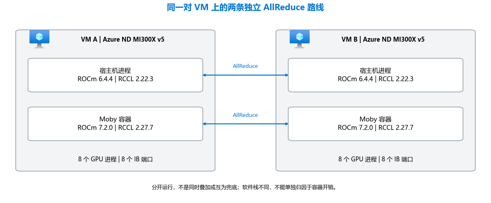

# 实测结果

[English](results.md) · [README](../README_CN.md) · [优化原理](optimizations_CN.md) · [部署细节](deployment_CN.md) · [复测与核对](benchmark_CN.md) · [参考](reference_CN.md) · **实测结果**

README 中每个数字背后的实测：测试环境、总体提升，每组运行的问题、记录的输入、控制变量、结果和边界，以及独立的 RCCL 通信测试。推理与 RCCL 是独立实验，不能拼成一次吞吐测量。

## 测试环境


阶段对比和并发阶梯跑在两台 ND MI300X v5 上：VM A 上是 prefill 服务（TP8）、PD router 和压测客户端，VM B 上是 decode 服务（TP8），KV cache 通过 Mooncake 走 8 路 InfiniBand 从 prefill 传到 decode。客户端指标（TTFT、TPOT、输入和输出 tok/s）由 VM A 上的 `sglang.bench_serving` 采集。64K A/B 则在单机上完成：一个 TP8 服务同时做 prefill 和 decode，吞吐取自调度器日志。

## MI300X 上的实测验证

优化后的栈比基线栈快多少（都在 MI300X 上实测，MI300X 自己和自己比）：

<!-- BEGIN GENERATED: cumulative -->
| MI300X 上实测 | 优化前 → 后 | 倍数 |
|---|---|---:|
| Decode 图捕获，单开关<br>16K/1K，16 路并发，基线栈 | 107.4 → 334.0 tok/s | **3.11×** |
| 128K prefill，1 个请求，8 张 GPU<br>单机 → 1P1D 的 prefill 服务 | 6,915 → 16,390 tok/s | **2.37×** |
| Decode 每 token 耗时，64 路并发<br>MTP 固定接受长度 3，越低越好 | 45.86 → 17.00 ms | **2.70×** |
| Decode 每 token 耗时，64 路并发<br>MTP 按实际接受，越低越好 | 45.86 → 30.07 ms | **1.53×** |
| 64K prefill，4 路并发<br>基线栈 prompt 平均 60,610 token | 13,919 → 19,023 tok/s | **1.37×** |
| 8K prefill，4 路并发<br>基线栈 prompt 平均 7,792 token | 16,644 → 20,781 tok/s | **1.25×** |
<!-- END GENERATED: cumulative -->

<!-- BEGIN GENERATED: glance -->
- 在其余不变的栈上单独改一项：block-scale FP8 GEMM 与 unified verify 两个开关让 64K 上下文 decode **+25.65%**（同一会话 A/B）；按 shape 调优的 fused-MoE 表让 8K prefill **+24.32%**（[详情](#单项优化各自带来多少)）。
- 这些倍数不能相乘：每一行比较的是不同的一对运行。每一行的负载和拓扑见[从基线栈到优化后](#从基线栈到优化后累计提升)。本页没有任何性能数字拿 MI300X 和其他加速器比较。
<!-- END GENERATED: glance -->

框架与负载层的思路，以及列出的 CUDA 对应实现，只是迁移线索，不代表已验证 NVIDIA 上的兼容性或性能。

## MI300X 实测结果

所有数字都是 MI300X 和 MI300X 自己比。建议从上往下读：先看从基线栈到优化后的总提升，再看单项优化各自带来多少，最后是每组对比的细节。优化后的测试打开了 FP8 KV cache，阶段对比那几次运行记录的环境显示 INT8 Quick Reduce 也是打开的。两者都有损，它们对准确率的影响本仓库没有测，见[哪些优化可能改变模型输出](optimizations_CN.md#哪些优化可能改变模型输出)。

### 从基线栈到优化后：累计提升

**问题。** 所有优化都打开以后，同一个模型、同一批 MI300X 虚拟机，比第一版能跑起来的栈快多少？

**输入。** 基线栈，即第一版把模型跑起来的配置：SGLang v0.5.11、Triton FP8 GEMM，不开投机解码，KV cache 用默认类型。它的 decode 和 128K prefill 测点用 Triton attention；8K/64K prefill 测点已经在用 AITER attention。它的 128K prefill 测点跑在一台 VM 上，其余测点和优化后一样是两台 VM 的 1P1D。优化后的栈：下文[阶段对比](#阶段对比按-shape-调优的-fused-moe-表)用的栈，即 AITER attention、CK FP8 GEMM、FP8 KV、EAGLE MTP、调优 fused-MoE 表，1P1D 走 8 路 InfiniBand。单开关那一行比较的是基线栈在同一轮会话里的两次运行。

这组对比的倍数见页面顶部的表格。

Decode 的倍数在很大程度上取决于 MTP 草稿 token 的接受率。优化后的吞吐测试把接受长度固定为每步 3 个 token，这是偏乐观的条件；同一套栈的一个较早版本，在同样的随机 prompt 上按草稿模型实际达到的接受率跑过一次，可作参考点。两者逐点列出（每个数值下方是相对基线栈的倍数）：

<!-- BEGIN GENERATED: cumulative-decode -->
| 指标 | 基线栈<br>16K 输入 | 按实际<br>接受 | 固定接受<br>长度 3 |
|---|---:|---:|---:|
| TPOT ms<br>并发 32 | 29.41 | 23.20<br>1.27× | 13.65<br>2.15× |
| TPOT ms<br>并发 64 | 45.86 | 30.07<br>1.53× | 17.00<br>2.70× |
| tok/s<br>并发 32 | 658 | 1,238<br>1.88× | 1,936<br>2.94× |
| tok/s<br>并发 64 | 1,396 | 1,645<br>1.18× | 2,458<br>1.76× |
<!-- END GENERATED: cumulative-decode -->

**边界。** 这是前后对比，不是 A/B：kernel、库版本和启动参数是一起变的，所以倍数属于整套栈，不属于某一项改动。基线栈的 decode 输入是 16K token，优化后是 8K。上下文越短，每步 decode 越便宜，所以 decode 倍数里有一部分来自负载差异，而不是栈本身。按实际接受的那次运行用的是较早的 AITER 版本，没有调优 fused-MoE 表，也没开 unified verify，而且随机 prompt 很难猜中，所以它说明不了真实流量上的接受率。基线栈的 8K 和 64K prompt 平均为 7,792 和 60,610 个 token，优化后的运行是正好 8,192 和 65,536，所以这两个倍数是近似值。基线栈的 128K 测点跑在一台 VM 上，prefill 和 decode 在同一个服务里；优化后的测点跑在 1P1D 的 prefill 服务上；两者都用 8 张 GPU 做 prefill。基线栈的 decode 和 128K 数值来自汇总报告；图捕获这一对以及基线栈的 8K/64K prefill 测点是客户端原始输出。基线栈的客户端在大约 340 个输出 token（请求的是 1,024）时就结束了请求，所以图捕获的倍数只能在这两次运行之间比较。来源和哈希见 [`evidence/runs.json`](../evidence/runs.json) 和 [`evidence/raw-manifest.json`](../evidence/raw-manifest.json)。

### 单项优化各自带来多少

每一行只在其余不变的栈上改一处。A/B 是同一轮测试里只改指定的开关；阶段对比是在更新一个库的前后，重复同一套已记录的启动和压测脚本。这些测试把 MTP 接受长度固定为 3 个草稿 token，所以应当看作相对提升，而不是生产吞吐。第一行是调度器的生成吞吐，后两行是客户端测得的输入和输出吞吐。

**输入。** 每一行都写明了负载、并发和拓扑；每组对比的完整输入见下面对应的小节。

<!-- BEGIN GENERATED: headline -->
| 改了什么 | 优化前 → 优化后（tok/s） | 变化 |
|---|---|---:|
| CK FP8 GEMM + unified verify<br>64K/1K decode，batch 16，单机<br>*两开关 A/B，各 2 次* | 743 → 934 | **+25.65%** |
| 调优 fused-MoE 表<br>8K prefill，并发 4，1P1D<br>*阶段对比，各 1 次* | 16,716 → 20,781 | **+24.32%** |
| 调优 fused-MoE 表<br>8K/1K decode，并发 128，1P1D<br>*阶段对比，各 1 次* | 2,209 → 2,487 | **+12.56%** |
<!-- END GENERATED: headline -->

**边界。** 每一行的收益只属于该行写明的改动，以及它当时所在的栈。各行是在不同的栈和负载上测的，不能相乘得出上面的累计倍数。

### 受控 A/B：64K 上下文下的 block-scale FP8 GEMM 路径

**问题。** 单台 MI300X 虚拟机上，最终版的 GEMM 与 verify 路径在长上下文下能带来多少稳态 decode 吞吐？

**输入。** 每个请求正好携带 65,536 个输入 token ID，生成 1,024 个 token；同时有 16 个请求在跑，调度器保持 batch 16。MTP 以固定接受 3 个草稿 token 的方式运行（`SGLANG_SIMULATE_ACC_LEN=3`、`SGLANG_SIMULATE_ACC_METHOD=match-expected`）。用 `--mem-fraction-static 0.95` 扩大 KV 池，保证 16 个 64K 上下文能同时放下。吞吐取的是 16 个请求全部在跑时调度器日志里的生成速率；每次运行的第一个满 batch 采样跨越 prefill 到 decode 的切换，按测试前定好的规则剔除。

**变量。** 两个环境变量，一起打开：优化组加上 `SGLANG_USE_AITER_CK_BLOCKSCALE_BPRESHUFFLE=1` 和 `SGLANG_AITER_UNIFIED_VERIFY=1`。主机、容器、镜像、模型、启动参数、压测命令和 KV 设置完全相同；每组各起两次全新服务，两组背靠背连续跑完。

<!-- BEGIN GENERATED: ab-table -->
| 组别 | 第 1、2 次 | 均值 |
|---|---:|---:|
| 基线 | 740.29、745.95 | 743.12 |
| 优化后 | 931.58、935.92 | 933.75 |
| 变化 |  | **+25.65%** |
<!-- END GENERATED: ab-table -->

每组两次运行之间差异都在 1% 以内，而两组差距远超这个波动。两组都是调度器的生成吞吐（tok/s）。用 batch 除以吞吐，就是 16 个请求里每一个等一个 token 的时间：

<!-- BEGIN GENERATED: ab-tpot -->
| 组别 | 折算 TPOT（ms） |
|---|---:|
| 基线 | 21.53 |
| 优化后 | 17.14 |
| 变化 | **-20.42%** |
<!-- END GENERATED: ab-tpot -->

折算 TPOT 按 `1000 × 16 / tok/s` 计算，不是客户端实测的延迟。

**边界。** 两个变量是一起打开的，收益属于这一对开关，不能拆给其中任何一个。测试是单机、prefill 和 decode 在同一个服务里完成，不能推到 PD 部署上。原始采样值在 [`evidence/raw/ab-64k-bs16.json`](../evidence/raw/ab-64k-bs16.json)，可以追溯到其中登记了 SHA-256 的审计文件。

### 阶段对比：按 shape 调优的 fused-MoE 表

**问题。** 在双机 PD 部署里，MiMo 专用的 fused-MoE 调优表改变了什么？

**输入。** Prefill：随机 prompt，长度 8,192 或 65,536 token，输出 1 个 token，16 个 prompt，并发 4，1 个预热请求，清缓存，seed 12345。Decode：随机 prompt 8,192 token，输出 1,024 token，256 个 prompt，并发 16 到 128，32 个预热请求，清缓存，seed 12345。每次运行的完整客户端参数都保存在 [`evidence/raw/`](../evidence/raw/)。

**变量。** AITER 从 `fc96a4f` 升级到加入了 [`d725746`](https://github.com/sammysun0711/aiter/commit/d725746a0f8c233d8e46e2771a7c8dbcd06e40d9) 调优表的版本（实际加载的 CSV 与该 commit 中的文件 SHA-256 相同）。前后两次运行的 prefill 启动脚本、router 脚本和两份压测脚本 SHA-256 完全一致，decode 服务记录下来的环境变量行也一致。decode 启动脚本的完整哈希只在“之后”那次记录过，sglang commit 只在“之前”那次记录过，所以把差异归到这张表上证据很强，但还没有同一轮内的 A/B 来证明。

Prefill，客户端测得（吞吐取整；精确值见 `evidence/measurements.json`）：

<!-- BEGIN GENERATED: stage-prefill -->
| 输入 token | tok/s 优化前 → 后 | 变化 |
|---:|---:|---:|
| 8,192 | 16,716 → 20,781 | **+24.32%**<br>TTFT -15.15% |
| 65,536 | 17,254 → 19,023 | **+10.25%**<br>TTFT -9.36% |
<!-- END GENERATED: stage-prefill -->

Decode，同一批运行：

<!-- BEGIN GENERATED: stage-decode -->
| 并发 | tok/s 优化前 → 后 | 变化 |
|---:|---:|---:|
| 16 | 1,299 → 1,332 | **+2.52%**<br>TPOT +1.79% |
| 32 | 1,911 → 1,936 | **+1.33%**<br>TPOT +1.11% |
| 64 | 2,188 → 2,458 | **+12.33%**<br>TPOT +12.58% |
| 128 | 2,209 → 2,487 | **+12.56%**<br>TPOT +14.05% |
<!-- END GENERATED: stage-decode -->

Prefill 吞吐上去的同时，首 token 时间也缩短了。Decode 在并发 64 和 128 时，输出吞吐提升了约八分之一，TPOT 也差不多涨了同样的幅度：服务每一步同时处理的请求更多，单个请求每个 token 多等一点，但整批完成得更快。

**边界。** 每个点前后各只跑了一次，不是交错进行的 A/B。前后两次都剔除了 256K prefill 点：在 `--context-length 262144` 下，262,144 token 的 prompt 加上 MiMo 的特殊 token 放不下，服务端可能返回错误内容，而客户端仍然记为成功。另有一次尝试用 `AITER_BYPASS_TUNE_CONFIG=1` 作为基线在同一轮里做 A/B，64K 时出现 GPU 内存访问错误，结果被判无效，所以这张表目前没有同一轮内的 A/B。

### Decode 在哪里饱和：并发阶梯

**问题。** 1P1D 的 decode 路径，客户端并发加到多少以后吞吐就不再增长？多出来的并发代价是什么？

**输入。** 与上面阶段对比“之前”那次相同的负载（8K 输入 / 1K 输出）和相同的栈，每个点 256 个 prompt，客户端并发 16 到 256。

<!-- BEGIN GENERATED: ladder -->
| 并发<br>（实测） | Output<br>tok/s | TPOT<br>（ms） | TTFT（s）<br>均值 / P99 |
|---:|---:|---:|---:|
| 16<br>(15.8) | 1,322 | 10.79 | 1.2 / 7.1 |
| 32<br>(30.9) | 1,914 | 13.37 | 2.8 / 14.1 |
| 64<br>(59.5) | 2,199 | 15.49 | 11.9 / 27.6 |
| 96<br>(84.0) | 2,201 | 15.06 | 23.7 / 40.8 |
| 128<br>(104.6) | 2,204 | 14.83 | 33.4 / 54.4 |
| 192<br>(135.4) | 2,203 | 14.72 | 47.9 / 81.3 |
| 256<br>(151.8) | 2,208 | 14.60 | 55.5 / 107.3 |
<!-- END GENERATED: ladder -->

并发到 64 时吞吐进入平台期。再往上，TPOT 基本不变，平均和 P99 首 token 时间却一直增长：多出来的请求没有带来吞吐，只是更晚拿到第一个 token。实测并发（括号内，客户端按时间平均的在途请求数）也不再跟随配置值增长。这与服务端的最大运行请求数和 KV 容量开始起作用相符，但这些运行没有调度器 trace 可以证实。

**边界。** 每个点只跑一次，而且是在加入调优 MoE 表之前的栈上测的。饱和点会随上下文长度、KV 容量和 `--max-running-requests` 变化，换配置就要重新测。

### 吞吐怎样随上下文长度变化

**问题。** 在优化后的 PD 栈上，上下文从 8K 增长到 256K token 时，prefill 速度和 decode batch 怎样变化？

**输入。** 两台 VM 组成 1P1D，用优化后栈的镜像，`--context-length 262151`。Prefill：随机 prompt、输出 1 个 token，每个点 16 个请求，客户端并发 1 到 8；256K 测点直接发送精确的 token ID。Decode：输出 1,024 个 token，MTP 固定接受长度 3。Decode batch 和生成速率取自 decode 服务的调度器日志（`#running-req`），不是客户端。表中 prefill 取 1 个请求时的值，decode 取该长度下测过的最高客户端并发；decode 两列分别是服务实际运行的 batch，以及总生成速率和它除以 batch 得到的每请求速率。

<!-- BEGIN GENERATED: context-table -->
| 上下文 | Prefill tok/s<br>1 个请求 | Decode batch<br>（稳态 / 峰值） | Decode tok/s<br>合计、每请求 |
|---|---:|---:|---:|
| 8K | 16,835 | 51 / 54<br>并发 128 | 2,333<br>45.8 |
| 64K | 18,057 | 4 / 5<br>并发 96 | 288<br>71.9 |
| 128K | 16,390 | 1 / 1<br>并发 32 | 138<br>138.2 |
| 192K | 13,827 | 1 / 1<br>并发 16 | 125<br>125.0 |
| 256K | 12,632 | 1 / 1<br>并发 4 | 128<br>127.8 |
<!-- END GENERATED: context-table -->

整个范围内 prefill 都保持在每秒约 12,600 到 18,100 个输入 token，一个 256K 的 prompt 大约 21 秒就能处理完。Decode 不一样：64K 时即使有 96 个请求在途，decode 服务也只同时跑 4 到 5 个；从 128K 起，即使有 32 个请求在途，也一次只跑 1 个。每个请求本身仍然很快，每秒 125 到 140 个 token，但服务的总速率从 8K 时的每秒约 2,300 个 token 降到约 130。长上下文下决定吞吐的是 KV 池，不是 kernel 速度，见[按 KV 容量估算 decode batch](optimizations_CN.md#按-kv-容量估算-decode-batch)。

**边界。** 8K 和 64K 两行来自一组测试，128K 到 256K 来自同一镜像上的另一组测试；每个点只跑了一次。256K prefill 在 4 个请求在途时的测点被判无效：两次服务生命周期都出现 GPU 内存访问错误，所以不报告数值。256K 的 decode 行用 261,120 个输入 token，这样 1,024 个输出 token 仍能放进上下文。Decode 用的是固定 MTP 接受长度 3，属于偏乐观的条件。

### 增加第二个 prefill 副本

**问题。** 当瓶颈在 prefill 时，同一个路由后面再加一个完整的 TP8 服务能带来多少？

**输入。** 两个副本：两台 VM，每台跑一个优化后栈的普通 TP8 服务（不是 PD 模式），两个服务都注册到同一个 `sglang_router`，按轮询分配；每个点 32 个请求。一个服务：同一组测试里 1P1D 部署的 prefill 服务；每个点 16 个请求。两者都用随机 prompt、输出 1 个 token。表中比较的是各自 1 个和 2 个请求在途时的结果。

<!-- BEGIN GENERATED: replicas-table -->
| 输入 token | 一个服务<br>1 → 2 个在途 | 两个副本<br>1 → 2 个在途 |
|---:|---:|---:|
| 8,192 | 16,835 → 19,618<br>1.17× | 20,752 → 41,202<br>**1.99×** |
| 65,536 | 18,057 → 19,860<br>1.10× | 19,695 → 38,984<br>**1.98×** |
| 262,144 | 12,382 → 12,378<br>1.00× | 12,783 → 25,064<br>**1.96×** |
<!-- END GENERATED: replicas-table -->

一个服务多一个在途请求只多 0% 到 17%，因为两个请求挤在同样的 8 张 GPU 上。两个副本则接近翻倍，因为第二个请求落到了空闲的副本上；首 token 时间基本不变（64K 时为 3.33 s 和 3.35 s）。再增加到 8 个或 16 个在途，最多再多 13%（8K），64K 和 256K 则不再增加。

**边界。** 这里测的是输出长度为 1 时的 prefill 容量。副本是普通服务，而单服务参照是 PD 的 prefill 服务，所以两列除了副本数不同，服务模式也不同。这不是 2P1D 的结果：测试中没有 decode 服务，也没有 KV 传输。每个点只跑了一次。

### 在优化后的 kernel 上实测的准确率

**问题。** 用优化后的 kernel、MTP 按实际接受，模型在公开基准上是否仍然答得对？

**输入。** 两台 VM，每台跑一个独立的 TP8 服务（prefill 和 decode 在同一个服务里），用的是优化后栈的 kernel：AITER attention、CK block-scale FP8 GEMM、调优 fused-MoE 表（启动前核对哈希），以及按草稿模型实际接受率运行的多层 EAGLE MTP（固定接受长度的变量都已去掉并做了检查）。权重为 FP8，KV cache 为模型默认精度（没有 `--kv-cache-dtype`），page size 1，1M 上下文。AIME 用 temperature 1.0、top-p 0.95、最多 65,536 个 token，打开 thinking；其他五个基准用 temperature 0、最多 16,384 个 token。每个基准都按原始顺序取前面的题目评分，遍数见表。输出为空且达到 token 上限的回答算错。

<!-- BEGIN GENERATED: accuracy-table -->
| 基准 | 评分范围 | 准确率 |
|---|---|---:|
| AIME24_25 | 前 16 题 × 1 遍 | **100.00%**<br>16 / 16 |
| CMMLU | 前 128 题 × 3 遍 | **89.84%**<br>345 / 384 |
| MinervaMath | 前 1,536 题 × 3 遍 | **97.61%**<br>4,498 / 4,608 |
| MMLU-Pro | 前 512 题 × 2 遍 | **89.36%**<br>915 / 1,024 |
| MMLU-Redux | 前 512 题 × 3 遍 | **96.22%**<br>1,478 / 1,536 |
| SuperGPQA | 前 512 题 × 1 遍 | **70.31%**<br>360 / 512 |
<!-- END GENERATED: accuracy-table -->

**边界。** 这些是子集上的绝对分数（共 3,216 道题、8,080 个评分回答），不是 A/B。没有给关掉优化的运行打分，所以这张表说明的是优化后的 kernel 和按实际接受的 MTP 能给出正常的答案，而不是它们对输出毫无影响。有两个有损开关没有覆盖：FP8 KV cache 是关着的；Quick Reduce 的实际设置没有记录（启动脚本没有设置，基础镜像导出的是 INT8）。基准前面的题目可能比整体更容易或更难，16 道 AIME 题单独看说明不了什么。FP8 KV 和 Quick Reduce 按[有损开关核对步骤](benchmark_CN.md#在你的模型上核对有损开关)核对。

### 本仓库没有测的部分

Decode 图捕获只在基线栈上测过，那时的栈没有 MTP 和 AITER kernel；它在优化后栈里的贡献没有单独拆分。FlyDSL paged-attention decode kernel、向量化 5D KV 布局、page 64 和 head 192 的 prefill tile 都在最终固定的 runtime 里，但微软已发布的测试没有单独测过它们，所以本页不给出它们的加速数字。它们的代码改动在[三层优化逐项拆解](optimizations_CN.md#三层优化逐项拆解)里讲清楚了；要测它们，可以在单机 profile 上按同样的 A/B 方法去做。

## 推理运行的输入与来源

<!-- BEGIN GENERATED: run-inputs -->
### MoE 调优前 (S1)

**问题。** 这份“MoE 调优前”记录能够说明什么？

**记录的输入。** `--tp-size 8 --attention-backend aiter --kv-cache-dtype fp8_e4m3 --page-size 32 --chunked-prefill-size 32768 --context-length 262144 --max-running-requests 128 --mem-fraction-static 0.85 --disable-radix-cache --disable-overlap-schedule --speculative-algorithm EAGLE --speculative-num-steps 3 --speculative-eagle-topk 1 --speculative-num-draft-tokens 4 --enable-multi-layer-eagle; the prefill server adds --disable-cuda-graph --disaggregation-mode prefill, the decode server --disaggregation-mode decode, both --disaggregation-transfer-backend mooncake`

**变量。** 使用[固定运行目录](../evidence/runs.json)中 `stage-before-moe-table` 对应的拓扑、runtime、开关和环境，不能借用其他组的配置。

**结果。** [stage-before-moe-table__decode-8k1k.txt](../evidence/raw/stage-before-moe-table__decode-8k1k.txt), [stage-before-moe-table__prefill.txt](../evidence/raw/stage-before-moe-table__prefill.txt)。[实测章节](#mi300x-实测结果)从这些记录计算结果。

**边界。** 公开投影只能支撑保留下来的数值；缺失的私有输入不能保证逐字节重放。离线复算也不是重新运行推理服务。

### MoE 调优后 (S2)

**问题。** 这份“MoE 调优后”记录能够说明什么？

**记录的输入。** `same as stage-before-moe-table`

**变量。** 使用[固定运行目录](../evidence/runs.json)中 `stage-after-moe-table` 对应的拓扑、runtime、开关和环境，不能借用其他组的配置。

**结果。** [stage-after-moe-table__decode-8k1k-c16.txt](../evidence/raw/stage-after-moe-table__decode-8k1k-c16.txt), [stage-after-moe-table__decode-8k1k-c32.txt](../evidence/raw/stage-after-moe-table__decode-8k1k-c32.txt), [stage-after-moe-table__decode-8k1k-c64.txt](../evidence/raw/stage-after-moe-table__decode-8k1k-c64.txt), [stage-after-moe-table__decode-8k1k-c128.txt](../evidence/raw/stage-after-moe-table__decode-8k1k-c128.txt), [stage-after-moe-table__prefill-8192-c4.txt](../evidence/raw/stage-after-moe-table__prefill-8192-c4.txt), [stage-after-moe-table__prefill-65536-c4.txt](../evidence/raw/stage-after-moe-table__prefill-65536-c4.txt), [stage-after-moe-table__prefill-262144-c4.txt](../evidence/raw/stage-after-moe-table__prefill-262144-c4.txt)。[实测章节](#mi300x-实测结果)从这些记录计算结果。

**边界。** 公开投影只能支撑保留下来的数值；缺失的私有输入不能保证逐字节重放。离线复算也不是重新运行推理服务。

### Decode 并发扫描 (S3)

**问题。** 这份“Decode 并发扫描”记录能够说明什么？

**记录的输入。** 这份记录没有保存完整的 shell 调用；下列公开证据保留了当时可获取的负载和配置字段。

**变量。** 使用[固定运行目录](../evidence/runs.json)中 `ladder-ck` 对应的拓扑、runtime、开关和环境，不能借用其他组的配置。

**结果。** [ladder-ck__decode-8k1k-c16.txt](../evidence/raw/ladder-ck__decode-8k1k-c16.txt), [ladder-ck__decode-8k1k-c32.txt](../evidence/raw/ladder-ck__decode-8k1k-c32.txt), [ladder-ck__decode-8k1k-c64.txt](../evidence/raw/ladder-ck__decode-8k1k-c64.txt), [ladder-ck__decode-8k1k-c96.txt](../evidence/raw/ladder-ck__decode-8k1k-c96.txt), [ladder-ck__decode-8k1k-c128.txt](../evidence/raw/ladder-ck__decode-8k1k-c128.txt), [ladder-ck__decode-8k1k-c192.txt](../evidence/raw/ladder-ck__decode-8k1k-c192.txt), [ladder-ck__decode-8k1k-c256.txt](../evidence/raw/ladder-ck__decode-8k1k-c256.txt)。[实测章节](#mi300x-实测结果)从这些记录计算结果。

**边界。** 公开投影只能支撑保留下来的数值；缺失的私有输入不能保证逐字节重放。离线复算也不是重新运行推理服务。

### 64K 双开关 A/B (S4)

**问题。** 这份“64K 双开关 A/B”记录能够说明什么？

**记录的输入。** 这份记录没有保存完整的 shell 调用；下列公开证据保留了当时可获取的负载和配置字段。

**变量。** 使用[固定运行目录](../evidence/runs.json)中 `ab-64k-bs16` 对应的拓扑、runtime、开关和环境，不能借用其他组的配置。

**结果。** [ab-64k-bs16.json](../evidence/raw/ab-64k-bs16.json)。[实测章节](#mi300x-实测结果)从这些记录计算结果。

**边界。** 公开投影只能支撑保留下来的数值；缺失的私有输入不能保证逐字节重放。离线复算也不是重新运行推理服务。

### 图捕获 A/B (S5)

**问题。** 这份“图捕获 A/B”记录能够说明什么？

**记录的输入。** 这份记录没有保存完整的 shell 调用；下列公开证据保留了当时可获取的负载和配置字段。

**变量。** 使用[固定运行目录](../evidence/runs.json)中 `baseline-pd-client` 对应的拓扑、runtime、开关和环境，不能借用其他组的配置。

**结果。** [baseline-pd-client.json](../evidence/raw/baseline-pd-client.json)。[实测章节](#mi300x-实测结果)从这些记录计算结果。

**边界。** 公开投影只能支撑保留下来的数值；缺失的私有输入不能保证逐字节重放。离线复算也不是重新运行推理服务。

### 基线软件栈 (S6)

**问题。** 这份“基线软件栈”记录能够说明什么？

**记录的输入。** 这份记录没有保存完整的 shell 调用；下列公开证据保留了当时可获取的负载和配置字段。

**变量。** 使用[固定运行目录](../evidence/runs.json)中 `baseline-pd-summary` 对应的拓扑、runtime、开关和环境，不能借用其他组的配置。

**结果。** [baseline-pd-summary.json](../evidence/raw/baseline-pd-summary.json)。[实测章节](#mi300x-实测结果)从这些记录计算结果。

**边界。** 公开投影只能支撑保留下来的数值；缺失的私有输入不能保证逐字节重放。离线复算也不是重新运行推理服务。

### 实际 MTP 接受率 (S7)

**问题。** 这份“实际 MTP 接受率”记录能够说明什么？

**记录的输入。** `--tp-size 8 --attention-backend aiter --kv-cache-dtype fp8_e4m3 --page-size 32 --chunked-prefill-size 16384 --context-length 262144 --max-running-requests 128 --mem-fraction-static 0.85 --disable-radix-cache --disable-overlap-schedule --speculative-algorithm EAGLE --speculative-num-steps 3 --speculative-eagle-topk 1 --speculative-num-draft-tokens 4 --enable-multi-layer-eagle`

**变量。** 使用[固定运行目录](../evidence/runs.json)中 `actual-acceptance` 对应的拓扑、runtime、开关和环境，不能借用其他组的配置。

**结果。** [actual-acceptance__decode-8k1k-c16.txt](../evidence/raw/actual-acceptance__decode-8k1k-c16.txt), [actual-acceptance__decode-8k1k-c32.txt](../evidence/raw/actual-acceptance__decode-8k1k-c32.txt), [actual-acceptance__decode-8k1k-c64.txt](../evidence/raw/actual-acceptance__decode-8k1k-c64.txt), [actual-acceptance__decode-8k1k-c128.txt](../evidence/raw/actual-acceptance__decode-8k1k-c128.txt)。[实测章节](#mi300x-实测结果)从这些记录计算结果。

**边界。** 公开投影只能支撑保留下来的数值；缺失的私有输入不能保证逐字节重放。离线复算也不是重新运行推理服务。

### 上下文长度扫描 (S8)

**问题。** 这份“上下文长度扫描”记录能够说明什么？

**记录的输入。** 这份记录没有保存完整的 shell 调用；下列公开证据保留了当时可获取的负载和配置字段。

**变量。** 使用[固定运行目录](../evidence/runs.json)中 `context-matrix` 对应的拓扑、runtime、开关和环境，不能借用其他组的配置。

**结果。** [context-matrix.json](../evidence/raw/context-matrix.json)。[实测章节](#mi300x-实测结果)从这些记录计算结果。

**边界。** 公开投影只能支撑保留下来的数值；缺失的私有输入不能保证逐字节重放。离线复算也不是重新运行推理服务。

### Prefill 副本 (S9)

**问题。** 这份“Prefill 副本”记录能够说明什么？

**记录的输入。** 这份记录没有保存完整的 shell 调用；下列公开证据保留了当时可获取的负载和配置字段。

**变量。** 使用[固定运行目录](../evidence/runs.json)中 `prefill-replicas` 对应的拓扑、runtime、开关和环境，不能借用其他组的配置。

**结果。** [prefill-replicas.json](../evidence/raw/prefill-replicas.json)。[实测章节](#mi300x-实测结果)从这些记录计算结果。

**边界。** 公开投影只能支撑保留下来的数值；缺失的私有输入不能保证逐字节重放。离线复算也不是重新运行推理服务。

### 公开基准子集准确率 (S10)

**问题。** 这份“公开基准子集准确率”记录能够说明什么？

**记录的输入。** `--tp-size 8 --attention-backend aiter --quantization fp8 --page-size 1 --mem-fraction-static 0.8 --max-running-requests 128 --context-length 1048576 --speculative-algorithm EAGLE --speculative-num-steps 3 --speculative-eagle-topk 1 --speculative-num-draft-tokens 4 --enable-multi-layer-eagle --reasoning-parser qwen3; no --kv-cache-dtype, so the KV cache stays at the model's default precision`

**变量。** 使用[固定运行目录](../evidence/runs.json)中 `accuracy-subset` 对应的拓扑、runtime、开关和环境，不能借用其他组的配置。

**结果。** [accuracy-subset.json](../evidence/raw/accuracy-subset.json)。[实测章节](#mi300x-实测结果)从这些记录计算结果。

**边界。** 公开投影只能支撑保留下来的数值；缺失的私有输入不能保证逐字节重放。离线复算也不是重新运行推理服务。
<!-- END GENERATED: run-inputs -->

## 独立的 RCCL 通信验证

宿主机与容器路线使用同一对 MI300X VM，但 ROCm、RCCL 和测试程序构建不同，差值不能单独归因于容器开销。AllReduce 不加载模型权重，也不测模型吞吐率。源码提交位于 [ROCm monorepo](https://github.com/ROCm/rocm-systems/tree/1284e5da11f7904e8a6efd902b9de52253785bd0/projects/rccl-tests)。

Moby 是安装的容器引擎软件包，不是测试镜像。这次使用公开的 `rocm/sgl-dev` 基础镜像，不是客户提供的镜像，也不是完整推理服务镜像。宿主机的 ROCm 6.4.4 与容器的 7.2.0 是日志报告的用户态软件栈，没有单独记录 amdgpu 内核模块的版本。



根据运行记录绘制的原创解释图，不是截图，也不是运行时流量的证明。

容器主扫描中，本地进程继承了镜像的 NCCL_MIN_NCHANNELS=112，经 SSH 启动的远端进程没有继承；统一设置的独立对照列在下方。完成这些扫描不等于通过长期稳定性验收。

<!-- BEGIN GENERATED: rccl-observation -->
**初始化观察：** 1 次记录的尝试在 rocm_smi 内失败，随后 6 次专项重试完成。根因为 **NOT_CONFIRMED**，不能据此估计失败率或认定已经修复。[诊断摘录](../evidence/rccl/initialization-observation.txt)。
<!-- END GENERATED: rccl-observation -->

[重新打包的构建配方](../docker/rccl.Dockerfile)获取公开源码，而不是复制作者已经构建好的目录。源码输入可获取，但这个新配方的构建与 GPU 重跑尚未执行；[构建状态](../evidence/rccl/build-status.json)明确区分了打包步骤和已收录的测量。

<!-- BEGIN GENERATED: rccl-runs -->
### 宿主机 AllReduce

**问题。** 容器中完成的运行是否仍与宿主机处于同一带宽水平？

**记录的输入。** 以下是当时的 MPI 调用，仅将节点地址和程序路径替换为变量，其余参数不变。

```bash
mpirun -np 16 -H ${NODE_A}:8,${NODE_B}:8 \
  -map-by ppr:8:node --bind-to numa \
  -x NCCL_IB_HCA=^mlx5_8:1,mlx5_an0:1 \
  -x NCCL_IB_PCI_RELAXED_ORDERING=1 \
  -x NCCL_DEBUG=VERSION \
  --mca pml ucx --mca btl '^vader,tcp,openib,uct' \
  -x PATH -x LD_LIBRARY_PATH \
  "${RCCL_BIN}" -g 1 -f 2 -b 1G -e 16G -c 0 -n 50 -w 20 < /dev/null
```

**变量。** 2 台 VM、16 个进程，float/sum；计时 50 次、预热 20 次，validation=0。ROCm、RCCL 和测试程序构建不同，不能把差异单独归因于容器开销。 每组仅一次扫描，不能估计重复性。

**观测结果。**

| 消息（GiB） | Out-of-place<br>GB/s | In-place<br>GB/s |
|---:|---:|---:|
| 1 | 348.00 | 348.10 |
| 2 | 351.05 | 351.10 |
| 4 | 353.16 | 356.18 |
| 8 | 357.78 | 357.75 |
| 16 | 361.31 | 361.27 |

工具报告平均 **354.57 GB/s**，包含两种模式和全部消息大小。数据校验：**NOT_RUN**。INFO 标记：IB=0、Socket=0、GDRDMA=0。

**边界。** VERSION 级别日志中没有 INFO 标记，只表示未记录，不能判断没有 RDMA。busbw 是归一化集合通信带宽，不是网卡利用率或模型吞吐率。[数值投影](../evidence/rccl/raw/host-performance.txt)；[来源哈希与条件](../evidence/rccl/runs.json)。

### Moby 容器 AllReduce

**问题。** 容器中完成的运行是否仍与宿主机处于同一带宽水平？

**记录的输入。** 以下是当时的 MPI 调用，仅将节点地址和程序路径替换为变量，其余参数不变。

```bash
mpirun --allow-run-as-root -np 16 -H ${NODE_A}:8,${NODE_B}:8 \
  -map-by ppr:8:node --bind-to numa \
  -x NCCL_IB_HCA=^mlx5_8:1,mlx5_an0:1 \
  -x NCCL_IB_PCI_RELAXED_ORDERING=1 \
  -x NCCL_DEBUG=VERSION \
  --mca pml ucx --mca btl '^vader,tcp,openib,uct' \
  --mca plm_rsh_args "-p 2222" \
  -x PATH -x LD_LIBRARY_PATH \
  "${RCCL_BIN}" -g 1 -f 2 -b 1G -e 16G -c 0 -n 50 -w 20
```

**变量。** 2 台 VM、16 个进程，float/sum；计时 50 次、预热 20 次，validation=0。仅一次完成的扫描；镜像默认 NCCL_MIN_NCHANNELS 只传到了本地进程。 每组仅一次扫描，不能估计重复性。

**观测结果。**

| 消息（GiB） | Out-of-place<br>GB/s | In-place<br>GB/s |
|---:|---:|---:|
| 1 | 354.72 | 354.74 |
| 2 | 357.77 | 357.47 |
| 4 | 357.53 | 357.56 |
| 8 | 362.15 | 362.08 |
| 16 | 364.28 | 364.10 |

工具报告平均 **359.24 GB/s**，包含两种模式和全部消息大小。数据校验：**NOT_RUN**。INFO 标记：IB=0、Socket=0、GDRDMA=0。

**边界。** VERSION 级别日志中没有 INFO 标记，只表示未记录，不能判断没有 RDMA。busbw 是归一化集合通信带宽，不是网卡利用率或模型吞吐率。[数值投影](../evidence/rccl/raw/container-performance.txt)；[来源哈希与条件](../evidence/rccl/runs.json)。

### 容器数据校验与传输路径

**问题。** 集合通信结果是否正确，每个进程是否都选择了 IB？

**记录的输入。** 以下是当时的 MPI 调用，仅将节点地址和程序路径替换为变量，其余参数不变。

```bash
mpirun --allow-run-as-root -np 16 -H ${NODE_A}:8,${NODE_B}:8 \
  -map-by ppr:8:node --bind-to numa \
  -x NCCL_IB_HCA=^mlx5_8:1,mlx5_an0:1 \
  -x NCCL_IB_PCI_RELAXED_ORDERING=1 \
  -x NCCL_DEBUG=INFO -x NCCL_DEBUG_SUBSYS=INIT,NET \
  --mca pml ucx --mca btl '^vader,tcp,openib,uct' \
  --mca plm_rsh_args "-p 2222" \
  -x PATH -x LD_LIBRARY_PATH \
  "${RCCL_BIN}" -g 1 -f 2 -b 1G -e 16G -c 1 -n 20 -w 5
```

**变量。** 2 台 VM、16 个进程，float/sum；计时 20 次、预热 5 次，validation=1。数据校验和 INFO 日志来自独立运行，不能算作主性能运行中的检查。 每组仅一次扫描，不能估计重复性。

**观测结果。**

| 消息（GiB） | Out-of-place<br>GB/s | In-place<br>GB/s |
|---:|---:|---:|
| 1 | 337.40 | 337.27 |
| 2 | 345.16 | 345.23 |
| 4 | 348.32 | 347.93 |
| 8 | 347.20 | 346.91 |
| 16 | 348.68 | 348.97 |

工具报告平均 **345.307 GB/s**，包含两种模式和全部消息大小。数据校验：**PASS**。INFO 标记：IB=16、Socket=0、GDRDMA=472。

**边界。** 本次运行已正向记录 IB 选择和 GPU Direct RDMA。busbw 是归一化集合通信带宽，不是网卡利用率或模型吞吐率。[数值投影](../evidence/rccl/raw/container-validation.txt)；[来源哈希与条件](../evidence/rccl/runs.json)。

### 不映射 IB 设备：退回 Socket

**问题。** RCCL 退回 Socket 时，程序是否仍可能正常结束？

**记录的输入。** 以下是当时的 MPI 调用，仅将节点地址和程序路径替换为变量，其余参数不变。

```bash
env -u NCCL_MIN_NCHANNELS mpirun --allow-run-as-root -np 16 -H ${NODE_A}:8,${NODE_B}:8 \
  -map-by ppr:8:node --bind-to numa \
  -x NCCL_IB_HCA=^mlx5_8:1,mlx5_an0:1 \
  -x NCCL_IB_PCI_RELAXED_ORDERING=1 \
  -x NCCL_DEBUG=INFO -x NCCL_DEBUG_SUBSYS=INIT,NET --mca btl_tcp_if_include eth0 \
  --mca pml ob1 --mca btl 'self,vader,tcp' \
  --mca plm_rsh_args "-p 2222" \
  -x PATH -x LD_LIBRARY_PATH \
  "${RCCL_BIN}" -g 1 -f 2 -b 1G -e 1G -c 1 -n 5 -w 2
```

**变量。** 2 台 VM、16 个进程，float/sum；计时 5 次、预热 2 次，validation=1。两组 MPI 都走 TCP；只测一个消息大小，不是主结果的完整扫描。 每组仅一次扫描，不能估计重复性。

**观测结果。**

| 消息（GiB） | Out-of-place<br>GB/s | In-place<br>GB/s |
|---:|---:|---:|
| 1 | 11.17 | 11.45 |

工具报告平均 **11.3114 GB/s**，包含两种模式和全部消息大小。数据校验：**PASS**。INFO 标记：IB=0、Socket=16、GDRDMA=0。

**边界。** 本次记录的是 Socket 回退，不能作为走 IB 的证明。busbw 是归一化集合通信带宽，不是网卡利用率或模型吞吐率。[数值投影](../evidence/rccl/raw/socket-validation.txt)；[来源哈希与条件](../evidence/rccl/runs.json)。

### 映射 IB 设备：使用 IB 传输

**问题。** 映射 IB 设备后，RCCL 是否选择 IB 并通过数据校验？

**记录的输入。** 以下是当时的 MPI 调用，仅将节点地址和程序路径替换为变量，其余参数不变。

```bash
env -u NCCL_MIN_NCHANNELS mpirun --allow-run-as-root -np 16 -H ${NODE_A}:8,${NODE_B}:8 \
  -map-by ppr:8:node --bind-to numa \
  -x NCCL_IB_HCA=^mlx5_8:1,mlx5_an0:1 \
  -x NCCL_IB_PCI_RELAXED_ORDERING=1 \
  -x NCCL_DEBUG=INFO -x NCCL_DEBUG_SUBSYS=INIT,NET --mca btl_tcp_if_include eth0 \
  --mca pml ob1 --mca btl 'self,vader,tcp' \
  --mca plm_rsh_args "-p 2222" \
  -x PATH -x LD_LIBRARY_PATH \
  "${RCCL_BIN}" -g 1 -f 2 -b 1G -e 1G -c 1 -n 5 -w 2
```

**变量。** 2 台 VM、16 个进程，float/sum；计时 5 次、预热 2 次，validation=1。MPI 和 RCCL 参数与 Socket 组相同，差别是容器可以访问 IB 设备。 每组仅一次扫描，不能估计重复性。

**观测结果。**

| 消息（GiB） | Out-of-place<br>GB/s | In-place<br>GB/s |
|---:|---:|---:|
| 1 | 334.35 | 336.82 |

工具报告平均 **335.588 GB/s**，包含两种模式和全部消息大小。数据校验：**PASS**。INFO 标记：IB=16、Socket=0、GDRDMA=472。

**边界。** 本次运行已正向记录 IB 选择和 GPU Direct RDMA。busbw 是归一化集合通信带宽，不是网卡利用率或模型吞吐率。[数值投影](../evidence/rccl/raw/ib-control-validation.txt)；[来源哈希与条件](../evidence/rccl/runs.json)。

### 单机：最少通道数设为 112

**问题。** 单机取消最少通道数设置后，带宽发生了什么变化？

**记录的输入。** 以下是当时的 MPI 调用，仅将节点地址和程序路径替换为变量，其余参数不变。

```bash
env -u NCCL_MIN_NCHANNELS mpirun --allow-run-as-root -np 8 -H ${NODE_A}:8 \
  -map-by ppr:8:node --bind-to numa \
  -x NCCL_IB_HCA=^mlx5_8:1,mlx5_an0:1 \
  -x NCCL_IB_PCI_RELAXED_ORDERING=1 \
  -x NCCL_DEBUG=VERSION -x NCCL_MIN_NCHANNELS=112 \
  --mca pml ucx --mca btl '^vader,tcp,openib,uct' \
  --mca plm_rsh_args "-p 2222" \
  -x PATH -x LD_LIBRARY_PATH \
  "${RCCL_BIN}" -g 1 -f 2 -b 1G -e 16G -c 1 -n 20 -w 5
```

**变量。** 1 台 VM、8 个进程，float/sum；计时 20 次、预热 5 次，validation=1。这是单机大消息校验，不代表模型推理吞吐率。 每组仅一次扫描，不能估计重复性。

**观测结果。**

| 消息（GiB） | Out-of-place<br>GB/s | In-place<br>GB/s |
|---:|---:|---:|
| 1 | 301.93 | 302.71 |
| 2 | 302.25 | 302.19 |
| 4 | 300.53 | 300.45 |
| 8 | 300.73 | 301.03 |
| 16 | 302.51 | 302.55 |

工具报告平均 **301.688 GB/s**，包含两种模式和全部消息大小。数据校验：**PASS**。INFO 标记：IB=0、Socket=0、GDRDMA=0。

**边界。** 这是单机通信结果，不能验证跨机 IB 链路。busbw 是归一化集合通信带宽，不是网卡利用率或模型吞吐率。[数值投影](../evidence/rccl/raw/single-min-channels.txt)；[来源哈希与条件](../evidence/rccl/runs.json)。

### 单机：不设置最少通道数

**问题。** 单机取消最少通道数设置后，带宽发生了什么变化？

**记录的输入。** 以下是当时的 MPI 调用，仅将节点地址和程序路径替换为变量，其余参数不变。

```bash
env -u NCCL_MIN_NCHANNELS mpirun --allow-run-as-root -np 8 -H ${NODE_A}:8 \
  -map-by ppr:8:node --bind-to numa \
  -x NCCL_IB_HCA=^mlx5_8:1,mlx5_an0:1 \
  -x NCCL_IB_PCI_RELAXED_ORDERING=1 \
  -x NCCL_DEBUG=VERSION \
  --mca pml ucx --mca btl '^vader,tcp,openib,uct' \
  --mca plm_rsh_args "-p 2222" \
  -x PATH -x LD_LIBRARY_PATH \
  "${RCCL_BIN}" -g 1 -f 2 -b 1G -e 16G -c 1 -n 20 -w 5
```

**变量。** 1 台 VM、8 个进程，float/sum；计时 20 次、预热 5 次，validation=1。单机测试参数相同，只取消 NCCL_MIN_NCHANNELS。 每组仅一次扫描，不能估计重复性。

**观测结果。**

| 消息（GiB） | Out-of-place<br>GB/s | In-place<br>GB/s |
|---:|---:|---:|
| 1 | 321.74 | 321.05 |
| 2 | 321.64 | 321.33 |
| 4 | 321.38 | 321.28 |
| 8 | 321.83 | 321.76 |
| 16 | 322.58 | 322.56 |

工具报告平均 **321.714 GB/s**，包含两种模式和全部消息大小。数据校验：**PASS**。INFO 标记：IB=0、Socket=0、GDRDMA=0。

**边界。** 这是单机通信结果，不能验证跨机 IB 链路。busbw 是归一化集合通信带宽，不是网卡利用率或模型吞吐率。[数值投影](../evidence/rccl/raw/single-auto-channels.txt)；[来源哈希与条件](../evidence/rccl/runs.json)。
<!-- END GENERATED: rccl-runs -->

## 边界

- `LOCAL_MEASUREMENT`：A/B 和阶段对比各自只覆盖一种负载 shape，其他上下文长度、并发和 batch 组成没有在同样的控制条件下测过。
- `LOCAL_MEASUREMENT`：吞吐是在 MTP 固定接受 3 个 token 的条件下测的。真实负载平均接受的草稿 token 更少，吞吐会更低。
- `NOT_MEASURED`：最终 runtime（FlyDSL decode、向量化 5D KV、page 64、1M 上下文）没有在这里发布微软自己的吞吐测试，混合精度 router GEMM 也没有。
- `NOT_MEASURED`：有损开关（FP8 KV cache、INT8 Quick Reduce、混合精度 router）对准确率的影响没有测；吞吐测试时前两个是打开的。[优化后 kernel 的子集准确率](#在优化后的-kernel-上实测的准确率)是在 FP8 KV cache 关闭时测的。[有损开关核对步骤](benchmark_CN.md#在你的模型上核对有损开关)覆盖 FP8 KV 和 Quick Reduce；router 的改动需要在包含提交 `1f9bb2b` 的 runtime 上单独做 A/B。
- `NOT_MEASURED`：这里没有任何内容在 NVIDIA GPU 上跑过，CUDA profile 只是上游开关的对应关系。
- `SOURCE_FACT`：摘录中 FlyDSL、CK 和 MTP 的 shape 检查把每个 kernel 限定在 MiMo 的 shape 上（每个 rank 16 个 query head、1 个 KV head，head 192，page 64，gfx942）。换一个模型需要重新验证，不是改改开关就行。
