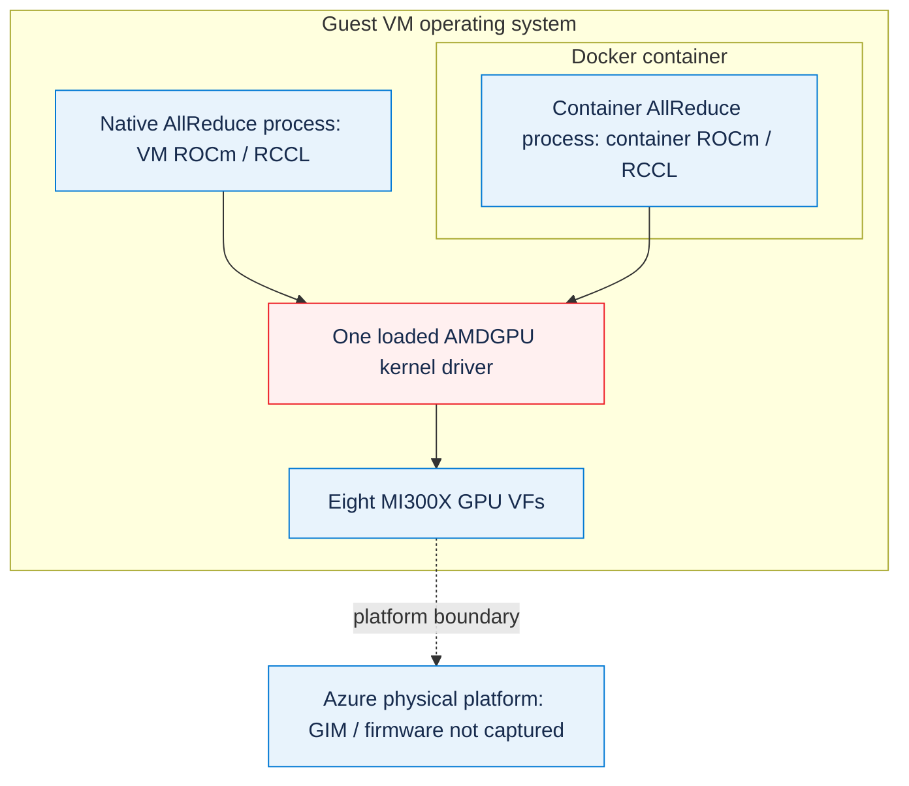

# Azure MI300X: AllReduce regression after a native host-driver upgrade

On one Azure ND MI300X v5 VM, upgrading the **VM operating system's AMDGPU kernel driver together with ROCm/RCCL** reduced eight-GPU AllReduce bandwidth from approximately 315 GB/s to 42 GB/s. The data checks still passed. Updating only the userspace libraries in containers on the old driver did **not** reproduce this regression.

This directory is a reproducible investigation case, **not a production upgrade recommendation or a vendor-confirmed root cause**. “Host” means the VM OS used as the container host, not the underlying Azure physical host or its GIM driver.

Author: Xinyu Wei · [中文](README_CN.md) · [Canonical data](data/native-summary.json) · [Original redacted evidence](evidence/) · [Offline verification](#verify-without-a-gpu)

## Purpose

**AMD engineering review request:** investigate an eight-GPU AllReduce throughput regression after activating AMDGPU 30.30.4 on an Azure MI300X VF VM, and identify a supported resolution. The controlled guest-OS upgrade reproduces the reported low-bandwidth symptom; it does **not** yet establish the cause of a customer's container-only deployment.

Please help confirm:

1. Whether guest driver `1:6.16.13.30300400-2341068.24.04` is supported for this MI300X VF platform, and which GIM/BKC/firmware requirements the platform owner should check.
2. Whether the new `psp_xgmi_get_topology_info` array-bounds reports and PSP status `0xFFFF000F` match a known regression or driver/platform mismatch.
3. Which driver release or specific patch should be tested while retaining ROCm 7.2.4/RCCL 2.27.7; a driver-only rollback and A/B/A recovery remain untested.
4. Which additional guest/platform traces are needed to distinguish the reproduced native upgrade regression from a customer running a high-version container on an unchanged VM driver.

Delivered here: pinned reproduction scripts, actual loaded-driver/library evidence, before/after producer output, correct data checks, and an evidence-linked investigation boundary. Not provided: a claimed code fix, a proven rollback restoration, physical-host GIM/firmware control, or a general ROCm performance guarantee.

### Native upgrade result at a glance

**1 GiB message, out-of-place AllReduce `busbw`, median of three independent runs. Bandwidth is decimal GB/s.**

<!-- BEGIN GENERATED: native-results -->
| Process layout | Before GB/s | After GB/s | Decrease |
|---|---:|---:|---:|
| 1 process, 8 GPUs | 314.60 | 41.78 | 86.72% |
| 8 processes, 1 GPU each | 314.81 | 41.74 | 86.74% |
<!-- END GENERATED: native-results -->

| Item | Before | After |
|---|---|---|
| Execution | Native VM OS | Native VM OS; real reboot |
| Loaded AMDGPU module | `6.12.12` | `6.16.13` |
| AMD driver package | `1:6.12.12.60404-2202139.24.04` | `1:6.16.13.30300400-2341068.24.04` (AMDGPU 30.30.4) |
| ROCm | `6.4.4` | `7.2.4` |
| RCCL | `2.22.3` | `2.27.7` |
| Linux kernel | `6.8.0-1067-azure` | Unchanged |
| MPI | HPC-X Open MPI `4.1.7rc1` | Unchanged |
| GPU partitioning | 8 MI300X VF GPUs, `SPX / NPS1` | Unchanged |
| Data validation | All `#wrong = 0` | All `#wrong = 0` |

Both stacks used [the same official rccl-tests source](https://github.com/ROCm/rocm-systems/tree/1284e5da11f7904e8a6efd902b9de52253785bd0/projects/rccl-tests), commit `1284e5da11f7904e8a6efd902b9de52253785bd0`, rebuilt against each native HIP/RCCL installation with `MPI=1` and `GPU_TARGETS=gfx942`. The test swept **1 MiB to 1 GiB**, doubling message size, with FP32 `sum`, 20 warmups, 100 iterations, graph capture disabled, and both out-of-place and in-place results.

The primary evidence comprises **12 native runs, 264 phase measurements and 44 before/after comparison rows**. [comparison.csv](data/comparison.csv) contains every message-size comparison. Do not compare the mixed-size `Avg bus bandwidth` with a large-message plateau, or treat normalized AllReduce `busbw` as raw XGMI link throughput.

### Four configurations: VM, container and the actually used driver

The following table explicitly describes **both the VM-installed userspace and the container-installed userspace**. All four values use one process with eight GPUs, a 1 GiB message, and out-of-place AllReduce `busbw`.

<!-- BEGIN GENERATED: execution-configurations -->
| Configuration | Userspace installed in the VM | Userspace installed in the container | Test location | Actually used AMDGPU kernel driver | busbw GB/s | Statistic |
|---|---|---|---|---|---:|---|
| 1 | ROCm `6.4.4` / RCCL `2.22.3` | **No container** | Native VM OS | `6.12.12` (VM) | 314.60 | Median of 3 runs |
| 2 | ROCm `6.4.4` / RCCL `2.22.3` | ROCm `7.2.4` / RCCL `2.27.7` | Inside container | `6.12.12` (shared VM driver) | 321.67 | Median of 3 runs |
| 3 | ROCm `7.2.4` / RCCL `2.27.7` | **No container** | Native VM OS | `6.16.13` (VM) | 41.78 | Median of 3 runs |
| 4 | ROCm `7.2.4` / RCCL `2.27.7` | ROCm `6.4.4` / RCCL `2.22.3` | Inside container | `6.16.13` (shared VM driver) | 37.44 | One extra diagnostic run |
<!-- END GENERATED: execution-configurations -->

**AMDGPU module version `6.12.12` and ROCm release `7.2.4` are different components, not competing versions of the same component.** ROCm/HIP/HSA/RCCL are userspace libraries. The AMDGPU kernel module is loaded in the VM OS. In these Docker tests, a container shares that already loaded module; it does not supply an independent kernel driver.

For configuration **2**, the actual combination is:

```text
VM-installed userspace:       ROCm 6.4.4 / RCCL 2.22.3
Container-executed userspace: ROCm 7.2.4 / RCCL 2.27.7
Kernel driver used by it:     VM's loaded AMDGPU module 6.12.12
```

The container's ROCm did **not** fall back or downgrade to “ROCm 6.12.12”. [The real startup output](evidence/fixed-images-old-driver/rocm-7.2.4-run-1.txt) reports `rccl-library=22707`, RCCL `2.27.7`, ROCm `7.2.4.0-93`, and `/opt/rocm-7.2.4/lib/librccl.so.1`. Observing driver `6.12.12` from inside that container is expected.

In AMD's [userspace/kernel compatibility matrix](https://rocm.docs.amd.com/projects/install-on-linux/en/docs-7.2.4/reference/user-kernel-space-compat-matrix.html), module `6.12.12` is the driver in AMD's `amdgpu/6.4.4` repository ([package pool](https://repo.radeon.com/amdgpu/6.4.4/ubuntu/pool/main/a/amdgpu-dkms/), matrix row `6.4.x`), and `6.16.13` is AMDGPU 30.30.4 ([package pool](https://repo.radeon.com/amdgpu/30.30.4/ubuntu/pool/main/a/amdgpu-dkms/), row `30.30.x`). Both rows list ROCm 6.4.x and 7.2.x userspace, so **all four tested combinations, including the slow configurations 3 and 4, are inside the published support matrix**. The matrix defines supported combinations; it neither explains nor predicts this AllReduce result, and GPU, virtualization and firmware requirements still apply. Before pairing an older VM driver with a newer container image, look up that driver's row: for example, the `6.2.x` row lists userspace only up to 7.0.x, so a ROCm 7.2 container on such a driver is outside the published matrix.

**Customer applicability is still conditional.** If a customer's deployment really matches configuration 2, this case did not reproduce their low bandwidth under that configuration. The native configuration-3 regression does not establish their root cause. First obtain their actually loaded VM driver, actual container library paths/build versions, partition/topology, test command and communication initialization logs. “Default VM image” and a container tag alone do not prove a matched deployment.

### Software-layer boundary

This is an explanatory arrangement of the measured software layers, not a product screenshot. Native and container processes represent **separate runs**, not simultaneous GPU workloads.



Both application paths use the **same kernel module already loaded by the VM**. The container does not upgrade that module. Its ROCm/HIP/RCCL userspace can still be a different version from the VM-installed userspace.

The same rule covers every ROCm userspace library in a container, not only RCCL. GPU compute kernels shipped by libraries such as AITER or Composable Kernel in an inference image are loaded from the container image and submitted through the same VM kernel driver; "kernel" there means device code that runs on the GPU, not the AMDGPU kernel-mode driver. Replacing a container changes the executed userspace code, including those compute kernels, but never the kernel driver. Changing the VM driver changes it for every container on that VM, so a driver upgrade needs its own validation. This case measured RCCL AllReduce only, not compute-kernel performance.

### Driver isolation, not a replacement for native measurements

Three experiments answer different questions:

1. **Old host driver, userspace-only container A/B:** both ROCm 6.4.4/RCCL 2.22.3 and ROCm 7.2.4/RCCL 2.27.7 remained fast. This did not test activating a new kernel module.
2. **Native host-stack upgrade and reboot:** both process layouts regressed to the low-bandwidth plateau in the primary table.
3. **Retain the same immutable userspace images, run them on the new loaded host driver:** even the old userspace image became slow. The old-driver values below are medians of three runs; the new-driver values are **one diagnostic run each**, not the primary native result.

<!-- BEGIN GENERATED: driver-isolation -->
| Fixed userspace image | Driver 6.12.12, GB/s | Driver 6.16.13, GB/s |
|---|---:|---:|
| ROCm 6.4.4 / RCCL 2.22.3 | 314.76 | 37.44 |
| ROCm 7.2.4 / RCCL 2.27.7 | 321.67 | 41.70 |
<!-- END GENERATED: driver-isolation -->

[The immutable image IDs and diagnostic measurements](data/native-summary.json) and [their raw output](evidence/fixed-images-new-driver/) are retained. This supports investigating the **host-driver transition and its firmware/virtualization/interconnect interaction**, rather than asserting that RCCL 2.27.7 alone must be slow.

### If another RCCL version is reported, for example 2.27.3

In this case, bandwidth followed the loaded AMDGPU driver rather than the RCCL version: on driver `6.12.12`, RCCL 2.22.3 and 2.27.7 were both fast; on driver `6.16.13`, both were slow.

No official ROCm release ships RCCL 2.27.3. The official ROCm APT repositories ship RCCL 2.22.3 for ROCm 6.4–6.4.4, 2.26.6 for 7.0–7.0.3 and 2.27.7 for 7.1–7.2.4 ([7.2.4 package pool](https://repo.radeon.com/rocm/apt/7.2.4/pool/main/r/rccl/)), and the [RCCL changelog](https://github.com/ROCm/rocm-systems/blob/c1faf5053567d0fb97ba5825f51bfd6874ac9527/projects/rccl/CHANGELOG.md) has no 2.27.3 entry. 2.27.3 is, however, an NVIDIA NCCL version, for example [`nvidia-nccl-cu12` 2.27.3](https://pypi.org/project/nvidia-nccl-cu12/2.27.3/), which does not run on MI300X. A reported 2.27.3 therefore points to a custom RCCL build or to NVIDIA NCCL, not to a ROCm release.

When a log reports 2.27.3 (version code `22703`), first identify the library that was actually loaded, using `ldd`, the resolved `librccl.so.1` path and `ncclGetVersion` as in [step 2 of the low-bandwidth collection](#if-low-bandwidth-appears-again-collect-before-changing-versions), and record the VM's loaded driver. This case did not measure 2.27.3. Two RCCL releases behaved the same on each driver, so a different RCCL version on driver `6.16.13` calls for the same driver investigation, but its bandwidth must be measured rather than assumed from this case.

### New kernel symptoms, not yet a proven code root cause

The new-driver boot reported:

```text
psp gfx command INVOKE_CMD(0x3) failed and response status is (0xFFFF000F)
index 8 is out of range for type 'xgmi_connected_port_num [8]'
psp_xgmi_get_topology_info
amdgpu_xgmi_add_device
```

<!-- BEGIN GENERATED: kernel-symptoms -->
| Search pattern in the complete private boot journals | Old-driver boot | New-driver boot |
|---|---:|---:|
| `xgmi_connected_port_num` | 0 | 4 |
| `psp_xgmi_get_topology_info` | 0 | 4 |
| `INVOKE_CMD(0x3) failed` | 0 | 8 |
<!-- END GENERATED: kernel-symptoms -->

See [the redacted old boot excerpt](evidence/before/kernel-xgmi-excerpt.txt), [the new boot excerpt](evidence/after/kernel-xgmi-excerpt.txt) and [search counts](data/kernel-symptom-counts.json). Counts came from the complete original journals; the public excerpts omit unrelated lines.

**Both drivers' topology output still labels the links `XGMI`.** A link label, successful GPU enumeration or `#wrong = 0` is not proof of healthy transfer performance. These errors are correlated symptoms, not proof that a particular array access caused the bandwidth loss. Physical-host GIM/firmware details were not collected, and **a driver-only rollback restoring bandwidth has not yet been tested**.

## Steps

### Read or verify the recorded case without starting a GPU VM

Review the four configurations and the linked original logs first. The published case can be verified with Python 3.10+ and its standard library; commands and acceptance criteria are in the offline test section below. No GPU, Azure login or secret is needed to read or validate the published data.

For a live experiment, use an isolated Linux GPU VM with `git`, `make`, `curl`, `python3`, `timeout`, `flock`, HIP development files and MPI for native tests. Configuration 2 also requires Docker. Keep your own SSH/recovery access. The scripts are version-pinned for the recorded Ubuntu 24.04 stack, not universal production installers.

### Configuration 2: high-version container, unchanged VM driver

Run this **before any native driver upgrade**, on a VM with actual loaded AMDGPU `6.12.12`, native ROCm `6.4.4-129` and RCCL `2.22.3.60404-129~24.04`:

```bash
export CONTAINER_WORKDIR="$PWD/local-runs/container-control"
sudo -E bash scripts/run_container.sh "$CONTAINER_WORKDIR"
```

The [pinned Dockerfile](docker/Dockerfile.rccl-tests) uses official ROCm 7.2.4 development-image digest `sha256:92f309c51b52cef8762867848f1529dee821624f23cd5df38455e819538f762f` and the same official test-source commit. It builds `MPI=0`, `gfx942`, one process/eight GPUs. Only the results directory is mounted; the VM's ROCm installation is **not** mounted over the container SDK.

Success: three runs pass data validation and end with `CONFIGURATION_2_CONTAINER_TEST_PASS_VM_DRIVER_UNCHANGED`. `configuration-2/runtime-layers.json` must report **container ROCm 7.2.4, actual container RCCL code 22707, its container library path, and shared VM KMD 6.12.12**. If a version/path check fails, preserve its output and investigate library mounts or loader settings; do not claim a matched configuration from the tag alone. The reported bandwidth is whatever the new experiment measures, not a hardcoded requirement to reach the earlier value.

This newly packaged wrapper follows the recorded experiment's image/source/launch settings. It has offline syntax/guard checks; it was **not** newly GPU-executed after packaging. The earlier real configuration-2 measurements remain the live evidence. The VM is not started merely to validate this documentation update.

### Native upgrade reproduction, in execution order

#### 0. Reserve a disposable, isolated test VM

The measured environment was Ubuntu 24.04 on Azure `Standard_ND96isr_MI300X_v5`. Start with native ROCm 6.4.4/RCCL 2.22.3 and loaded driver 6.12.12. Stop your own GPU workloads before testing. Do not alter another user's running jobs.

The new-driver combination reproduced poor performance. Use a disposable VM, maintenance window, verified recovery access and a verified OS-disk snapshot. Keep exact old package backups. **Do not deallocate a scarce Spot GPU VM merely to reboot it**; capacity may not be recoverable. Snapshot storage and a running VM incur costs.

Example snapshot creation from an already authenticated **isolated** Azure CLI environment:

```powershell
$env:AZURE_CONFIG_DIR = "C:\Temp\az-mi300x-case"
$subscription = "<YOUR_SUBSCRIPTION_ID>"
$resourceGroup = "<YOUR_RESOURCE_GROUP>"
$vm = "<YOUR_VM_NAME>"
$disk = az vm show --subscription $subscription --resource-group $resourceGroup --name $vm --query storageProfile.osDisk.managedDisk.id -o tsv
az snapshot create --subscription $subscription --resource-group $resourceGroup --name mi300x-pre-driver-upgrade --source $disk --incremental true --sku Standard_LRS
az snapshot show --subscription $subscription --resource-group $resourceGroup --name mi300x-pre-driver-upgrade --query provisioningState -o tsv
```

Success: snapshot state `Succeeded`. On failure, **do not install the new driver**. Keep the snapshot reference private; never commit it.

#### 1. Record and run the native baseline

Run from this directory on the Linux VM, not from a container:

```bash
export WORKDIR="$PWD/local-runs/native-ab"
# Use the same existing MPI installation for both phases.
export MPI_HOME="/opt/hpcx-v2.23-gcc-doca_ofed-ubuntu24.04-cuda12-x86_64/hpcx-rebuild"
sudo -E bash scripts/run_native.sh before "$WORKDIR"
```

Success: six runs finish with `NATIVE_PHASE_BENCHMARK_PASS`, every data check passes, and `before/host-metadata.json` records actual loaded driver 6.12.12. Adjust `MPI_HOME` to your installed MPI; do not change it between phases. If the source, library, native-execution or data-check guard fails, inspect the files in `WORKDIR/before` and stop before upgrading.

#### 2. Opt in to the native upgrade, then reboot

```bash
export SNAPSHOT_REFERENCE="<YOUR_VERIFIED_PRIVATE_OS_SNAPSHOT_REFERENCE>"
sudo -E bash scripts/upgrade_host.sh --apply "$WORKDIR"
```

The script backs up installed old package versions and APT/DKMS/boot state, downloads the official installer, uses signed repositories, pins the measured packages, and rejects simulated removal of unrelated software or changes to the kernel, SSH, Azure Agent or RDMA components. It installs into the **VM OS**:

```text
amdgpu-dkms=1:6.16.13.30300400-2341068.24.04
rocm=7.2.4.70204-93~24.04
rccl=2.27.7.70204-93~24.04
rccl-dev=2.27.7.70204-93~24.04
```

Success before reboot: `INSTALLATION_COMPLETE_REBOOT_REQUIRED`. A newly installed module file is **not** the currently loaded module. If download, transaction safety, package installation or DKMS compilation fails, preserve the logs and do not reboot into an unverified driver.

Then reboot the guest OS in place:

```bash
sudo reboot
```

Reconnect using your existing configured SSH port and credentials. Check:

```bash
cat /sys/module/amdgpu/version
cat /sys/module/amdgpu/srcversion
cat /proc/sys/kernel/random/boot_id
dkms status
/opt/rocm/bin/rocm-smi --showproductname
/opt/rocm/bin/rocm-smi --showcomputepartition --showmemorypartition
```

Success: actual loaded module 6.16.13, a new boot ID, matching module `srcversion`, and eight GPUs still in `SPX / NPS1`. GPU initialization took several minutes in this case. If SSH or GPU initialization fails, use the verified management/recovery path and your snapshot or old packages; a full automatic rollback is deliberately **not** supplied as a tested fix.

#### 3. Rebuild and run the native upgraded stack

```bash
sudo -E bash scripts/run_native.sh after "$WORKDIR"
```

Success: the collector confirms actual native RCCL 2.27.7, actual loaded driver 6.16.13 and a real reboot; kernel and MPI match the baseline; six runs pass correctness checks. Low bandwidth is a valid experimental result, **not** a reason to discard a correct run. If GPU partitions or topology differ, record that difference before making a causal claim.

Raw JSON and text logs under `local-runs/` are ignored by Git and may contain identifiers. Redact copies before sharing; never commit snapshots, credentials, backups or private run directories.

### If low bandwidth appears again: collect before changing versions

1. In the **VM OS**, record `/sys/module/amdgpu/version`, `/sys/module/amdgpu/srcversion`, the kernel, `dpkg-query -W amdgpu-dkms`, GPU partitioning and topology. `modinfo` describes the installed module file; it alone does not prove what is loaded.
2. In the **actual test environment** (VM or container), record the test binary's `ldd`, the resolved `librccl.so.1` path and its `ncclGetVersion`, HIP/ROCm build versions, mounts and `NCCL_*`/`RCCL_*` settings. Use the startup record rather than only an image tag.
3. Run the same 1 GiB FP32-sum test and retain both `algbw`, `busbw`, time and `#wrong`. Keep one-process/eight-GPU and eight-process/one-GPU results separate.
4. Collect `journalctl -k -b --no-pager`, partition/topology output, and a **separate diagnostic run** with `NCCL_DEBUG=INFO` and `NCCL_DEBUG_SUBSYS=INIT,GRAPH,P2P,SHM`. Debug output can interleave with timings; do not replace the baseline measurements with it.
5. Redact copies and provide AMD with the configuration, exact package versions, source commit, commands and observed errors. Keep the current evidence before applying an AMD-confirmed driver/platform fix. No automatic downgrade, reboot or cloud-resource shutdown is part of these diagnostic steps.

## Results

### Evidence index and conclusion boundary

| Question | First-principle record | What it establishes |
|---|---|---|
| Did a native host-driver change actually take effect? | [Before metadata](evidence/before/host-metadata.json), [old boot record](evidence/before/driver-boot-evidence.json), [new module before reboot](evidence/installed-module-before-reboot.json), [after metadata](evidence/after/host-metadata.json) | Different loaded module and boot ID; actual native RCCL path/version |
| Did the native bandwidth regress with correct output? | [Before single-run output](evidence/before/single-run-1.txt), [after output](evidence/after/single-run-1.txt), [all native records](evidence/) | Repeated correct low-throughput AllReduce, not a failed calculation |
| Did configuration 2 run new userspace on the old driver? | [Container startup and performance](evidence/fixed-images-old-driver/rocm-7.2.4-run-1.txt) | Actual RCCL `22707`, ROCm 7.2.4 path, correct high-throughput run |
| Is the old userspace also slow after the host transition? | [Fixed-image old-driver records](evidence/fixed-images-old-driver/), [same images on the new driver](evidence/fixed-images-new-driver/), [image IDs](data/native-summary.json) | Driver/host-transition association across two fixed userspace images; not proof of the exact KMD code cause |
| What kernel symptoms appeared? | [Old excerpt](evidence/before/kernel-xgmi-excerpt.txt), [new excerpt](evidence/after/kernel-xgmi-excerpt.txt), [counts](data/kernel-symptom-counts.json) | New correlated XGMI/PSP errors; topology still reports XGMI |

**Expected comparison:** the unchanged workload should be compared against this node's recorded old-stack baseline. No universal 360 GB/s requirement or Azure VF bandwidth guarantee is asserted. **Actual result:** the native upgrade shows the decline in the generated native table, while configuration 2 remains fast in this case.

**Open:** the exact code/firmware cause, the first bad driver, physical-platform GIM/BKC versions, driver-only rollback recovery, and applicability to the customer's real container deployment. We do not call the correlated kernel errors a confirmed fix target.

### Next controlled experiments

These are **not yet measured conclusions**:

1. Keep ROCm 7.2.4/RCCL 2.27.7, roll back only the kernel-driver stack, reboot and check whether bandwidth recovers. Record dependency changes and firmware packages, not just the driver version label.
2. On a fresh protected test VM, compare intermediate supported driver releases with fixed userspace, kernel, partitioning, code and MPI. Locate the first bad driver.
3. Capture `NCCL_DEBUG=INFO` with `NCCL_DEBUG_SUBSYS=INIT,GRAPH,P2P,SHM` and compare the actual channel paths and selected algorithms. Do not infer physical path changes merely from an environment-variable value.
4. Ask AMD/Azure engineering to correlate the XGMI topology/PSP symptoms with VF/GIM/BKC compatibility. Do not modify or claim control over Azure's physical hypervisor/GIM from a guest VM.
5. Only after the driver/VF mismatch is understood, isolate a kernel-code fix and demonstrate **A/B/A** restoration on the same hardware.

### Verify without a GPU

Python 3.10+ and the standard library are sufficient:

```bash
python3 tools/verify_case.py --check
python3 -m unittest discover -s tests -v
for script in scripts/*.sh; do bash -n "$script"; done
```

Success: all original measurements, actual loaded-driver/reboot evidence, fixed-image diagnostics and both README tables agree. To regenerate only derived tables and CSV:

```bash
python3 tools/verify_case.py --write
python3 tools/verify_case.py --check
```

Do not edit the raw evidence to make a result pass.

The scoped [GitHub Actions workflow](../../.github/workflows/mi300x-host-driver-regression-ci.yml) runs offline checks and unit tests on Linux/Windows with Python 3.10/3.12. It checks shell syntax, explicit entry-point guards and idempotent regeneration. It does **not** allocate a GPU VM, install a host driver or certify hardware performance. The committed evidence hashes are checked separately from generated tables.

### Evidence and publication boundaries

The public JSON/text files are **redacted copies of real rccl-tests output and kernel journals**, not mock results. Host/IP/account/cloud-resource identifiers, boot UUIDs, hive/MAC identifiers and memory addresses are masked. Trailing whitespace in the published text copies is normalized. Numeric measurements, software versions, test options and error codes are unchanged. Original private records are retained separately.

No password, SSH key, tenant/subscription ID, snapshot reference, model weights, package archive or private host is published. The original experiment retained the upgraded low-bandwidth state for investigation; it did not claim an untested downgrade restored performance.

### Producer references

- [ROCm 7.2.4 native Ubuntu installation](https://rocm.docs.amd.com/projects/install-on-linux/en/docs-7.2.4/install/install-methods/package-manager/package-manager-ubuntu.html)
- [AMDGPU 30.30.4 native Ubuntu installation](https://instinct.docs.amd.com/projects/amdgpu-docs/en/docs-30.30.4/install/detailed-install/package-manager/package-manager-ubuntu.html)
- [User/kernel driver compatibility matrix](https://rocm.docs.amd.com/projects/install-on-linux/en/docs-7.2.4/reference/user-kernel-space-compat-matrix.html)
- [RCCL 2.27.7 environment variables](https://rocm.docs.amd.com/projects/rccl/en/docs-7.2.4/api-reference/env-variables.html)
- [Pinned official rccl-tests source](https://github.com/ROCm/rocm-systems/tree/1284e5da11f7904e8a6efd902b9de52253785bd0/projects/rccl-tests)
