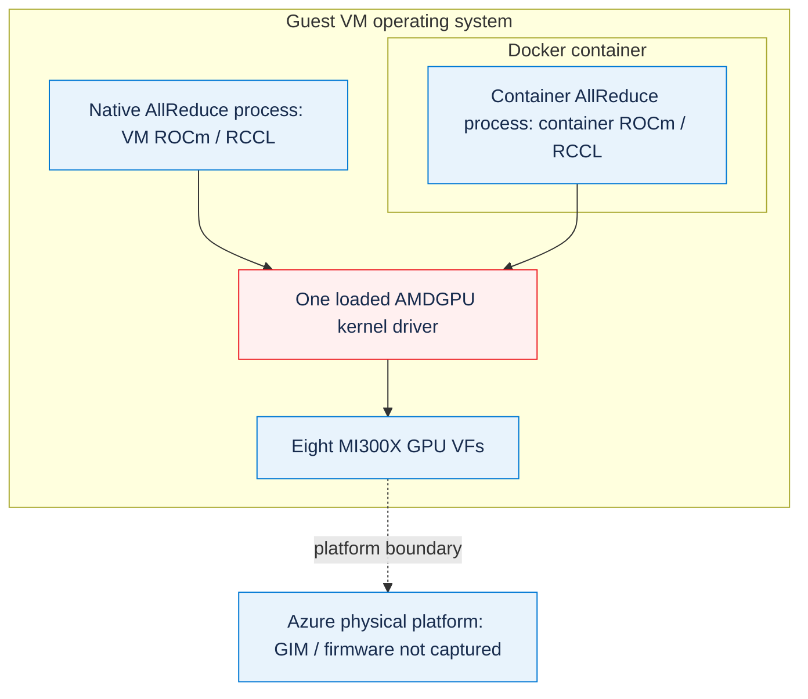

# Azure MI300X：宿主机驱动升级后的 AllReduce 性能回归

在一台 Azure ND MI300X v5 VM 上，**原生升级 VM 操作系统的 AMDGPU 内核驱动以及 ROCm/RCCL** 后，8 卡 AllReduce 带宽从约 315 GB/s 降到约 42 GB/s，数据校验仍全部通过。仅在旧驱动上升级容器用户态，并没有复现这个问题。

本目录用于复现和定位问题，**不是生产升级建议，也不是厂商已确认的代码根因**。“宿主机”指运行容器的 VM 操作系统，不是 Azure 底层物理宿主机或其 GIM 驱动。

作者：Xinyu Wei · [English](README.md) · [统一数据](data/native-summary.json) · [脱敏原始证据](evidence/) · [无需 GPU 的验证](#无需-gpu-的验证)

## 目的

**请 AMD 工程团队协助核查：**Azure MI300X VF VM 激活 AMDGPU 30.30.4 后，8 卡 AllReduce 吞吐明显下降，希望确认受支持的解决路径。这里已复现受控的 VM 原生升级低带宽，**还没有证明客户仅升级容器时的问题与它是同一根因**。

具体希望 AMD 确认：

1. 客户平台是否支持 guest 驱动 `1:6.16.13.30300400-2341068.24.04`，平台方应核对哪些 GIM/BKC/固件版本。
2. 新出现的 `psp_xgmi_get_topology_info` 数组越界、PSP 状态 `0xFFFF000F`，是否对应已知回归或驱动与平台不匹配。
3. 保持 ROCm 7.2.4/RCCL 2.27.7 时，应测试哪个驱动版本或具体补丁；只回退驱动和 A/B/A 恢复尚未验证。
4. 还需要哪些 guest/平台日志，才能区分本案例的原生升级回归与客户“VM 驱动不变、容器高版本”的部署问题。

本目录交付：锁定版本的复现脚本、实际加载的驱动与库证据、升级前后原始输出、正确性校验和结论边界。不交付：未经验证的代码修复、已证明的回退恢复、物理宿主机 GIM/固件控制，或对全部 ROCm 性能的保证。

### 原生升级结果速览

**1 GiB 消息、AllReduce out-of-place `busbw`、三轮独立运行的中位数；带宽单位是十进制 GB/s。**

<!-- BEGIN GENERATED: native-results -->
| 进程布局 | 升级前 GB/s | 升级后 GB/s | 性能下降 |
|---|---:|---:|---:|
| 单进程、8 GPU | 314.60 | 41.78 | 86.72% |
| 8 进程、每进程 1 GPU | 314.81 | 41.74 | 86.74% |
<!-- END GENERATED: native-results -->

| 项目 | 升级前 | 升级后 |
|---|---|---|
| 执行位置 | VM 操作系统原生 | VM 操作系统原生，真实重启 |
| 实际加载的 AMDGPU 模块 | `6.12.12` | `6.16.13` |
| AMD 驱动包 | `1:6.12.12.60404-2202139.24.04` | `1:6.16.13.30300400-2341068.24.04`，AMDGPU 30.30.4 |
| ROCm | `6.4.4` | `7.2.4` |
| RCCL | `2.22.3` | `2.27.7` |
| Linux 内核 | `6.8.0-1067-azure` | 不变 |
| MPI | HPC-X Open MPI `4.1.7rc1` | 不变 |
| GPU 分区 | 8 张 MI300X VF，`SPX / NPS1` | 不变 |
| 数据校验 | 全部 `#wrong = 0` | 全部 `#wrong = 0` |

两边使用[同一份官方 rccl-tests 源码](https://github.com/ROCm/rocm-systems/tree/1284e5da11f7904e8a6efd902b9de52253785bd0/projects/rccl-tests)，提交为 `1284e5da11f7904e8a6efd902b9de52253785bd0`；针对各自原生 HIP/RCCL 重新编译，配置为 `MPI=1`、`GPU_TARGETS=gfx942`。测试覆盖 **1 MiB～1 GiB**、消息大小每次翻倍，FP32 `sum`，20 次预热、100 次迭代，不使用 graph capture，同时保存 out-of-place 与 in-place 结果。

主实验包含 **12 轮原生运行、264 条分阶段测量、44 行前后对照**。[comparison.csv](data/comparison.csv) 保存每个消息大小的对比。不要把混合消息大小的 `Avg bus bandwidth` 与大消息平台值直接比较，也不要把归一化的 AllReduce `busbw` 当作原始 XGMI 链路吞吐。

### 四种配置：VM、容器和实际使用的驱动

下表把**VM 内安装的用户态、容器内安装的用户态**分别列出，不能只写测试时用的版本。四行均为单进程 8 卡、1 GiB 消息、AllReduce out-of-place `busbw`。

<!-- BEGIN GENERATED: execution-configurations -->
| 配置 | VM 内安装的用户态 | 容器内安装的用户态 | 测试位置 | 实际使用的 AMDGPU 内核驱动 | busbw GB/s | 统计口径 |
|---|---|---|---|---|---:|---|
| 1 | ROCm `6.4.4` / RCCL `2.22.3` | **没有容器** | VM 操作系统原生 | `6.12.12`（VM） | 314.60 | 三轮中位数 |
| 2 | ROCm `6.4.4` / RCCL `2.22.3` | ROCm `7.2.4` / RCCL `2.27.7` | 容器内 | `6.12.12`（共享 VM 驱动） | 321.67 | 三轮中位数 |
| 3 | ROCm `7.2.4` / RCCL `2.27.7` | **没有容器** | VM 操作系统原生 | `6.16.13`（VM） | 41.78 | 三轮中位数 |
| 4 | ROCm `7.2.4` / RCCL `2.27.7` | ROCm `6.4.4` / RCCL `2.22.3` | 容器内 | `6.16.13`（共享 VM 驱动） | 37.44 | 单轮额外诊断 |
<!-- END GENERATED: execution-configurations -->

**AMDGPU 模块版本 `6.12.12` 与 ROCm 发布版本 `7.2.4` 是不同组件的版本，不能直接作大小比较。**ROCm/HIP/HSA/RCCL 是用户态库；AMDGPU 内核模块由 VM 操作系统加载。在这些 Docker 测试中，容器共享 VM 已加载的模块，不提供一套独立的内核驱动。

配置 **2** 的实际运行组合是：

```text
VM 内安装的用户态：     ROCm 6.4.4 / RCCL 2.22.3
容器实际执行的用户态：  ROCm 7.2.4 / RCCL 2.27.7
它使用的内核驱动：      VM 已加载的 AMDGPU 模块 6.12.12
```

这不是容器的 ROCm 回退或降级成了“ROCm 6.12.12”。[真实初始化输出](evidence/fixed-images-old-driver/rocm-7.2.4-run-1.txt)明确记录 `rccl-library=22707`、RCCL `2.27.7`、ROCm `7.2.4.0-93` 和 `/opt/rocm-7.2.4/lib/librccl.so.1`。在容器里看到驱动 `6.12.12` 是预期行为。

对照 AMD 官方[用户态与内核驱动兼容矩阵](https://rocm.docs.amd.com/projects/install-on-linux/en/docs-7.2.4/reference/user-kernel-space-compat-matrix.html)：模块 `6.12.12` 来自 AMD 的 `amdgpu/6.4.4` 软件源（[驱动包目录](https://repo.radeon.com/amdgpu/6.4.4/ubuntu/pool/main/a/amdgpu-dkms/)，对应矩阵 `6.4.x` 行），`6.16.13` 就是 AMDGPU 30.30.4（[驱动包目录](https://repo.radeon.com/amdgpu/30.30.4/ubuntu/pool/main/a/amdgpu-dkms/)，对应 `30.30.x` 行）。这两行都支持 ROCm 6.4.x 和 7.2.x 用户态，所以**四种实测组合都在官方支持范围内，变慢的配置 3、4 也不例外**。兼容矩阵只规定哪些组合受支持，解释不了、也预测不了这次的 AllReduce 结果；GPU、虚拟化和固件方面的要求仍然要满足。如果打算在较旧的 VM 驱动上跑较新的容器镜像，先查这个驱动所在的行：例如 `6.2.x` 行只支持到 7.0.x 用户态，在这类驱动上跑 ROCm 7.2 容器就不在官方支持范围内。

**客户配置尚未确认。**如果客户确实使用配置 2，本案例在该配置下没有复现其低带宽，不能直接把配置 3 的原生升级回归当作客户根因。应先取得客户 VM 实际加载的驱动、容器实际库路径与构建版本、分区/拓扑、原始测试命令和通信初始化日志。“VM 用默认镜像”“容器标签是高版本”都不足以证明环境与本案例相同。

### 软件层次与共享边界

下图仅解释实测的软件层次，不是产品截图。原生进程和容器进程表示**分别执行的实验**，不是同时争用 GPU。



两条应用路径都使用 **VM 已经加载的同一个内核模块**。容器不会升级这个模块；容器内 ROCm/HIP/RCCL 用户态则可以与 VM 内安装的用户态是不同版本。

这条规则适用于容器里的所有 ROCm 用户态库，不只是 RCCL。推理镜像里 AITER、Composable Kernel 等库自带的 GPU 计算 kernel 从容器镜像加载，也通过 VM 的这个内核驱动提交到 GPU；这里的“kernel”是在 GPU 上执行的设备代码，不是 AMDGPU 内核态驱动。换容器，换掉的是实际执行的用户态代码（包括这些计算 kernel），内核驱动不会变；换 VM 驱动，则这台 VM 上的所有容器都会受影响，所以驱动升级必须单独验证。本案例只测了 RCCL AllReduce，没有测计算 kernel 的性能。

### 驱动隔离诊断，不替代原生主实验

三个实验的边界不同：

1. **旧驱动上只换容器用户态**：ROCm 6.4.4/RCCL 2.22.3 和 ROCm 7.2.4/RCCL 2.27.7 都正常；这没有验证新内核驱动。
2. **宿主机原生升级并重启**：两种进程布局都复现了主表中的低带宽。
3. **保持相同不可变用户态镜像，仅在新宿主机驱动上运行**：连旧用户态也变慢。下表的旧驱动数值是三轮中位数，新驱动数值各来自**一轮额外诊断**，不是原生主表结果。

<!-- BEGIN GENERATED: driver-isolation -->
| 保持不变的用户态镜像 | 驱动 6.12.12，GB/s | 驱动 6.16.13，GB/s |
|---|---:|---:|
| ROCm 6.4.4 / RCCL 2.22.3 | 314.76 | 37.44 |
| ROCm 7.2.4 / RCCL 2.27.7 | 321.67 | 41.70 |
<!-- END GENERATED: driver-isolation -->

保留了[不可变镜像 ID 和诊断测量](data/native-summary.json)及[原始输出](evidence/fixed-images-new-driver/)。这些结果支持优先排查**宿主机驱动变化及其固件、虚拟化和互连交互**，不能据此说 RCCL 2.27.7 单独必然慢。

### 如果看到其他 RCCL 版本，例如 2.27.3

本案例中，带宽跟着 VM 实际加载的 AMDGPU 驱动走，不跟着 RCCL 版本走：驱动 `6.12.12` 上，RCCL 2.22.3 和 2.27.7 都快；驱动 `6.16.13` 上，两者都慢。

没有任何官方 ROCm 发布版附带 RCCL 2.27.3。官方 ROCm APT 软件源中，ROCm 6.4～6.4.4 配 RCCL 2.22.3，7.0～7.0.3 配 2.26.6，7.1～7.2.4 配 2.27.7（[7.2.4 软件包目录](https://repo.radeon.com/rocm/apt/7.2.4/pool/main/r/rccl/)）；[RCCL 更新日志](https://github.com/ROCm/rocm-systems/blob/c1faf5053567d0fb97ba5825f51bfd6874ac9527/projects/rccl/CHANGELOG.md)里也没有 2.27.3。不过 2.27.3 是 NVIDIA NCCL 的版本号，例如 [`nvidia-nccl-cu12` 2.27.3](https://pypi.org/project/nvidia-nccl-cu12/2.27.3/)，它不能在 MI300X 上运行。所以看到 2.27.3，要么是自行编译的 RCCL，要么是 NVIDIA NCCL，而不是某个 ROCm 发布版。

日志里出现 2.27.3（版本码 `22703`）时，先按[低带宽采集第 2 步](#再次出现低带宽时先采集再改版本)，用 `ldd`、解析后的 `librccl.so.1` 路径和 `ncclGetVersion` 确认实际加载的是哪个库，同时记录 VM 实际加载的驱动。本案例没有测过 2.27.3。两个 RCCL 版本在同一驱动上表现一致，所以在驱动 `6.16.13` 上遇到其他 RCCL 版本时，同样先排查驱动；但它的带宽必须实测，不能直接套用本案例的数字。

### 新内核异常是线索，还不是已证明的代码根因

新驱动启动时出现：

```text
psp gfx command INVOKE_CMD(0x3) failed and response status is (0xFFFF000F)
index 8 is out of range for type 'xgmi_connected_port_num [8]'
psp_xgmi_get_topology_info
amdgpu_xgmi_add_device
```

<!-- BEGIN GENERATED: kernel-symptoms -->
| 在完整私有启动日志中检索的模式 | 旧驱动启动 | 新驱动启动 |
|---|---:|---:|
| `xgmi_connected_port_num` | 0 | 4 |
| `psp_xgmi_get_topology_info` | 0 | 4 |
| `INVOKE_CMD(0x3) failed` | 0 | 8 |
<!-- END GENERATED: kernel-symptoms -->

参见[旧启动脱敏摘录](evidence/before/kernel-xgmi-excerpt.txt)、[新启动摘录](evidence/after/kernel-xgmi-excerpt.txt)和[检索计数](data/kernel-symptom-counts.json)。计数来自完整原始日志，公开摘录省略了无关行。

**新旧驱动的拓扑输出仍把链路标成 `XGMI`。**链路标签、能枚举出 GPU 或 `#wrong = 0` 都不能证明传输性能正常。异常与低带宽同时出现，但尚未证明某一处数组访问造成了性能下降。没有采集物理宿主机的 GIM/固件详情，**也尚未测试“只回退驱动后带宽恢复”**。

## 步骤

### 不启动 GPU VM，先查看和验证记录

先看四种配置和对应原始日志。公开数据只需 Python 3.10+ 标准库即可校验，具体命令和成功标准见后面的离线验证小节；读取和验证资料不需要 GPU、Azure 登录或秘密凭据。

实际复现需要独立 Linux GPU VM，具备 `git`、`make`、`curl`、`python3`、`timeout`、`flock`、HIP 开发文件；原生实验还需要 MPI，配置 2 需要 Docker。保留自己的 SSH/恢复入口。脚本锁定本案例的 Ubuntu 24.04 软件栈，不是通用生产安装器。

### 配置 2：VM 驱动不变，容器内使用高版本

在**升级原生驱动之前**执行，要求 VM 实际加载 AMDGPU `6.12.12`，原生 ROCm 为 `6.4.4-129`、RCCL 为 `2.22.3.60404-129~24.04`：

```bash
export CONTAINER_WORKDIR="$PWD/local-runs/container-control"
sudo -E bash scripts/run_container.sh "$CONTAINER_WORKDIR"
```

[锁定的 Dockerfile](docker/Dockerfile.rccl-tests) 使用官方 ROCm 7.2.4 开发镜像 digest `sha256:92f309c51b52cef8762867848f1529dee821624f23cd5df38455e819538f762f` 和相同官方测试源码提交，编译 `MPI=0`、`gfx942`，单进程使用 8 GPU。只挂载结果目录，**不把 VM 的 ROCm 目录覆盖到容器 SDK 上**。

成功标准：三轮正确性校验通过，输出 `CONFIGURATION_2_CONTAINER_TEST_PASS_VM_DRIVER_UNCHANGED`。`configuration-2/runtime-layers.json` 必须记录**容器 ROCm 7.2.4、实际容器 RCCL 版本码 22707、容器库路径、共享 VM 内核驱动 6.12.12**。版本或路径检查失败时，保留输出并核查目录挂载与动态库加载设置，不能只凭标签说环境匹配。带宽如实记录，不把之前测到的数值硬编码成新实验必须达到的门槛。

这次新整理的 wrapper 沿用原实验的镜像、源码和启动配置，已安排离线语法/保护开关检查；整理后**没有重新在 GPU 上执行该 wrapper**。之前真实配置 2 的测量仍是运行证据。本次文档更新不会为了校验资料重开 VM。

### 按执行顺序原生升级复现

#### 0. 使用独立、可恢复的测试 VM

实测环境是 Ubuntu 24.04、Azure `Standard_ND96isr_MI300X_v5`。初始状态应为原生 ROCm 6.4.4/RCCL 2.22.3、已加载驱动 6.12.12。先停止自己的 GPU 工作负载，不要修改其他用户正在运行的任务。

该升级组合已复现低性能。只在可丢弃测试 VM 和维护窗口操作，准备经过验证的管理恢复入口、系统盘快照和精确旧包备份。**不要为了重启而 deallocate 稀缺 Spot GPU VM**，之后可能无法重新分配；快照和运行中的 VM 均会产生费用。

在已经登录的**隔离 Azure CLI 环境**创建快照：

```powershell
$env:AZURE_CONFIG_DIR = "C:\Temp\az-mi300x-case"
$subscription = "<YOUR_SUBSCRIPTION_ID>"
$resourceGroup = "<YOUR_RESOURCE_GROUP>"
$vm = "<YOUR_VM_NAME>"
$disk = az vm show --subscription $subscription --resource-group $resourceGroup --name $vm --query storageProfile.osDisk.managedDisk.id -o tsv
az snapshot create --subscription $subscription --resource-group $resourceGroup --name mi300x-pre-driver-upgrade --source $disk --incremental true --sku Standard_LRS
az snapshot show --subscription $subscription --resource-group $resourceGroup --name mi300x-pre-driver-upgrade --query provisioningState -o tsv
```

成功标准：快照状态为 `Succeeded`。失败时**不要安装新驱动**。快照引用仅保存在私有位置，不要提交。

#### 1. 采集并运行宿主机原生基线

在 Linux VM 的本目录执行，不是在容器内：

```bash
export WORKDIR="$PWD/local-runs/native-ab"
# 两阶段使用同一个现有 MPI 安装。
export MPI_HOME="/opt/hpcx-v2.23-gcc-doca_ofed-ubuntu24.04-cuda12-x86_64/hpcx-rebuild"
sudo -E bash scripts/run_native.sh before "$WORKDIR"
```

成功标准：六轮输出 `NATIVE_PHASE_BENCHMARK_PASS`，校验全部通过，`before/host-metadata.json` 记录实际加载的驱动 6.12.12。按机器上的 MPI 路径设置 `MPI_HOME`，两阶段不要更换。源码、库来源、原生执行或数据校验检查失败时，查看 `WORKDIR/before` 并停止升级。

#### 2. 显式执行原生升级，然后重启

```bash
export SNAPSHOT_REFERENCE="<YOUR_VERIFIED_PRIVATE_OS_SNAPSHOT_REFERENCE>"
sudo -E bash scripts/upgrade_host.sh --apply "$WORKDIR"
```

脚本先备份旧包版本与 APT/DKMS/启动状态，下载官方安装器，使用签名仓库并锁定实测包版本；事务模拟会拒绝删除无关软件或改动内核、SSH、Azure Agent、RDMA 组件。安装位置是 **VM 操作系统**：

```text
amdgpu-dkms=1:6.16.13.30300400-2341068.24.04
rocm=7.2.4.70204-93~24.04
rccl=2.27.7.70204-93~24.04
rccl-dev=2.27.7.70204-93~24.04
```

重启前成功标准：`INSTALLATION_COMPLETE_REBOOT_REQUIRED`。磁盘上的新模块**不等于内核实际加载的新模块**。下载、事务模拟、包安装或 DKMS 编译失败时，保留日志，不要启动未经验证的驱动。

原地重启 VM：

```bash
sudo reboot
```

使用原有 SSH 端口和凭据重新连接，检查：

```bash
cat /sys/module/amdgpu/version
cat /sys/module/amdgpu/srcversion
cat /proc/sys/kernel/random/boot_id
dkms status
/opt/rocm/bin/rocm-smi --showproductname
/opt/rocm/bin/rocm-smi --showcomputepartition --showmemorypartition
```

成功标准：实际加载 6.16.13、新 boot ID、与安装模块一致的 `srcversion`，8 张卡仍为 `SPX / NPS1`。本案例 GPU 初始化需要几分钟。SSH 或 GPU 初始化失败时，使用预先验证的管理恢复通道和快照/旧包；本目录刻意**不把未经实测的自动回退脚本当成已验证修复**。

#### 3. 对新宿主机栈重新编译并测试

```bash
sudo -E bash scripts/run_native.sh after "$WORKDIR"
```

成功标准：确认实际原生 RCCL 2.27.7、内核加载驱动 6.16.13及真实重启；内核和 MPI 与基线一致，六轮正确性校验通过。低带宽本身是有效实验结果，**不能为了让结果好看而丢弃正确运行**。分区或拓扑变化时，先记录变化，再判断原因。

`local-runs/` 下的原始 JSON 和文本日志已被 Git 忽略，可能含环境标识。分享前应生成脱敏副本；不要提交快照、凭据、备份或私有运行目录。

### 再次出现低带宽时，先采集再改版本

1. 在 **VM 操作系统**记录 `/sys/module/amdgpu/version`、`/sys/module/amdgpu/srcversion`、内核、`dpkg-query -W amdgpu-dkms`、GPU 分区和拓扑。`modinfo` 描述磁盘上的安装模块，单靠它不能证明实际加载版本。
2. 在**真正运行测试的位置**（VM 或容器）记录测试程序 `ldd`、解析后的 `librccl.so.1` 路径及 `ncclGetVersion`、HIP/ROCm 构建版本、挂载关系和 `NCCL_*`/`RCCL_*` 设置。使用初始化记录，不只看镜像标签。
3. 跑相同的 1 GiB FP32-sum 测试，保存 `algbw`、`busbw`、耗时和 `#wrong`；单进程 8 卡与 8 进程各 1 卡分别统计。
4. 采集 `journalctl -k -b --no-pager`、分区/拓扑，以及设置 `NCCL_DEBUG=INFO`、`NCCL_DEBUG_SUBSYS=INIT,GRAPH,P2P,SHM` 的**单独诊断测次**。调试日志可能与计时输出交错，不能拿它替换基线测量。
5. 生成脱敏副本，向 AMD 提供配置、精确包版本、源码提交、命令和错误现象。先保存当前证据，再应用 AMD 确认的驱动/平台修复。这些诊断步骤不包含自动降级、重启或云资源关机。

## 结果

### 证据索引与结论边界

| 要确认的问题 | 第一性记录 | 能证明什么 |
|---|---|---|
| 是否真正加载了新的原生驱动？ | [升级前元数据](evidence/before/host-metadata.json)、[旧 boot 记录](evidence/before/driver-boot-evidence.json)、[重启前新模块](evidence/installed-module-before-reboot.json)、[升级后元数据](evidence/after/host-metadata.json) | 实际加载模块和 boot ID 改变，原生 RCCL 路径/版本已核对 |
| 是否在正确输出下发生原生带宽回归？ | [升级前单次输出](evidence/before/single-run-1.txt)、[升级后输出](evidence/after/single-run-1.txt)、[全部原生记录](evidence/) | 多次正确但低吞吐的 AllReduce，不是计算失败 |
| 配置 2 是否确实在旧驱动上用了新用户态？ | [容器初始化和性能记录](evidence/fixed-images-old-driver/rocm-7.2.4-run-1.txt) | 实际 RCCL `22707`、ROCm 7.2.4 路径，正确且高吞吐的运行 |
| 新驱动上旧用户态也会变慢吗？ | [旧驱动上的固定镜像记录](evidence/fixed-images-old-driver/)、[新驱动上的相同镜像](evidence/fixed-images-new-driver/)、[镜像 ID](data/native-summary.json) | 两套固定用户态都与宿主机变化相关；不能证明具体内核代码根因 |
| 新出现了哪些内核症状？ | [旧摘录](evidence/before/kernel-xgmi-excerpt.txt)、[新摘录](evidence/after/kernel-xgmi-excerpt.txt)、[计数](data/kernel-symptom-counts.json) | 新出现的 XGMI/PSP 相关错误，拓扑仍显示 XGMI |

**预期对照：**把不变的工作负载与本节点记录的旧栈基线比较，不声明普遍必须达到 360 GB/s 或 Azure VF 带宽保证。**实际结果：**原生升级出现生成式主表中的下降，而本案例配置 2 仍正常。

**待查项：**具体代码/固件原因、首个坏驱动、物理平台 GIM/BKC 版本、只回退驱动后的恢复，以及客户真实容器部署是否同根因。相关内核错误不是已确认的修复目标。

### 下一步控制变量实验

以下是**尚未测出的结论**：

1. 保持 ROCm 7.2.4/RCCL 2.27.7，只回退内核驱动栈，重启并验证带宽能否恢复；同时记录依赖和固件包变化。
2. 在有回退保护的新测试 VM 上，对比中间的受支持驱动版本；固定用户态、内核、分区、源码和 MPI，找出首个坏版本。
3. 设置 `NCCL_DEBUG=INFO`、`NCCL_DEBUG_SUBSYS=INIT,GRAPH,P2P,SHM`，比较实际通道与选用算法；不能仅凭某个环境变量值推断物理通信路径发生了变化。
4. 请 AMD/Azure 工程团队将 XGMI/PSP 症状与 VF/GIM/BKC 兼容性对应；不要从客户 VM 中修改或声称控制 Azure 的物理宿主机/GIM。
5. 驱动与 VF 的交互问题清楚后，再隔离内核代码修复，并在相同硬件上证明 **A/B/A** 恢复。

### 无需 GPU 的验证

只需 Python 3.10+ 标准库：

```bash
python3 tools/verify_case.py --check
python3 -m unittest discover -s tests -v
for script in scripts/*.sh; do bash -n "$script"; done
```

成功标准：原始测量、实际加载驱动与重启证据、固定镜像诊断，以及中英文 README 的数字全部一致。仅重新生成派生表格和 CSV：

```bash
python3 tools/verify_case.py --write
python3 tools/verify_case.py --check
```

不要修改原始证据来使检查通过。

限定本目录的 [GitHub Actions 工作流](../../.github/workflows/mi300x-host-driver-regression-ci.yml) 在 Linux/Windows、Python 3.10/3.12 上跑离线检查和单测，检查 shell 语法、显式入口保护及重复生成无差异。CI **不分配 GPU VM、不安装宿主机驱动、不认证硬件性能**。已提交的证据哈希与派生表格分开校验。

### 证据和公开边界

公开的 JSON/文本是**真实 rccl-tests 输出和内核日志的脱敏副本**，不是模拟结果。掩码覆盖主机/IP/账号/云资源标识、boot UUID、hive/MAC 标识及内存地址；公开文本副本去除行末空白。测量数值、软件版本、测试参数和错误码不变，私有原件单独保留。

本目录不发布密码、SSH 密钥、租户/订阅 ID、快照引用、模型权重、安装包归档或私有主机信息。原实验保留了升级后的低带宽现场，没有宣称未做过的降级恢复。

### 官方参考

- [ROCm 7.2.4 原生 Ubuntu 安装](https://rocm.docs.amd.com/projects/install-on-linux/en/docs-7.2.4/install/install-methods/package-manager/package-manager-ubuntu.html)
- [AMDGPU 30.30.4 原生 Ubuntu 安装](https://instinct.docs.amd.com/projects/amdgpu-docs/en/docs-30.30.4/install/detailed-install/package-manager/package-manager-ubuntu.html)
- [用户态和内核驱动兼容矩阵](https://rocm.docs.amd.com/projects/install-on-linux/en/docs-7.2.4/reference/user-kernel-space-compat-matrix.html)
- [RCCL 2.27.7 环境变量](https://rocm.docs.amd.com/projects/rccl/en/docs-7.2.4/api-reference/env-variables.html)
- [锁定的官方 rccl-tests 源码](https://github.com/ROCm/rocm-systems/tree/1284e5da11f7904e8a6efd902b9de52253785bd0/projects/rccl-tests)
